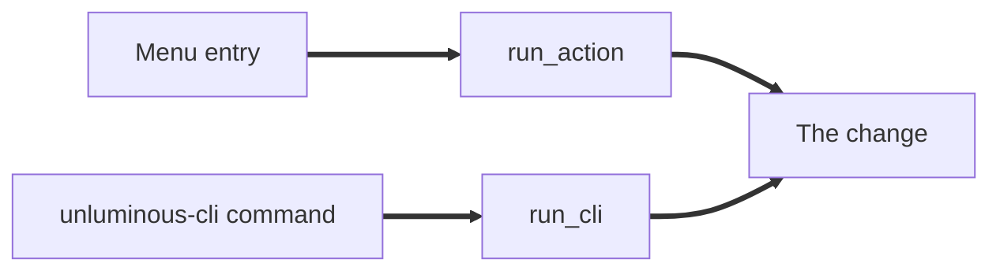

<!--
Thank you for opening a pull request. Read CONTRIBUTING.md before you fill this in:
https://github.com/Black-Rainbow-Labs/Unluminous/blob/main/CONTRIBUTING.md

Every section below is required. The "PR description" check reads this description and fails until each
section has words of your own in it, and it names what is missing in a comment on this pull request.
The text inside these comment markers is guidance and is ignored by the check, so you can leave it or
delete it. Do not delete the headings.

Write plain sentences. Say what the change does and why, once.
-->

## Overview

<!--
The problem or the feature, in a few sentences, and why it matters. Who notices it and how?
Link the issue this closes, for example "Closes #123", if there is one.
-->

## Details

<!--
How the change works. Name the files and the functions a reviewer should read first.
Say what you weighed and rejected when the choice is not obvious.
When the change moves data between parts of the program, or adds a state machine, draw it:

-->

## Agent parity

<!--
Unluminous is an AI-first IDE: everything a person can do in the window, an agent can do too, through the
same command. Say how an agent reaches what this change adds: the menu entry (which is reachable through
`unluminous-cli action run` with no extra work), or the row in `unluminous-cli/src/catalogue.rs`, the arm
in `app/cli.rs`, and the section in `unluminous-cli/docs/commands.md`.
If the change adds nothing a person can do, write "No new control." and say why.
-->

## Test coverage

<!--
The tests this change adds or changes, by name, and what each one would catch if the change were broken.
A change to Rust code adds a test. If it genuinely cannot have one, start a line with
"No new test:" and say why.

Our standard:
- Behaviour is tested where it lives: unit tests in the crate with no window for unluminous-core,
  unluminous-terminal, unluminous-git, unluminous-dap, unluminous-db and unluminous-chat.
- A change to what the window draws has a screenshot test in crates/unluminous-app/tests, and its
  accepted picture is in this pull request.
- A new command is reached from a test through the same path a person uses.
- Say which of the four test layers you ran (see CONTRIBUTING.md) and on which machine.
-->

## Evidence

<!--
Proof the change does what the overview says. A reviewer should be able to see it working without
building your branch.
- A change anybody can see: a video (preferred) or screenshots, before and after. Drag the files into
  this box and GitHub uploads them.
- A change nobody can see: the command you ran and what it printed.
- A claim about speed or memory: the numbers, the machine, and the command that produced them.
-->

## Platforms

<!-- Tick every platform you built and ran this change on. At least one is required. -->

- [ ] Windows
- [ ] macOS
- [ ] Linux

## AI disclosure

<!--
Unluminous is built with coding agents and welcomes changes made with them. Say which agent and model you
used and for what, for example "Claude Code wrote the first draft of the parser; I rewrote the error
handling and wrote the tests". If you used none, write "None".
Whoever opens the pull request has read every line of it and answers for it.
-->

## Checklist

<!-- Tick each one. A box left empty fails the check. -->

- [ ] I have read CONTRIBUTING.md and the section of CLAUDE.md that covers the part I changed.
- [ ] `cargo fmt --all -- --check` and `cargo clippy --workspace --all-targets` pass.
- [ ] The tests named under "Test coverage" pass, and I opened every screenshot I accepted.
- [ ] Every control I added has a plain name through `widget_info`, and is absent rather than dimmed where it can never apply.
- [ ] Documentation that describes what I changed is updated: `CLAUDE.md`, `unluminous-cli/docs/commands.md`, `documentation/`.
- [ ] I submit this change under the same terms as the rest of Unluminous: MIT or Apache 2.0, at the user's option.
