<p align="center">
  
</p>

<h1 align="center">Unluminous</h1>

<p align="center">
  <b>The IDE built for agents.</b><br>
  A code editor where anything you can click, your agent can do too.<br>
  Written in Rust. Free and open source. Windows and macOS.
</p>

<p align="center">
  <a href="https://unluminous.com"><b>Download</b></a> &nbsp;·&nbsp;
  <a href="https://unluminous.com/docs">Docs</a> &nbsp;·&nbsp;
  <a href="#install">Install</a> &nbsp;·&nbsp;
  <a href="documentation/README.md">Documentation in this repository</a> &nbsp;·&nbsp;
  <a href="unluminous-cli/docs/commands.md">Command reference</a> &nbsp;·&nbsp;
  <a href="https://blackrainbowlabs.com">Black Rainbow Labs</a>
</p>

<p align="center">
  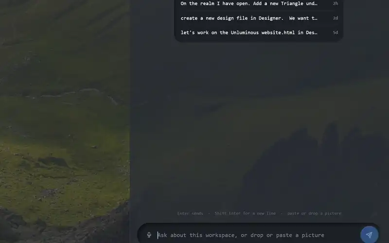
</p>

<p align="center"><i>Claude Code driving Unluminous from Agent Chat, then Agent Tasks, completion, the debugger and a realm.<br>Sped up where Claude is thinking.</i></p>

Hand Claude Code, Codex, OpenCode or Pi a task board, a chat pane and an infinite canvas, and watch
them work in the same window you do. Unluminous is written from scratch in Rust: its own text engine,
terminal, git client, debugger, database explorer and canvas. There is no Electron and no web view,
and every pixel is drawn on the graphics card.

## Everything you can do, your agent can do too

Every menu entry, button and shortcut in Unluminous is also a command. Claude Code, Codex, OpenCode
and Pi reach all 292 of them through the command line or through Unluminous's MCP server.

So when you ask an agent to open a file, split the pane, fold it and set a breakpoint, it does what
your clicks would have done, and you watch it happen. Most editors give an agent a file system and a
shell. Unluminous gives it the editor: open a tab, split the pane, fold a block, set a breakpoint, read
a variable, run the tests, commit.

This is enforced by tests rather than promised:

- **A menu entry needs nothing extra.** `unluminous-cli action list` is built by walking the real
  menus, so an entry added tomorrow can be run from the command line tomorrow.
- **Everything else is a row in one catalogue**, which the command line parses against and the window
  dispatches on. A command from an agent and a click from a person reach the same code.
- **The MCP tools are generated from that catalogue**, and a test fails if a command is ever not
  offered as a tool.
- **The command reference is a test too.** It fails while a command has no section, or a section
  describes a command that is gone.

## What's in the box

<table>
  <tr>
    <td width="50%"><a href="#agent-tasks"><b>Agent Tasks</b></a><br><sub>board, sprints, todos, Claude Code, Codex, Pi</sub><br>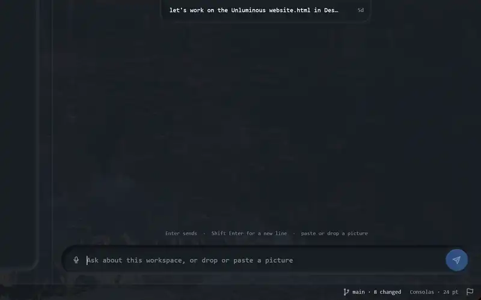</td>
    <td width="50%"><a href="#agent-chat"><b>Agent Chat</b></a><br><sub>charts, tables, diffs, the agent you already have</sub><br>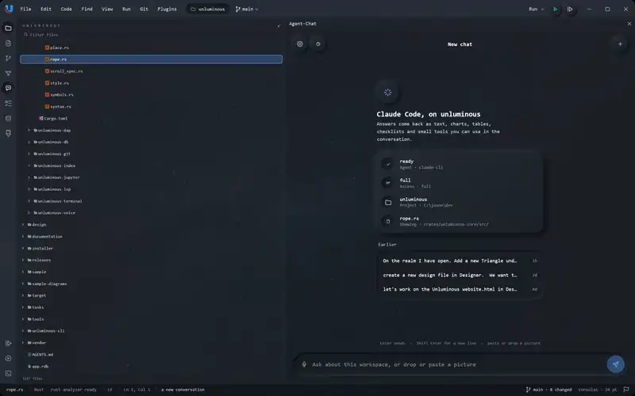</td>
  </tr>
  <tr>
    <td><a href="#realm"><b>Realm</b></a><br><sub>an infinite canvas of terminals, editors and agents, wired together</sub><br>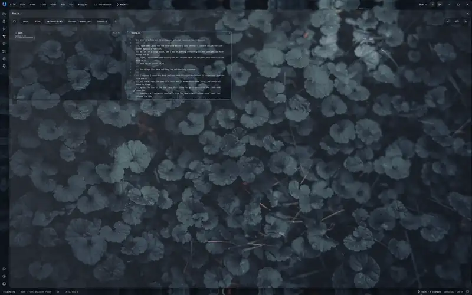</td>
    <td><a href="#designer"><b>Designer</b></a><br><sub>notes on an HTML design, sent to the agent</sub><br>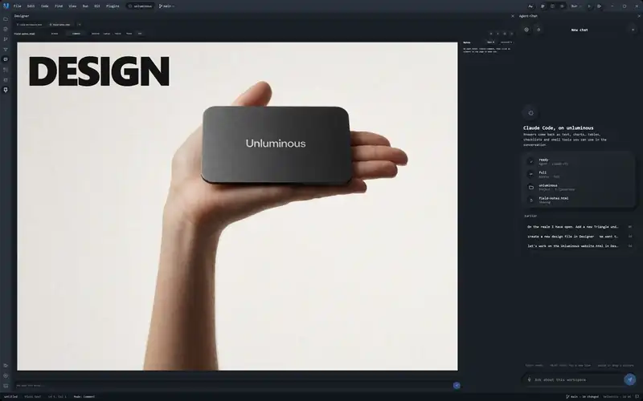</td>
  </tr>
  <tr>
    <td><a href="#a-real-debugger-built-in"><b>Debugger</b></a><br><sub>Debug Adapter Protocol, LLDB, js-debug, values beside the code</sub><br>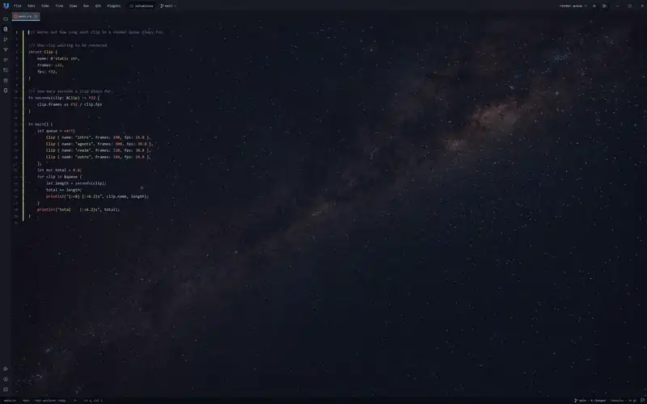</td>
    <td><a href="#postgresql-sqlite-and-inillucent-in-a-pane"><b>Database explorer</b></a><br><sub>PostgreSQL, SQLite, Inillucent</sub><br>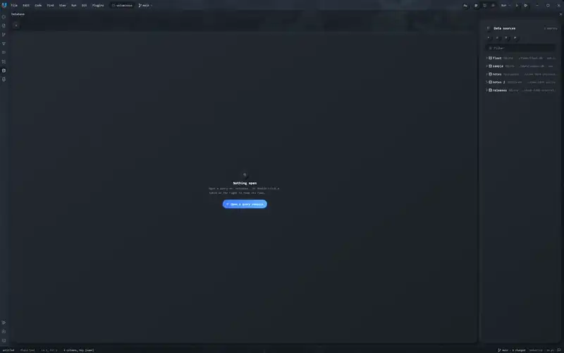</td>
  </tr>
  <tr>
    <td><a href="#notebooks-in-python-and-rust"><b>Jupyter notebooks</b></a><br><sub>Python, matplotlib, pandas, and Rust</sub><br>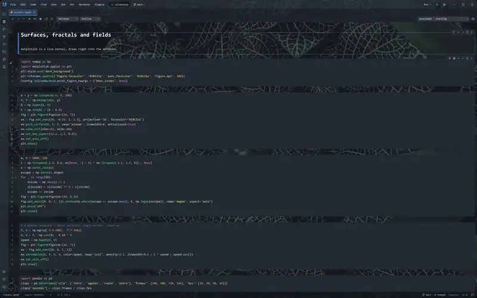</td>
    <td><a href="#say-it-to-agent-chat"><b>Speech to text</b></a><br><sub>dictation on your own machine, and a wake word</sub><br>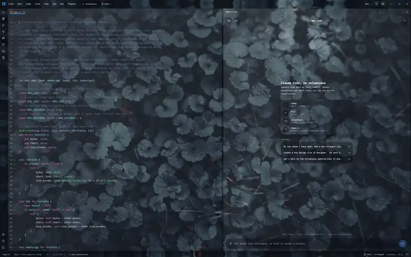</td>
  </tr>
</table>

---

## Agent Tasks

### A task board your agents work through


Write a ticket, add a few todos and press **Start Work**. Unluminous opens a terminal for that ticket,
starts Claude Code, Codex, OpenCode or Pi in it, and the card moves across the board as the agent
ticks off its todos. There are sprints, epics, a backlog and comments too, and it is all one file on
your machine.

- **One click to start.** Each ticket gets its own terminal and agent session, and Resume picks the
  same conversation back up later.
- **Todos tick as it works.** The agent checks off todos and comments on the ticket through the same
  commands your buttons use.
- **Read it as a chat or as a terminal.** A ticket's agent is shown as a conversation read from the
  agent's own transcript, and the terminal is one tab away.
- **Nothing to set up.** The board is one database file. No server, no account and no port.

## Agent Chat

### Chat with the agent you already have


Agent Chat runs the `claude`, `codex`, `opencode` or `pi` command you have already installed, in your
project folder, so it reads your `CLAUDE.md` or `AGENTS.md` the way it does in a terminal. Answers
stream in with charts, tables, checklists, diffs and small calculators you can use right in the
conversation.

- **Your key stays where it is.** Unluminous never holds an API key. It can also talk to llama.cpp,
  LM Studio, Ollama or any endpoint that speaks Anthropic's or OpenAI's format.
- **Answers you can use.** Charts, stats, tables, steps, forms and diffs are drawn as live components,
  with buttons that act on them.
- **Three levels of access.** Read, edit or full, set per conversation.
- **Pictures too.** Paste or drop a screenshot and ask about it.
- **Conversations survive a restart.** The agent's own session is resumed, so the context it built is
  the context it keeps.

## Realm

### Lay out your whole system on one canvas


A realm is an infinite canvas of real things: terminals, file editors, the task board, chats,
browsers, notes, pictures, sound, video and whiteboard shapes. Wire a terminal to an editor and the
agent running in that terminal can drive it. Every realm is a plain file in your repository, so you
can review it and share it like code.

- **A wire is a permission.** An agent can act on the nodes its terminal is wired to, and it is
  refused everywhere else.
- **Agents know where they are.** `unluminous-cli realm here` tells an agent which node it is in and
  what it can reach.
- **Saved with your code.** `.realm-files/` holds every realm, so a teammate opens the same layout.
- **Eleven kinds of node.** Terminal, file editor, folder, browser, chat, task board, note, image,
  audio, video and shape.

## Designer

### Leave notes on a design and hand them to Claude


Open an HTML design at desktop, laptop, tablet or phone width, click an element and write a note on
it. Send every open note to the agent in one message and the design reloads with the changes.
Unluminous keeps a copy before each request, so you can step back to any version.

- **Notes pinned to elements.** Each note sits on the element it is about, and the agent gets the
  selector with it.
- **Every width.** Desktop, laptop, tablet, phone, or fit to the pane.
- **History.** A copy is taken before each request, and any copy can be put back.

---

## A fast editor, written from scratch

No Electron and no web view. Unluminous draws every pixel itself on the graphics card.

### Completions that know your code

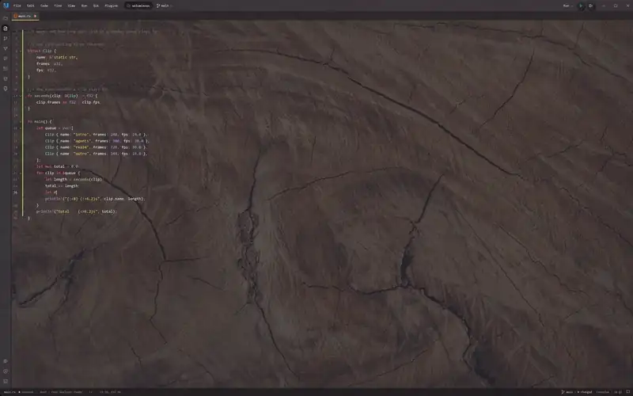

Completion ranks what rust-analyzer and TypeScript's own server offer with a model trained on real
edits. On code it had never seen, the first suggestion was the right one 75.8% of the time in Rust
and 81.7% in TypeScript, against 66.6% and 58.1% for the editor it was compared with. With the
language servers switched off, completion and go to definition still work from Unluminous's own index
of the project.

### A real debugger, built in


Click the gutter, start the run, and the program stops with its call stack, its locals, and the
values painted at the end of every line that uses them. Unluminous speaks the Debug Adapter Protocol
itself, with LLDB for Rust and native code and js-debug for JavaScript and TypeScript. Breakpoints
take conditions and log messages, and they move with the text as you type.

### Run anything with one button

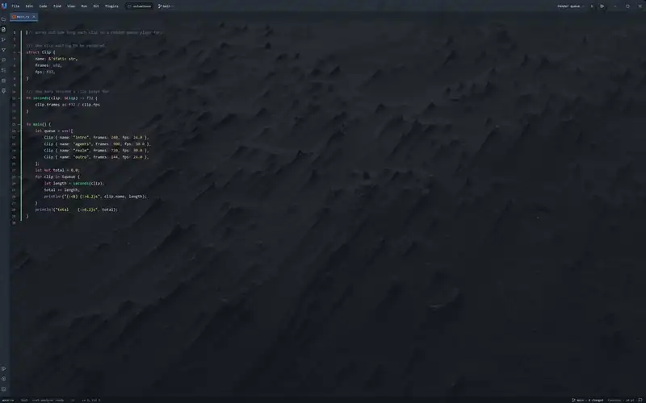

A run configuration is a command, a folder and a few environment variables. `Shift+F10` starts it,
the output streams into the run tile, and `Ctrl+F2` stops it. Debugging uses the same configuration,
so `cargo run` is built and then debugged.

### Git without leaving the window

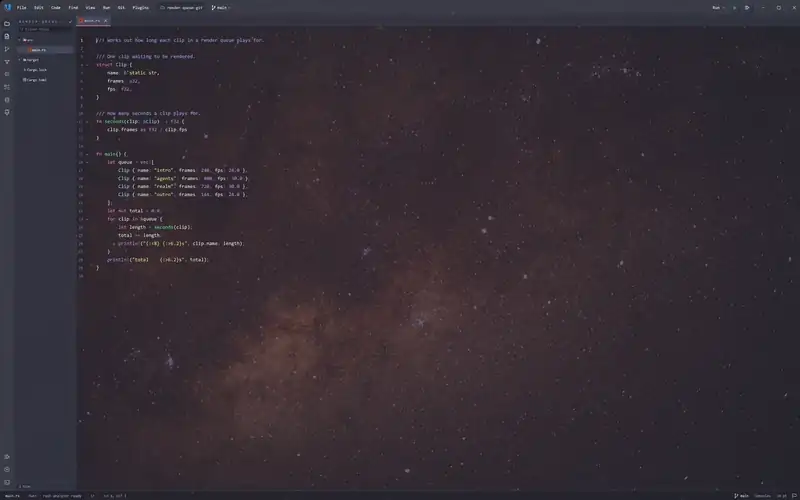

Commit, push, pull, diff, blame, history, branches, stashes, merges and rebases, all on top of the git
you already have installed. A push from Unluminous is the same push you get in your terminal, with the
same credential helper, ssh agent, hooks and signing, and when something goes wrong you see git's own
message. `Ctrl+K` commits and `Ctrl+Shift+K` pushes.

### PostgreSQL, SQLite and Inillucent, in a pane


Browse schemas and tables, run queries in a console and edit rows in a grid. You see the SQL every
change becomes before you submit it, and it is written in one transaction. Passwords stay in your
credential store, and vector columns are drawn as vectors.

### Notebooks in Python and Rust


Open any `.ipynb` and run it in a real Jupyter kernel started from your project's own Python.
matplotlib figures, pandas tables and tracebacks are drawn right under the cell. Switch the kernel to
Rust and the same notebook compiles and runs Rust a cell at a time, through evcxr. Notebooks save as
ordinary `.ipynb` files, outputs included, so Jupyter, VS Code and PyCharm open them too.

### Say it to Agent Chat


Press the microphone inside the Agent Chat prompt, or `Alt+V`, and say what you want. The words fill
the prompt while you talk. Moonshine, a 66 MB model that ships with the installer, turns the speech
into text on your own machine, so nothing you say leaves it, and 4.3 seconds of speech takes about
170 ms. If you would rather use a service, point it at any OpenAI compatible
`/v1/audio/transcriptions` address. Turn on **Listen for "Sable"** and say "Sable" before a request:
the pane opens and the message is sent when you stop talking.

### Markdown and Mermaid, drawn as you type

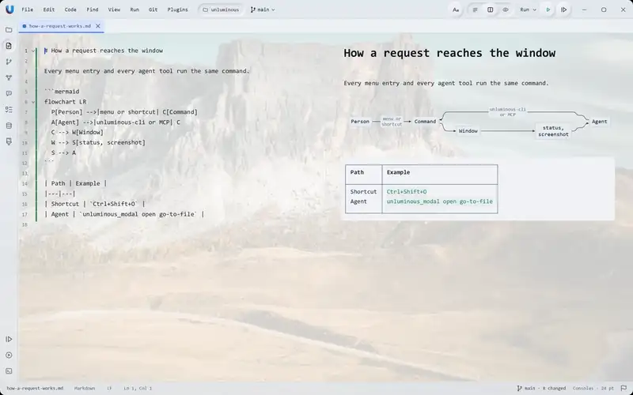

Markdown with tables and twenty kinds of Mermaid diagram, side by side with the source. The preview
redraws as you type, its text selects and copies, and scrolling either half scrolls the other.
`Ctrl+1`, `Ctrl+2` and `Ctrl+3` switch between the source, side by side and the preview.

### Also in the box

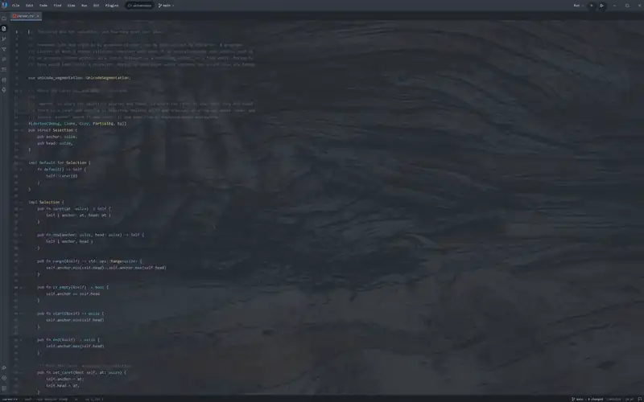

Find in Files, Go to File, a command palette, go to definition, find all references, rename across
the project, split panes, code folding, a terminal with 24 bit colour, browser tabs, twelve language
plugins, panels that dock to any edge, sessions that reopen as you left them, a keymap with VS Code
and IntelliJ presets, and updates checked once a day.

---

## Eight themes: glass, dark and light

<table>
  <tr>
    <td width="33%">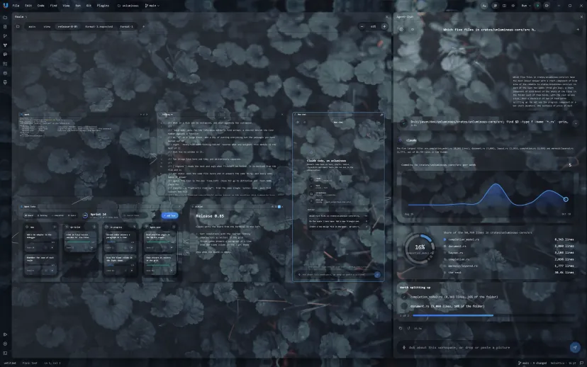<br><sub>Unluminous Glass</sub></td>
    <td width="33%">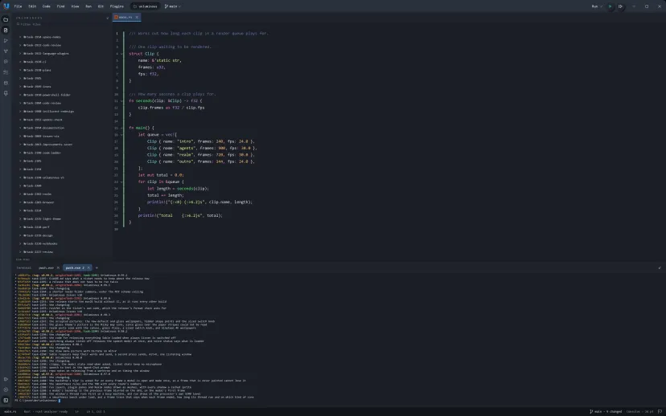<br><sub>Unluminous Dark</sub></td>
    <td width="33%">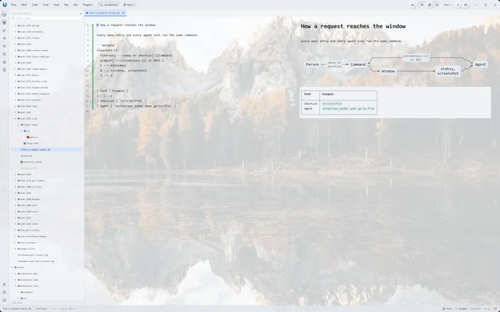<br><sub>Unluminous Light</sub></td>
  </tr>
  <tr>
    <td>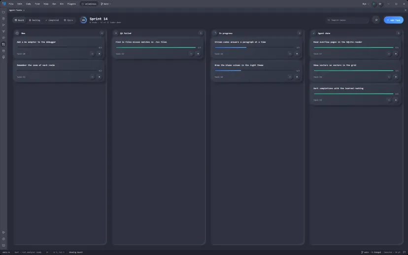<br><sub>Islands Dracula Colorful</sub></td>
    <td>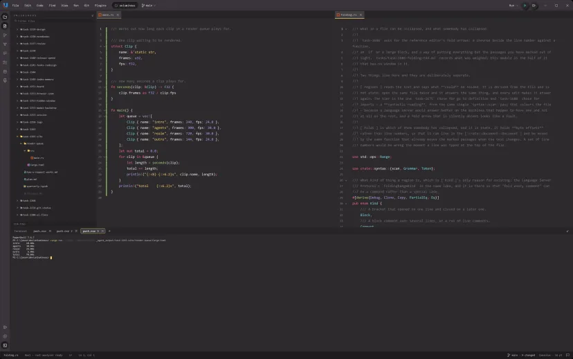<br><sub>Monokai Pro</sub></td>
    <td>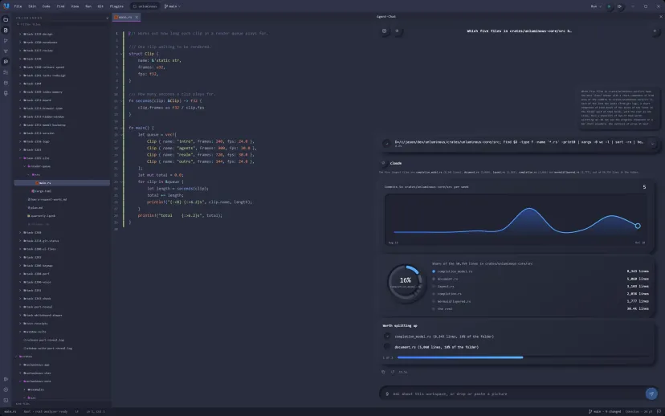<br><sub>Material Palenight</sub></td>
  </tr>
</table>

Unluminous Glass bends the picture behind each panel the way a lens would. The bundled theme pack
adds Material Deep Ocean and One Dark as well.

## Let your desktop show through

<table>
  <tr>
    <td width="33%">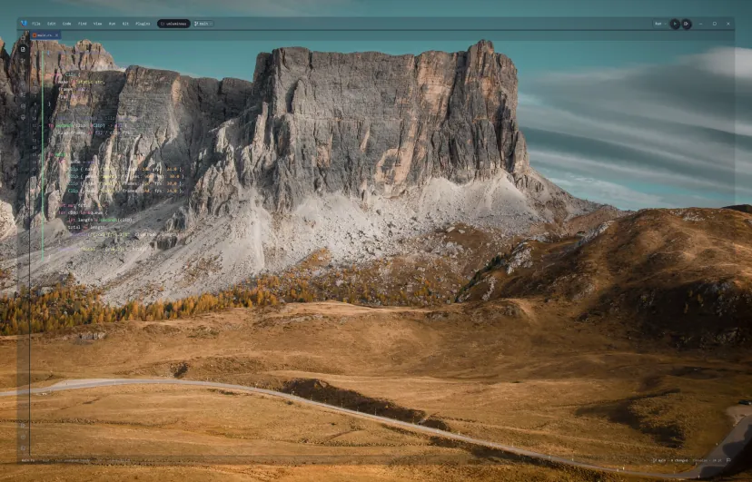<br><sub>15% background</sub></td>
    <td width="33%">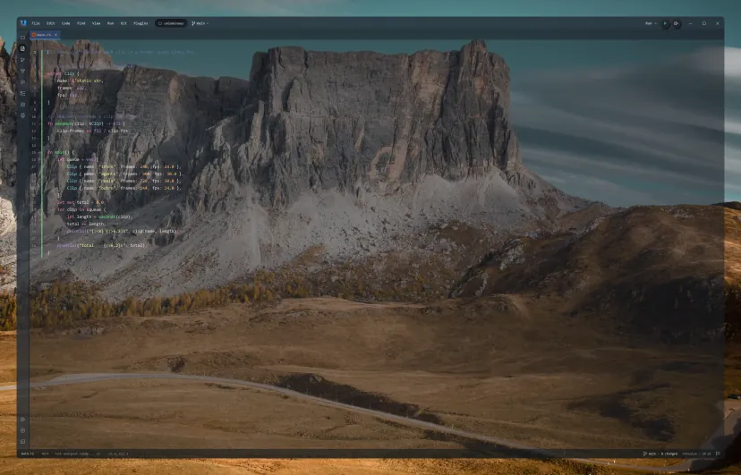<br><sub>55% background</sub></td>
    <td width="33%">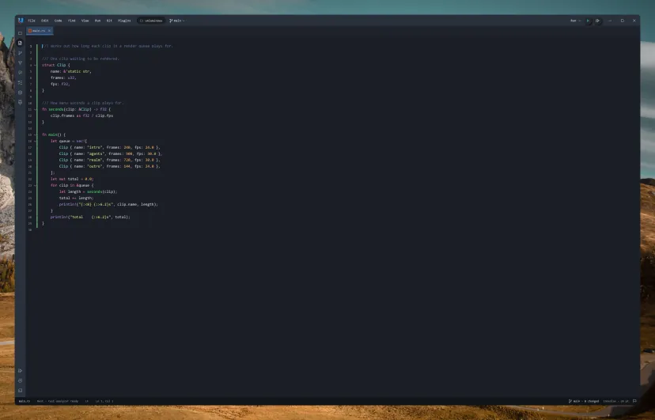<br><sub>Opaque</sub></td>
  </tr>
</table>

Turn the background on and down, and your wallpaper shows through behind the code while the text
stays solid. Or put one of the nineteen 4K pictures Unluminous ships with behind it. One setting,
`Settings -> Theme -> Background`, on Windows and macOS.

## Extremely lightweight

Written in Rust, with memory and processor use in mind.

| | Measured |
|---|---|
| Memory after starting | 177 MB |
| Launch until it takes commands | 652 ms |
| One keystroke in a 380 KB file | 2.7 ms |
| Switching tabs | 156 ms |
| Processor time while idle | 5.6 ms a second |

Language servers and the code index's embedding model are off by default, so a window you are not
using costs almost nothing. The numbers come from the performance write ups in [`tasks/`](tasks/).

---

## Install

**[unluminous.com](https://unluminous.com) has the Windows installer and the macOS app**, each with
its size and SHA-256 beside it. The Windows installer needs no administrator rights.

The installer connects Claude Code, Codex, OpenCode and Pi to Unluminous's MCP server for you, and the
first time Unluminous opens, the **Set Up Unluminous** dialog offers whatever is left, such as
microphone access for dictation. Restart an agent to see its tools.

### Or have your agent install it

Paste this into Claude Code, Codex, OpenCode, Pi or any agent that can fetch a page and run a command:

```text
Download and install Unluminous on this machine. It is a code editor built for AI agents: anything I can click in it, you can do through its command line tool or its MCP server.

1. Read https://unluminous.com/releases/latest.json. It has the address, size and SHA-256 of the Windows installer and of the macOS archive.
2. Download the one for my operating system and check that its SHA-256 matches.
3. On Windows, run the installer with /VERYSILENT /SUPPRESSMSGBOXES /CURRENTUSER. It installs into %LOCALAPPDATA%\Programs\Unluminous, needs no administrator rights, puts unluminous-cli on the PATH and connects the coding agents on this machine.
   On macOS, unzip the archive, move Unluminous.app to /Applications, and run /Applications/Unluminous.app/Contents/MacOS/unluminous-cli setup. It puts unluminous-cli on the PATH and connects the coding agents on this machine.
4. Run unluminous-cli setup --check --json. On Windows use %LOCALAPPDATA%\Programs\Unluminous\unluminous-cli.exe if this shell has not picked up the new PATH. It says where the tool is, which of Claude Code, Codex, OpenCode and Pi it connected to Unluminous's MCP server, and whether the server answered.
5. If you are an agent it did not connect, run unluminous-cli mcp config and add the entry it prints to your own MCP settings.
6. Tell me the version you installed, where it is, which agents were connected, and that each of them has to be restarted to see Unluminous's tools. Tell me too that the first time I open Unluminous, its Set Up Unluminous dialog lists anything that is still not set up, such as microphone access for dictation, which only I can allow. The command that opens this project in it is unluminous-cli launch .
```

### Build it yourself

```sh
cargo build --release
```

```powershell
pwsh installer\windows\build.ps1 -Install     # a Windows installer, installed
```

```bash
installer/macos/build.sh --install            # Unluminous.app in /Applications, and a disk image
```

[Getting started](documentation/getting-started.md) covers the switches, windows and projects, and
where the settings live. [`installer/README.md`](installer/README.md) is the whole of building an
installer.

## Driving it from the command line

```sh
unluminous-cli launch .                                   # start Unluminous here and wait for it
unluminous-cli tab open README.md                         # open a file
unluminous-cli editor view preview                        # look at its Markdown preview
unluminous-cli terminal send cargo test                   # run something in the terminal
unluminous-cli terminal read --wait-for "test result"     # wait for it, and read what it said
unluminous-cli window screenshot shot.png                 # a real picture of the window
```

292 commands across 29 areas, and `--json` makes every answer readable by a program.
[`unluminous-cli/docs/commands.md`](unluminous-cli/docs/commands.md) is the reference, written to be
handed to an agent whole. By default an agent is given one MCP tool an area, 34 tools in about 31,500
tokens, rather than one tool a command, which would be 289 tools in about 82,000.
[For AI agents](documentation/for-ai-agents.md) and [The command line](documentation/command-line.md)
say how it all works, down to the socket.

## Documentation

[unluminous.com/docs](https://unluminous.com/docs) is every feature in 21 chapters.
[`documentation/README.md`](documentation/README.md) is the same ground in this repository, written for
somebody who wants to know how it works as well as what it does.

| | |
|---|---|
| [What it is](documentation/what-it-is.md) | what Unluminous is, who it is for, and the case for it |
| [What it looks like](documentation/overview.md) | captures of the running window |
| [Getting started](documentation/getting-started.md) | install, run, the switches, windows and projects |
| [The window](documentation/the-window.md) | every part named, the panels, the menus, every Settings page |
| [Editing](documentation/editing.md) | text, files, encodings, find and replace, highlights, folding, Markdown, diagrams |
| [Writing code in it](documentation/writing-code.md) | tabs, completion, navigation, git, running, the debugger |
| [The terminal](documentation/the-terminal.md) | the tile, the tabs, which shell, and how one comes back |
| [The Realm](documentation/the-realm.md) | the canvas, its node kinds, and what a connection grants |
| [The agent panes](documentation/agent-panes.md) | Agent Chat and Agent Tasks |
| [The Database plugin](documentation/database.md) | the tree, a grid, a console, a pending change |
| [For AI agents](documentation/for-ai-agents.md) | the contract, how it is enforced, and what a study found |
| [The command line](documentation/command-line.md) | the commands, the channel, and the MCP server |
| [Architecture](documentation/architecture.md) | the crates, one frame, the seams, the threads, what it costs |
| [How plugins work](documentation/plugins.md) | why a plugin is data, and the manifest key by key |
| [Tests](documentation/testing.md) | the four layers, and what the release scripts check |
| [Not included](documentation/not-included.md) | everything deliberately absent, with the reason for each |

## Limits

- **No several carets at once, and no column selection.**
- **Right to left and complex writing systems are not supported.** Grapheme clusters are placed from
  left to right, which is correct for Latin, Greek and Cyrillic and wrong for Arabic and Hindi.
- **A file that is not UTF-8 opens read only.** UTF-16 and Latin-1 are read and named in the status
  bar, and saving one is refused rather than attempted.
- **Ten of Mermaid's thirty diagram types are named rather than drawn**, and the twenty that are drawn
  are not pixel identical to `mermaid.js`, because none of it runs `mermaid.js`.
- **No screen reader support yet.** The accessibility tree is on and every control has a plain name;
  [`design/accessibility.md`](design/accessibility.md) is what is still missing.
- **A screenshot Unluminous takes never contains a rendered web page**, because a page is a native
  child window that the operating system draws on top of the surface a screenshot reads.

[Not included](documentation/not-included.md) is the whole list, with the reason for each.

## Licence, and how to take part

Dual licensed under [MIT](LICENSE-MIT) or [Apache 2.0](LICENSE-APACHE), at your option. Any
contribution you deliberately submit is under those same terms.

- [`CONTRIBUTING.md`](CONTRIBUTING.md): why a feature is three things (the control, the agent's way
  in, and tests over both), how to run the tests, and which crate a change goes in.
- [`CODE_OF_CONDUCT.md`](CODE_OF_CONDUCT.md)
- [`SECURITY.md`](SECURITY.md): where to report a vulnerability.
- [`CHANGELOG.md`](CHANGELOG.md): what changed in each release.

If Unluminous is useful to you, a star on GitHub helps other people find it.
