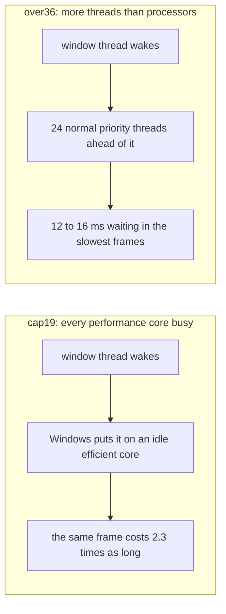
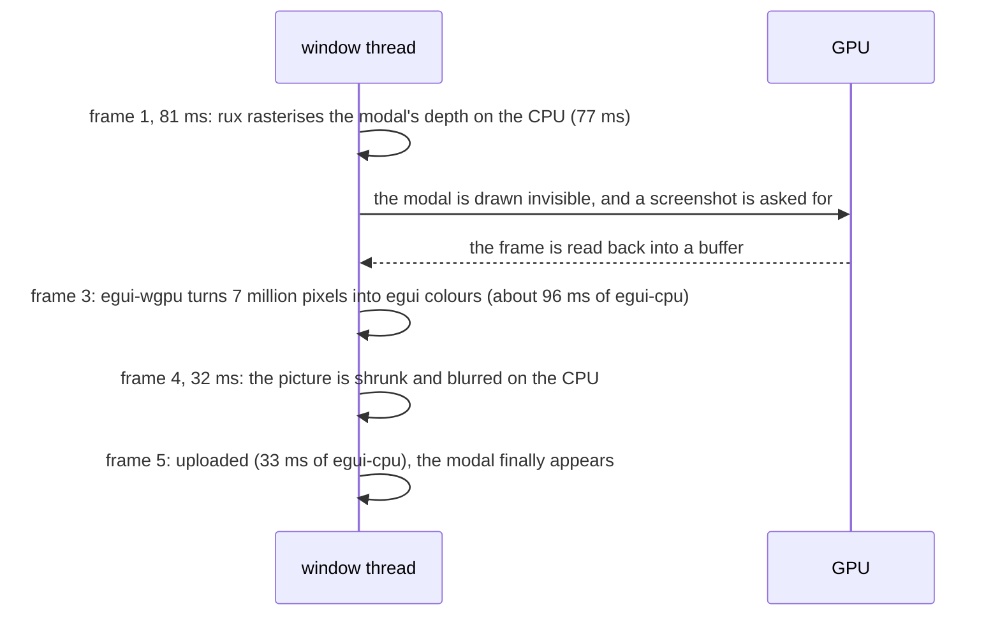
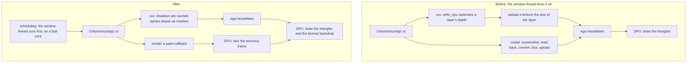
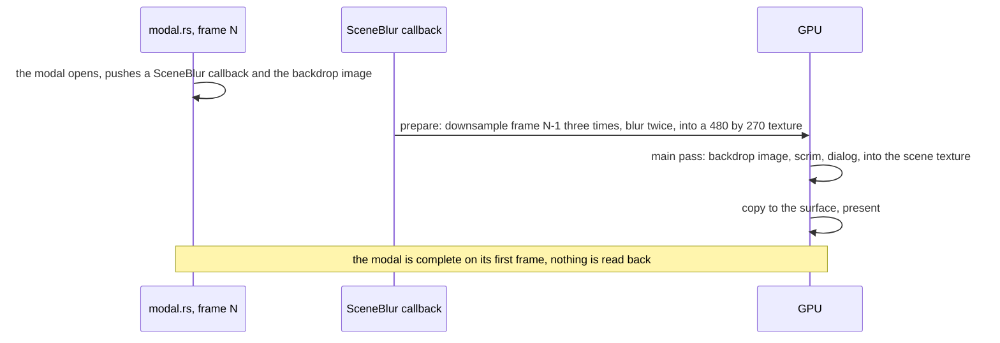

# task-2288: Unluminous stays smooth while the machine is busy

## Introduction

Jason: *"when my cpu is busy, at 80% (eg when an agent is running the unluminous window suite), unluminous
becomes jerky/not-smooth when dragging the window around the screen, opening panels, opening modals ... whereas
other apps, such as Firefox, do not."* He asked whether Unluminous uses the GPU well, given two RTX 5090s.

It does not. The GPU draws egui's final triangles, which is about 0.2 ms of work a frame. Everything that costs
anything runs on the one thread that runs the window: egui's tessellation, every shadow, gradient and carved well
(rux rasterises them with `vello_cpu`), and the modal backdrop (a full window screenshot read back from the GPU,
converted pixel by pixel, shrunk and blurred on the CPU). And that thread is scheduled like any other, so a build
pushes it onto a slow core or makes it wait. This TDD is the measurement that showed it, and the four changes that
take the work off that thread and give the thread the processor first.

The advice behind the ranking is Fable's, in `_agent_output/task-2288-perf/fable-advice.md` (task-2289). The web
research is `_agent_output/task-2288-perf/research-web.md`.

## Goals and non goals

Goals, each measured by `tools/perf-smooth/bench.mjs` under the oversubscribed load (`over36`) unless it says
otherwise, three interleaved reps:

| Measure | Now | Goal |
|---|---|---|
| Typing, slowest 5% of frame gaps | 29 ms | under 10 ms |
| Scrolling, slowest 5% of frame gaps | 21.6 ms | under 10 ms |
| Hover, slowest 5% of frame gaps | 24 ms | under 10 ms |
| Settings, command to the frame it is complete on | 168 to 235 ms | under 30 ms |
| Settings, idle machine | 75 to 83 ms | under 20 ms |
| Share of frames on efficient cores, window suite load | 0.75 to 0.84 | under 0.10 |
| An idle window's processor time | unchanged | unchanged |

Non goals:

- The look does not change: the glass theme, the blurred modal backdrop (`task-2247`), rux's neumorphic depth.
  Pictures may move by a pixel of antialiasing where a renderer changes, and are accepted after looking.
- Rendering does not move to a second thread. eframe has no way to, and the work below removes what that thread
  was doing.
- Builds are not slowed down. `processor-share.ps1` keeps giving them the fastest processors.

## Problem statement

The machine is a Core Ultra 9 285: eight performance cores and sixteen efficient ones. The display is 3840 by
2160 at 164 Hz, so a frame has 6.1 ms. Two loads were measured beside idle: `cap19`, the window suite's own
processor share (the fastest nineteen processors, which is every performance core plus eleven efficient ones),
and `over36`, thirty six busy threads on twenty four processors, which is what a cargo build with tests looks like.

| Gesture frames | idle | cap19 | over36 |
|---|---|---|---|
| Frames on efficient cores | 0.16 to 0.29 | 0.75 to 0.84 | 0.00 |
| Unluminous's own work per typing frame, p95 | 3.8 ms | 8.4 | 24.1 |
| Time the thread waited for a processor, typing p95 | 0.14 ms | 0.17 | 16.5 |

Opening Settings on an idle machine, from the frame trace:

So a modal is 75 to 83 ms on an idle machine and 170 to 235 ms under load. A plugin pane appearing costs 32 to
44 ms of rux rasterisation, and a menu 14 ms. Every one of those is slower again on an efficient core.

## Architectural overview

## Detailed technical sections

### 1. The instrument (`tools/perf-smooth/`)

| File | What it does |
|---|---|
| `load.mjs` | N threads at normal priority doing integer work over a buffer larger than a cache, like a compiler. `--tied` ends it when the bench lets go of its input. `capped.ps1` in front gives it the window suite's mask. |
| `probe.ps1` | A helper at high priority that sends the window `WM_NULL` and times the answer, and drives a window drag step by step with `SetWindowPos` inside `WM_ENTERSIZEMOVE`. |
| `bench.mjs` | One build, one load, one rep: a fresh project and settings folder copied from Jason's (the desert picture at 0.754, a 20 point interface, a 24 point editor, depth on), the chat and the board open, then nine cases. One row a case in the hill climb shape. |
| `rounds.mjs` | Several builds or settings, interleaved pass by pass, never two benches at once. |
| `score.mjs` | Each case's median over reps, its ratio to the baseline, and geometric means over the train and test cases. |

The window's side of it:

- Each frame trace line now carries `at` (when the frame ended, milliseconds since 1970), `cpu` (the window
  thread's own processor time in the frame, `services::thread_clock`) and `core P` or `core E`.
- The control channel writes `event control <command> <ms>` the moment a command arrives, on the socket thread,
  so a latency is the `at` of the frame that answered minus the arrival, and the command line's own start up under
  load is not in it.
- `--features diagnostic-spans` turns egui's, eframe's and egui-wgpu's `profiling::scope!` marks into spans and
  writes every span over half a millisecond onto the frame line as `~<name>` (`services::span_trace`). This is
  what splits `egui-cpu`.

The cases are `rest`, `drag-window`, `open-modal`, `open-menu`, `toggle-panes`, `drag-divider`, `scroll`,
`type` and `hover`, under `idle`, `cap19` and `over36`. `_agent_output/task-2288-perf/hillclimb/metrics.md` says
what each one's number is.

PresentMon 2.6.0 (SHA-256 checked against the release) starts on this machine but records no rows, with
thousands of lost ETW events, so frame gaps come from the window's own `at`.

### 2. The window thread runs first (`services::scheduling`)

Called on the main thread before `eframe::run_native`:

- `SetThreadPriority(THREAD_PRIORITY_ABOVE_NORMAL)`: base 9 against every build's 8, which is what Chromium
  gives the threads that draw and present.
- Power throttling off for the process and the thread (`ProcessPowerThrottling` and `ThreadPowerThrottling`
  with the execution speed bit cleared), which Windows calls high quality of service.
- `SetThreadSelectedCpuSets` to the fastest efficiency class, only on a machine with two kinds of core. If the
  share of frames on efficient cores does not fall under 10%, a hard affinity mask instead.
- `timeBeginPeriod(1)`, because since Windows 10 2004 the one millisecond timer is per process, and egui's
  `request_repaint_after` waits otherwise round to 15.6 ms.

`UNLUMINOUS_SCHEDULING=off|priority|cores` chooses, so the bench measures each and a machine where one misbehaves
has a way out. On macOS AppKit's main thread already runs at the user interactive quality of service, so nothing
changes there.

### 3. rux rasterises at the processor's own SIMD level

Every `RuxState` the window builds is `RuxState::deterministic`, which pins `vello_cpu` to the target's baseline
level so screenshot tests are identical on every machine. The window should use `RuxState::new`, which detects
AVX2 here. One constructor, `theme::rux_state()`, answers `deterministic` only after
`UnluminousApp::draw_deterministically` has been called, which every screenshot test does, and the ten call sites
use it.

### 4. The modal backdrop is blurred on the GPU from the previous frame

egui-wgpu 0.36 already has the path the screenshot uses: render the frame into a texture of its own, then copy that
texture to the surface. A patched copy of egui-wgpu (vendored at `vendor/egui-wgpu`, wired in with
`[patch.crates-io]`, the diff kept as a file for the next upgrade) does that on every frame when
`WgpuConfiguration` asks for it, and puts the texture in the renderer's `CallbackResources` before the frame's
callbacks are prepared. At that point the texture still holds the previous frame, which is the window before the
modal: exactly the photograph that is taken today.

`services::scene_blur` holds the pipelines and the output texture, registered once with
`Renderer::register_native_texture`; the callback goes on the background layer's painter, because a modal fades in
from no opacity and egui drops every shape a painter at no opacity is given. `modal.rs` keeps the screenshot path only for a painter without the scene
texture, which a test harness that does not set it is. The same patch moves `read_screen_rgba`'s pixel loop off the
window thread, so `window screenshot` no longer stalls the window either. The macOS half is the same code on Metal.

### 5. rux's shadows are cached sprites, and anything left is rasterised off the window thread

In `black-rainbow-labs-rux`: a blurred rounded rectangle is the same along its edges away from its corners, so one
small rasterised sprite per (radius, deviation, colour, inset, scale) draws a surface of any size as nine textured
quads through egui's ordinary mesh path. Fills and gradients become meshes with coloured vertices. A layer whose
decoration the composer cannot draw exactly falls back to the canvas as before; across every bench case there are
none. A deterministic store never composes, so screenshot tests keep drawing with the canvas and no accepted picture
moved. Steady state is no rasterisation and no upload. Unluminous takes it by moving the rux pin, and its own canvas
(plugin panes, Realm nodes) goes through the same composer.

### Risks

| Risk | What happens | Answer |
|---|---|---|
| A higher priority window thread spins | the machine is less responsive | it is above normal by one level, not high or realtime, and it is idle between frames |
| CPU sets are only a preference | frames still land on efficient cores | measured; a hard affinity mask is the fallback |
| A patched egui-wgpu | an egui upgrade has to reapply it | the diff is a file, and small; an upstream request is the way out |
| The scene texture costs a copy a frame | GPU time | one 4K copy is microseconds on this card, and only frames that draw pay it |
| Sprites antialias differently from `vello_cpu` | pictures move a pixel | every moved picture is looked at before it is accepted |

## Results

Every number is a median over three interleaved reps on the machine that reported it, from
`_agent_output/task-2288-perf/hillclimb*/`. Lower is better. The display's floor is 6.1 ms a frame.

| Round | Change | Test cases against the 0.96.1 baseline (geometric mean of ratios) |
|---|---|---|
| 1 | the window thread runs first | 0.85 |
| 2 | plus the modal backdrop blurred on the GPU, and rux at the processor's SIMD level | 0.68 |
| 3 | plus rux and Unluminous's canvas drawn as meshes with sprite shadows | **0.39** |
| 4 | `THREAD_PRIORITY_HIGHEST`, or a frame latency of 1 | 1.00 and 0.96 against round 3: neither kept |

| Case | Load | 0.96.1 | Now |
|---|---|---|---|
| Open Settings, cold | idle | 172 ms | **10.6** |
| | cap19 | 263 | **16.4** |
| | over36 | 491 | **16.6** |
| Scroll, frame gap p95 | over36 | 21.7 | **6.8** |
| Hover, frame gap p95 | over36 | 21.3 | **7.0** |
| Divider drag, frame gap p95 | over36 | 25.8 | **10.7** |
| Typing, frame gap p95 | over36 | 26.7 | **11.9** |
| Toggle panes | idle | 5.5 | **3.8** |
| Frames on efficient cores while the suite runs | cap19 | 0.86 | **0.00** |
| Time waiting for a processor, p95 | over36 | 7.0 | **0.2** |
| At rest, WM_NULL answer p95 | all | 0.3 | 0.3 |

What was tried and not kept: `THREAD_PRIORITY_HIGHEST` (hover under over36 went from 10.4 to 16.3 ms), a frame
latency of 1 (the divider drag's slowest gaps went up 1.3 to 2 times), and Mailbox presentation, which drew about
430 frames a second the display never showed and was left out before it was measured.

What is left: typing under the heaviest load is still about 12 ms at its slowest 5%, against 8.4 idle, and a
typing frame is 4 to 5 ms of the window thread's work on an idle performance core, which is most of a 164 Hz
frame. That is the next thing to profile, with `--features diagnostic-spans`.

## Alternatives considered

| Option | For | Against |
|---|---|---|
| Lower the builds' priority, or give builds the efficient cores first | the window would win without changing it | `task-2205` measured below normal builds starving behind other tickets; efficient cores first costs builds about 14% and helps only the suite's own load |
| MMCSS "Games" for the window thread | priority 16 to 22 | an 80 ms raster frame overruns the quota and drops the thread below everything; only after the frame cost is bounded |
| Mailbox or a frame latency of 1 | lower input latency | the slow frames are CPU, not presentation; latency 1 removes a frame of slack under load. One experiment, recorded |
| Show the modal at once and fade the photograph in | no patch | keeps every millisecond of the readback on the window thread and appears in two steps |
| A downsampled screenshot | less to convert | still a frame with the modal invisible, still a readback and a loop on the window thread |
| rux shadows as analytic shaders in paint callbacks | crisp, nothing rasterised | every surface becomes its own draw call outside egui's batching, clips and layer transforms, a second renderer on two backends |
| `vello_cpu`'s `multithreading` feature | 4x on a board | changes epaint's own glyph rasteriser, which then panics |
| A render thread | the move loop could not block a frame | eframe cannot; the move loop already draws no frames (`task-2281`) |

## Testing strategy

- **The bench is the acceptance test.** Every change is a round in
  `_agent_output/task-2288-perf/hillclimb/`: the candidate and a no change control, interleaved, three reps,
  idle, cap19 and over36. A change is kept when its test cases move beyond the control's spread and nothing at rest
  gets worse. Numbers are posted on task-2288 every round.
- `scheduling.rs`: the choice is read from the variable; the fastest processors are chosen only where there are two
  kinds; on Windows, calling it changes what `GetThreadPriority` and the power throttling query read back.
- `thread_clock.rs`: a thread that spins has used processor time.
- egui-wgpu patch: a callback reads the previous frame (a red frame, then a frame whose callback reads one texel of
  the scene texture back), and a resize recreates it.
- `a_modal_opens_with_its_backdrop_on_its_first_frame`: after one frame Settings has its blurred backdrop, the
  trace has `modal-complete` on the opening frame and no `modal-photo-asked`.
- rux: a nine patch shadow matches the rasterised one within two units a channel; a surface of any size costs no
  rasterisation after the first; a layer the sprites cannot express falls back and arrives the next frame.
- The window suite and `tools/test.mjs` before the merge, with moved pictures accepted after looking, and the glass
  rim check on `desert-1.jpg` at 18.75 points.
