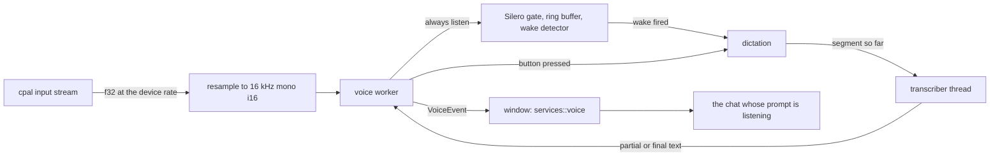

# task-2290: speech to text in the Agent-Chat prompt

## 1. What is asked

> We want to add a small microphone button to our agent chat input prompt on the inside left of it.
> We recently did Sable personal assistant project that figured out the optimal way to load/unload,
> listen for keyword name "sable". Let's put that same functionality in Unluminous agent chat. I want
> real time transcription populating the agent chat prompt as I speak. I want our setup/install to
> provide the download, etc needed to setup. We should have intelligent policy for loading/unloading
> the model to save ram (Sable project had this figured out). We should have an always listen toggle
> that's disabled by default in settings. Alternatively, the user should be able to configure an
> OpenAI compatible endpoint that provides STT. [...] Verify both approaches work as expected. Make
> sure our install prompts the user for mic access, same if they didn't allow it initially but then
> click the mic icon. Always on listening for "Sable" should be a setting in main settings, as well as
> in agent chat setting icon at top left.

So there are seven things to build:

1. A microphone button inside the left end of the prompt box.
2. Pressing it puts the words being spoken into the prompt while they are spoken.
3. Two engines: a model on this machine, and an OpenAI compatible `/v1/audio/transcriptions` endpoint.
4. An always listen switch, off by default, that listens for "Sable" and then takes dictation.
   It is in `Settings -> Voice` and in the Chat settings the gear opens.
5. A policy for when each model is in memory.
6. The installer and `unluminous-cli setup` download what the local engine needs.
7. Microphone access is asked for at install and again when the button is pressed while it is refused.

## 2. What Sable worked out, and what of it is used

Sable (`C:/jason/dev/sable`, task-2187, task-2188, task-2189) has a phone app that listens for "Sable"
all day and a server that transcribes with Whisper. Its findings, from `docs/wake-word.md` and
`crates/sable-wake`:

| Sable finding | Measured there | Used here |
|---|---|---|
| openWakeWord's mel spectrogram and speech embedding models plus a trained `sable.onnx` classifier, run with `tract`, in pure Rust | 0.33 false accepts an hour on 3 hours of podcasts, 0% false rejects on clips Whisper agrees say "Sable" | Yes, the four model files and the detector code, unchanged |
| A voice activity detector gates the wake models, so a quiet room costs almost nothing | Silero: 25 s of processor time per audio hour; the wake models cost 99 s per hour of speech | Yes, Silero, as Sable chose |
| While the VAD hears nothing, audio only goes into a 1.5 s ring buffer, replayed into the models when speech starts | the classifier needs the start of the word | Yes, and the same ring is the pre roll for dictation after a wake |
| Two hops in a row over the threshold fire the detector; sensitivity 0.5 maps to threshold 0.6 | one hop triples false accepts | Yes, `voice.wake_sensitivity` maps the same way |
| The server re-checks a wake against the transcript and drops one with no "Sable" in its first three words | removes confusable words (table, cable, fable) | Yes: a wake whose transcript does not start with a word that sounds like "Sable" is dropped |
| The models keep running for 1 s after speech ends | the score peaks a few hops after the word | Yes |

So "the optimal way to load and unload" in Sable is a tiered pipeline: a cheap gate that is always
running, a mid sized model that runs only while somebody speaks, and the expensive step (transcription)
only after a wake. Unluminous adds a fourth tier Sable did not need, because Sable's transcription
model lives on a server: the local speech model is loaded on demand and released when idle (section 6).

## 3. The local engine: Moonshine base through ONNX Runtime

Options weighed:

| Option | Size | Streaming | Build cost | Verdict |
|---|---|---|---|---|
| whisper.cpp through `whisper-rs` | 75 MB to 1.5 GB | no | a C++ build with cmake on Windows and in the zig cross build for macOS | Rejected: a native build in two toolchains for a feature that `ort` already reaches |
| Moonshine Streaming small (`moonshine-voice-assets`) | 160 MB, six `.ort` graphs | yes | the frontend, encoder, adapter and two decoders with a streaming protocol that is only written down in the vendor's C++ runtime | Rejected for now: the protocol would be reverse engineered |
| Parakeet TDT 0.6B ONNX | 670 MB | no | transducer decoding written by hand | Rejected: ten times the memory of the choice below |
| **Moonshine base, quantized ONNX** (`moonshine-ai/moonshine`, `onnx/merged/base/quantized`) | **67 MB** (encoder 20.5 MB, decoder 42.5 MB, tokenizer 3.8 MB) | no, but fast enough to transcribe the whole utterance again every 300 ms | `ort` is already in the build through the code index; nothing native to compile | **Chosen** |

Measured on this machine (Python, onnxruntime 1.24, two threads): 4.3 s of speech, encoder 35 ms and
decoder 142 ms, text `"Sable, tell me a long story about a lighthouse keeper."`. An utterance is cut
at 20 s, so the most one pass costs is under a second, and a typical pass is a fifth of that.

**Moonshine takes raw 16 kHz samples**, so there is no mel spectrogram to compute: the encoder's one
input is `input_values [1, samples]`. The merged decoder takes `input_ids`, `encoder_hidden_states`,
`use_cache_branch` and `past_key_values.{0..7}.{decoder,encoder}.{key,value}` of shape
`[1, 8, n, 52]`, and answers `logits` and the matching `present.*`. Decoding is greedy from token 1
until token 2, at most `seconds * 6.5` tokens (the model card's limit against loops). The tokenizer is
a BPE vocabulary with `▁` for a space and `<0xNN>` byte pieces, which is decoded by a table lookup;
no tokenizer crate is needed.

**ONNX Runtime is loaded the way the code index loads it**: `ort` with `load-dynamic`, version 1.22.
`ort` loads one library per process and the first `init_from` wins, so the voice engine looks for it
in the same order the index does: `ORT_DYLIB_PATH`, then the runtime `inillucent setup-embeddings`
installed under the platform's local application data folder, then the copy Unluminous's own install
put in its voice folder. The two can never load different versions.

## 4. The endpoint engine

`voice.engine = endpoint` sends audio to `voice.endpoint`, an OpenAI compatible
`/v1/audio/transcriptions` URL, as `multipart/form-data` with `file` (a 16 kHz mono WAV built in
memory, never written to disk), `model` (`voice.endpoint_model`, default `whisper-1`), `language`
(`voice.language`, default `en`) and `response_format = json`. A key is read from the environment
variable `voice.endpoint_key` names, sent as `Authorization: Bearer`, and never written down, which is
the rule `services::ai_endpoints` keeps. ai-proxy on 4141 answers this shape and forwards it to
transcribe-audio (Whisper large-v3) on 4140; that is the pair the verification uses.

A network round trip per partial is too expensive to repeat every 300 ms, so the endpoint engine sends
a partial at most every 1.2 s and always sends the final pass at a pause.

## 5. Real time transcription

One thread captures, one decides, one transcribes:

**Segments.** Dictation cuts speech into segments at pauses the VAD finds. While a segment is open the
whole segment is sent to the transcriber every 300 ms (local) or 1.2 s (endpoint); the answer is the
segment's **partial** text. After 700 ms of silence, or at 20 s, the segment is sent once more as
**final**; its text is committed and a new segment starts. The transcriber keeps only the newest
partial job, so a slow pass never builds a queue; a final job is never dropped.

**What the prompt shows** is `base + committed + partial`, where `base` is whatever was in the draft
when dictation began. Typing in the prompt during dictation makes the current draft the new base, so a
correction is never overwritten by the next partial.

**Dictation ends** when the button is pressed again, when the message is sent, after 15 s with no
speech, or (for a wake) after 1.5 s of silence following speech. A wake started dictation sends the
message when it ends if `voice.send_after_wake` is on (the default), which is what a hands free
request needs; the button never sends by itself.

**The wake word is taken off the front.** After a wake, dictation starts from the pre roll (the ring
buffer, 1.5 s), so the transcript starts with "Sable". The first word is compared phonetically (a
small Soundex) against "Sable"; when it matches it is removed with the punctuation after it, and when
no word in the first three matches the wake is dropped as a false wake, which is Sable's server check.

## 6. What is in memory, and when

| Part | Size in memory | Loaded | Released |
|---|---|---|---|
| Microphone stream | a device handle and a 64 KB buffer | while dictation is on or always listen is on | the moment neither is on, so the system's microphone indicator is off whenever Unluminous is not listening |
| Silero VAD (`tract`) | about 3 MB | with the stream | with the stream |
| Wake models (`tract`) | about 6 MB | when always listen is turned on | when it is turned off |
| Moonshine (`ort`) | about 200 MB | when dictation starts, on the transcriber thread; audio is held while it loads (about 300 ms) | `voice.model_idle` seconds (default 60) after the last transcription, unless dictation is on |
| ONNX Runtime library | about 20 MB | the first time Moonshine loads | never: a library `ort` loaded stays for the process, as it does for the code index |

With always listen on and nobody talking, the cost is the stream and Silero: Sable measured 25 s of
processor time per audio hour for Silero, 0.7% of one core.

## 7. Microphone access

**Windows** has no prompt a desktop program can raise. Access is decided by
`HKCU` and `HKLM` `Software\Microsoft\Windows\CurrentVersion\CapabilityAccessManager\ConsentStore\microphone`
(`Value` = `Allow` or `Deny`) and the `NonPackaged` subkey under it, which is the switch "Let desktop
apps access your microphone". `unluminous_voice::access::status` reads both. When either says `Deny`,
the stream is never opened: the button opens the **Microphone access** dialog, which says which switch
is off and has `Open Microphone Settings` (`ms-settings:privacy-microphone`) and `Try Again`. Windows
hands a refused desktop program a stream of zeros rather than an error, so a stream whose first 1.5 s
are exactly zero is treated as refused too.

**macOS** asks the person. `Info.plist` gains `NSMicrophoneUsageDescription` and the entitlements gain
`com.apple.security.device.audio-input`, which the hardened runtime requires. `access::status` asks
`AVCaptureDevice authorizationStatusForMediaType:` and `access::request` calls
`requestAccessForMediaType:completionHandler:`, which shows the system prompt the first time. When the
answer was no, the dialog's button opens `x-apple.systempreferences:com.apple.preference.security?Privacy_Microphone`.

**At install.** On Windows the installer's new `voice` task runs `unluminous.exe --setup-voice`, which
downloads the model (section 8) and, when access is refused, opens the Microphone settings page with a
message box saying why. On macOS there is no installer program, so the first start
(`app::first_start`) asks for access with the system prompt once. Either way, pressing the button
while access is refused shows the dialog above, which is the "same if they didn't allow it initially"
half of the ask.

## 8. The download

`unluminous_voice::install` owns it, and three things call it: `unluminous --setup-voice` (the
installer, and `unluminous-cli setup`, which runs the window binary beside it), `unluminous-cli voice
install` (a running window), and the `Download` button on `Settings -> Voice`.

| What | From | Size | Checked |
|---|---|---|---|
| `encoder_model.onnx`, `decoder_model_merged.onnx` | `huggingface.co/moonshine-ai/moonshine/resolve/<commit>/onnx/merged/base/quantized/` | 20.5 MB, 42.5 MB | SHA-256 from the repository's LFS pointers, written in the code |
| `tokenizer.json` | the same commit, `onnx/merged/base/float/` | 3.8 MB | size |
| ONNX Runtime 1.22.0, CPU | `github.com/microsoft/onnxruntime/releases/download/v1.22.0/` | 10 to 30 MB archive, one library kept | the library loads and reports 1.22 |

Only when no runtime is found (section 3) is it downloaded. Files are written to `downloads/` and
renamed into place once checked, so a cut download is never mistaken for a model. The folder is
`%LOCALAPPDATA%\Unluminous\voice` on Windows (not the roaming folder the settings are in: 70 MB should
not roam), `~/Library/Application Support/Unluminous/voice` on macOS and `~/.local/share/unluminous/voice`
on Linux. `UNLUMINOUS_VOICE_HOME` overrides it for tests.

The wake models (4.5 MB) are compiled into the binary, as Sable's app does, so always listen needs no
download when the endpoint engine is chosen and the runtime is present.

## 9. Settings

In the window's `settings.conf`, so `settings list`, `get` and `set` reach them and both the main page
and the chat's gear write the same value:

| Key | Default | What |
|---|---|---|
| `voice.engine` | `local` | `local` or `endpoint` |
| `voice.endpoint` | empty | the transcription URL; `http://localhost:4141/v1/audio/transcriptions` is the placeholder |
| `voice.endpoint_model` | `whisper-1` | the `model` field sent |
| `voice.endpoint_key` | empty | the name of an environment variable holding a key |
| `voice.language` | `en` | sent to an endpoint |
| `voice.always_listen` | `false` | listen for "Sable" whenever the window is open |
| `voice.wake_sensitivity` | `0.5` | 0 to 1, threshold `0.8 - 0.4 * s` |
| `voice.send_after_wake` | `true` | a wake started dictation sends when it ends |
| `voice.button` | `true` | the prompt has its microphone button; off removes it (asked for on the ticket mid way) |
| `voice.model_idle` | `60` | seconds the local model stays loaded after its last use, 10 to 3600 |

`Settings -> Voice` is a new page: the engine as a segmented control, the endpoint fields, the model's
state with `Download`, the microphone's state with `Open Microphone Settings`, and the always listen
switch. The Chat settings dialog the gear opens gains two rows: `Listen for "Sable"`, a switch that
runs `voice listen`, and `Microphone button`, which runs `settings set voice.button`. The Voice page has the
same `voice.button` switch.

## 10. Where the code goes

| Place | What |
|---|---|
| `crates/unluminous-voice` (new) | no user interface: `capture` (cpal), `resample`, `wake` and `vad` (Sable's `sable-wake`, copied with its four models), `moonshine` (ort), `endpoint` (ureq), `segmenter` (the pure dictation state machine), `phonetic`, `access`, `install`, and `Voice`, the thread that owns them and answers `VoiceEvent`s |
| `unluminous-app/src/services/voice.rs` | the window's half: starts and stops the engine from the settings, routes text to the chat that is listening, opens the pane on a wake |
| `components/agent_chat/composer.rs` | the microphone button, inside the left end of the well; the words start after it |
| `components/agent_chat/mod.rs` | the `Listen for "Sable"` row in the Chat settings |
| `components/voice_page.rs` | `Settings -> Voice` |
| `components/microphone_dialog.rs` | the Microphone access dialog |
| `unluminous-cli/src/catalogue.rs` and `app/cli_voice.rs` | the agent's half (section 11) |
| `installer/windows/unluminous.iss`, `installer/macos/Info.plist`, `Unluminous.entitlements`, `unluminous-cli/src/setup.rs` | section 7 and 8 |

The chat pane is a plugin provider and does not reach the window's state, so the two meet through the
existing seams: the button reports `Request::RunCommand(voice dictate ...)`, and the window hands every
chat its dictation through a new `UiProvider::dictation(&Dictation)` with a default that does nothing.
A chat node on the canvas is the same `AgentChat`, so its button targets that node.

## 11. The agent's half

A `voice` area in the catalogue, each command through `UnluminousApp::run_cli`:

| Command | What |
|---|---|
| `voice status` | engine, model state (missing, on disk, loaded), microphone access, listening, dictating, the last text |
| `voice dictate [on\|off] [--node N]` | start or stop dictation into the side pane's prompt or a chat node's |
| `voice listen [on\|off]` | always listen, the same as the setting |
| `voice transcribe <wav>` | transcribe a WAV file with the chosen engine, through the same segmenter the microphone feeds, and answer the text; `--live` also writes it into the prompt as partials arrive. This is how the engines are tested with no microphone |
| `voice install` | download what the local engine needs |
| `voice microphone [open-settings]` | microphone access, and open the system's page |

`plugins run agent-chat mic [on|off]` is the same as `voice dictate` for that chat.

## 12. Tests

- `unluminous-voice`: the segmenter (partials, finals at pauses, the 20 s cut, end of dictation), the
  wake word strip and false wake check, the WAV encoder, the tokenizer decode, the resampler, the
  install's path rules and checksum refusal, the Windows registry reading against a fake hive.
- Real model tests, `#[ignore]` unless the model is installed (`UNLUMINOUS_REQUIRE_VOICE=1` makes a
  missing model a failure): Moonshine transcribes Sable's `sable-tell-me-a-long-story.wav` to text
  containing "lighthouse keeper"; the wake detector fires on `sable-what-time-is-it.wav` and not on a
  clip without the word; a wake started dictation strips "Sable".
- Endpoint test against ai-proxy on 4141, ignored unless `UNLUMINOUS_VOICE_ENDPOINT` names it.
- Window tests: the button is in the well and named `Dictate`; `voice transcribe --live` fills the
  prompt; the Chat settings row flips `voice.always_listen`; Settings -> Voice draws.
- By hand, on the installed build: both engines, through `voice transcribe`, against the same clips.

## 13. Left out

- Languages other than English for the local engine: Moonshine base is English. The endpoint takes
  `voice.language`.
- Choosing the input device: the system default is used. `voice status` names it.
- Speaking answers aloud. Sable does that; this ticket is about the prompt.
