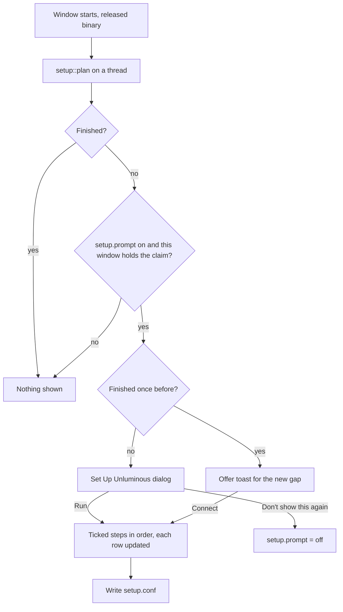

# task-2301: a Set Up Unluminous dialog that finishes the install from inside the window

## 1. What the ticket asks

> Right now installing Unluminous requires manually installation of the cli. We want that to be
> automatically done. Which approach would be best? Can additional install steps be ran when the user
> opens the app? Eg a modal with Setup, that has a Run button and progress showing cli setup, mic access,
> mcp, etc? And show the modal when the user hasn't completed setup or they check don't show me this
> again. Research what we need for setup, then write a TDD and provide a link to it in the comments.

This document is the research and the design. It changes no code.

## 2. Recommendation

Build a **Set Up Unluminous** dialog in the window, on every platform, and show it when the window
starts and setup is not finished. It lists each step with a tick box, a state and a sentence; `Run`
does the ticked steps in order and shows each one's progress; `Don't show this again` stops it opening
by itself. It is also on the `Unluminous` menu and reachable from the command line, so it can be opened
again at any time.

The steps themselves already exist. `task-2278` built `unluminous-cli setup` and `task-2290` built
`unluminous --setup-voice`. What is missing is a place that **notices** setup is not done, **shows**
what is left, and **runs** it where the result is visible. Section 3 shows that each of the routes that
run setup today misses a common case.

Keep the Windows installer's two `[Run]` lines as they are. When they work, the dialog finds nothing
left to do and never opens. The dialog is what covers the cases they miss.

## 3. What setup is today, and where it does not happen

### 3.1 What "set up" means

Read from `unluminous-cli/src/setup.rs`, `crates/unluminous-app/src/app/voice.rs` and
`installer/windows/unluminous.iss`. Six things, in the order `setup::run` does them:

| Step | What it does | Code |
|---|---|---|
| Command line tool | Windows: the install folder in the user's `PATH` in `HKCU\Environment`. macOS and Linux: a link called `unluminous-cli` in `/usr/local/bin`, `/opt/homebrew/bin` or `~/.local/bin`, and a marked line in `~/.zprofile` when that folder is not on the path. | `setup::path::step` |
| Claude Code | An `unluminous` MCP entry in `~/.claude.json`, through `claude mcp add-json` when it is on the path. | `setup::agent_step`, `mcp::install` |
| Codex | An `unluminous` entry in `~/.codex/config.toml`, through `codex mcp add`. | same |
| OpenCode | An `mcp.unluminous` entry in `~/.config/opencode/opencode.json`. | same |
| API keys | Names `ANTHROPIC_API_KEY` and `OPENAI_API_KEY` as set or not. Changes nothing. | `setup::keys_step` |
| MCP server | Starts `unluminous-cli mcp serve` and asks it `initialize` and `tools/list`. | `setup::server_step` |
| Speech model | Downloads the 66 MB Moonshine model and, when the machine has none, ONNX Runtime, checking each SHA-256. | `unluminous_voice::install::install` |
| Microphone | Windows: reads the three privacy switches and offers their Settings page. macOS: `AVCaptureDevice requestAccessForMediaType:`. | `unluminous_voice::access` |

The speech model and the microphone are reached through `unluminous --setup-voice`, which
`setup::voice_step` starts as a child process.

### 3.2 The four routes that run it, and what each one misses

**1. The Windows installer.** Two `[Run]` lines: `unluminous-cli setup --installer --no-path --no-voice`
under the `connectagents` task, and `unluminous.exe --setup-voice` under the `voice` task. Both hidden
or silent, and both "never fail the install", so a failure is only in `%APPDATA%\Unluminous\setup.log`
or `%LOCALAPPDATA%\Unluminous\voice\setup.log`, which nobody opens.

Measured on this machine, which runs 1.0.19 installed by the installer:

- `HKCU\...\Uninstall\{64635361-...}_is1`, value `Inno Setup: Selected Tasks`, is
  `desktopicon,addtopath,contextfile,contextfolder,associate,connectagents`. `voice` is not in it.
- `%LOCALAPPDATA%\Unluminous\voice\setup.log` does not exist, so `--setup-voice` never ran here.

So the upgrade to a version with the `voice` task did not select it, although the task is on by default.
`task-2278` §4.3 relied on Inno selecting a task it has no record of, and on this machine that did not
happen for `voice`. A person who has upgraded through `Install & Restart` keeps whatever tasks their
first install chose, and a task added since then is not run.

**2. The window's first start on macOS and Linux** (`app::first_start`). Runs `setup` on a thread and
shows a toast. It runs only when `fresh_install` is true, which is "the settings folder has no
`settings.conf`". Three things follow:

- **Everybody who used Unluminous on a Mac before `task-2278` never gets it.** Their settings file
  exists. This is the case the ticket describes: the command line tool has to be put on the path by hand.
- **An update on macOS never runs it.** `apply_update.rs` unzips the new bundle with `ditto` and swaps
  it; nothing runs `setup` afterwards. If the bundle moved, an agent entry naming the old path stops
  working until something runs `setup` again.
- **A failure is a toast**, which fades, and there is no way to try again from the window.

It also runs without asking. It edits three other programs' settings files the first time the window
opens, which the person did not press anything for.

**3. `unluminous-cli setup` from a terminal.** Works, but somebody has to know about it, and on macOS
the command is inside the bundle (`/Applications/Unluminous.app/Contents/MacOS/unluminous-cli`) until the
first run of it has made the link. On macOS the microphone half has two further problems, described in
§3.3.

**4. The agent instructions on unluminous.com.** Tell an agent to run `unluminous-cli setup`. Works when
an agent does the install; a person downloading the image does not read them.

### 3.3 The microphone on macOS has to be asked for by the window

Two faults in the current route, from reading the code. Neither has been run on a Mac, because this
machine has none, and the implementation ticket checks both on one:

- macOS decides which application a microphone request belongs to by the **responsible process**, which
  for a program started from a terminal is the terminal. `unluminous-cli setup` run in Terminal starts
  `Unluminous.app/Contents/MacOS/unluminous --setup-voice`, so its request is Terminal's request, and the
  answer is recorded against Terminal.
- `set_up_from_the_installer` calls `access::request()` and returns at once. `requestAccessForMediaType`
  answers through a completion handler on another thread, and the process exits before it runs, so the
  prompt can be taken away with the process.

The window is `Unluminous.app` itself, so a request it makes is Unluminous's, and it is still running
when the answer arrives. That is a second reason the microphone step belongs in the dialog.

### 3.4 Summary

| Case | Today | With the dialog |
|---|---|---|
| Fresh Windows install, all tasks ticked | Installer does it | Nothing left, dialog does not open |
| Windows upgrade where `voice` was never selected | Speech model and microphone never set up | Dialog offers those two rows |
| Windows install with `connectagents` unticked | Agents not connected | Dialog does not open (the person declined, §5.3) |
| Fresh Mac install | Silent `setup` and a toast | Dialog opens; person presses Run |
| Mac user from before `task-2278` | Nothing, ever | Dialog opens |
| Mac update moved the bundle | Agent entries point at a missing program | Dialog opens with those agents to reconnect |
| An agent installed after Unluminous | Nothing | A toast offers to connect it (§5.4) |
| Any step failed | A log file or a toast | Row says why, with a button to try again |

## 4. What other editors do

| Editor | How its command line tool gets on the path |
|---|---|
| VS Code | macOS: `Shell Command: Install 'code' command in PATH` in the command palette, which asks for an administrator password to write `/usr/local/bin/code`. Windows: the installer's PATH tick box. |
| Zed | macOS: a `cli: install` action, also asking for a password for `/usr/local/bin/zed`. Offered in its welcome page. |
| Cursor | A first run page with buttons for its command line tool and for importing VS Code settings. |
| JetBrains Toolbox | Writes launcher scripts into a folder of its own and tells the person to put that folder on the path. |
| Docker Desktop | A first run dialog that installs its privileged helper, with the system's password prompt. |

What they share: the step runs from inside the application, the person presses something for it, and it
can be run again later. None of them edits another program's settings without asking. The dialog follows
the same pattern.

Unluminous does not need the administrator password VS Code and Zed ask for: `setup::path` already uses
`~/.local/bin` and a profile line when `/usr/local/bin` is not writable. A terminal opened afterwards finds
`unluminous-cli`, and every agent entry names the absolute path, so no agent depends on the path at all.
§9 leaves the password route out.

## 5. Design

### 5.1 The steps become separate calls with progress

`setup::run` does every step in one call and returns a `Report`. The dialog has to draw each step as it
starts and finishes, and the speech model has a download fraction worth showing. So `setup.rs` gains:

```rust
/// One step `setup` can take, in the order it takes them.
pub enum StepId { Path, Agent(Client), Server, SpeechModel, Microphone }

/// Which steps apply on this machine, each with what `--check` says about it now.
pub fn plan(options: &Options, machine: &Machine) -> Vec<(StepId, Step)>;

/// Take one step.
pub fn take(id: StepId, options: &Options, machine: &Machine) -> Step;
```

`run` becomes `plan` followed by `take` for each step that is not already done, so `unluminous-cli setup`
prints what it printed before and its tests keep passing. `plan` never starts the server: asking a
server for its tools is a check of something just changed, and it is taken after the agent rows.

The two voice steps move out of `setup.rs`'s child process for the window. `unluminous-cli` cannot link
`unluminous-voice` (the CLI crate has no dependency on the window crate, and the voice crate pulls in
`cpal` and `tract`), so:

- In the **window**, `SpeechModel` calls `unluminous_voice::install::install` directly. Its existing
  `progress: &dyn Fn(&str, f32)` callback is what the row's track is drawn from. `Microphone` calls
  `unluminous_voice::access` in the window's own process, for the reason in §3.3, and waits for the
  completion handler before reporting.
- In **`unluminous-cli setup`**, the speech model is still `--setup-voice`. On macOS the microphone is no
  longer asked for there; the step says `The microphone is asked for the next time Unluminous opens`
  and the dialog does it. On Windows nothing changes, because there is no prompt to attribute.

### 5.2 The dialog

`components::setup_dialog`, built from `components::modal` with `modal::show_unframed` and
`settings_kit`, the way the Settings window and the report dialog are. About 640 by 520 points; it asks
for less than 600 points of width, so it keeps its size (`modal::starting_size`).

```
 Set Up Unluminous                                                   (x)

 Unluminous works best with these connected. Untick anything you do not want.

 [x] Command line tool      already   unluminous-cli is on the path.
 [x] Claude Code            to do     Adds Unluminous's tools to Claude Code.
 [x] Codex                  done      Connected. Restart Codex to use its tools.
 [x] Speech model (66 MB)   running   ======>-----------  31 of 66 MB
 [x] Microphone             to do     Asks macOS for the microphone.
     MCP server             waiting   Checked after the agents are connected.

     Not found on this machine: OpenCode.
     API keys: ANTHROPIC_API_KEY is set. OPENAI_API_KEY is not set.

 [ ] Don't show this again                              (Close)  (Run)
```

Rules for the rows:

- **One row a step `plan` returns.** An agent that is not installed is not a row; it is named in the quiet
  line under the rows. The API keys are a note under the rows, because there is nothing to run.
- **The state is a `rux` `StatusWell`**, which is what Agent-Chat uses for a state, and its word is one of
  `to do`, `waiting`, `running`, `done`, `already`, `left`, `declined`, `failed`. The speech model's
  running state is a `Track` with the megabytes.
- **A row that is already done has its tick box dimmed**, because there is nothing for it to do.
- **A `left` row** (an entry that points at another Unluminous, which `setup` leaves alone) shows a
  `Replace` button, which takes that step with `force`.
- **A failed row shows the step's own sentence** and the button that fixes it, where there is one:
  `Open microphone settings` (`access::open_settings`), `Try again`, or, for an application running from
  App Translocation, `Show in Finder` with the sentence telling the person to move it to `/Applications`.
- **The MCP server row has no tick box.** It is run after any agent row that changed something.

`Run` takes the ticked rows that are not done, in the order of the table, on a thread, and the dialog
draws each row as its step reports. `Run` becomes `Stop` while it runs; `Stop` lets the current step
finish and does not start the next, because stopping a download half way leaves a file the next run
has to throw away anyway. Once every ticked row has finished, `Run` becomes `Done`.

A step that is unticked when `Run` is pressed is recorded as declined (§5.3), so the dialog does not offer
it again by itself.

`Close` and the round cross close the dialog without running anything. Escape is the same.

### 5.3 What "finished" means, and what is kept

A new file in the settings folder, `setup.conf`, in the store's ordinary `key = value` format:

```
setup.prompt = on            # off after "Don't show this again"
setup.declined = microphone,speech-model
setup.last = 1.0.19 1792376339
```

Setup is **finished** when every row `plan` returns is `done`, `already`, `left` or declined. `left` counts,
because an entry pointing at another Unluminous was somebody's choice.

`setup.declined` is filled from two places:

- A row that was unticked when `Run` was pressed, or that a person declined in the system's own prompt
  (the microphone refused after Unluminous asked).
- **On Windows, the installer's own record.** A task the person unticked in the installer is in
  `Inno Setup: Selected Tasks` as missing, but so is a task added after the first install, which is the
  case in §3.2. The two are told apart by a second value the installer writes from now on:
  `[Registry]` gains `Unluminous: Offered Tasks` with the list of task names this installer offered. A
  task that was offered and is not selected was declined; a task that was never offered was not. An
  installer from before this change wrote no such value, so for it every missing task counts as never
  offered, which shows the dialog for `voice` on this machine, which is the right answer here.

The file is written by the window only, after a `Run`, after `Don't show this again`, and after a row is
declined. It is **per person**, in the settings folder, because the agents' files and the path are per
person. A test's window has no store and writes nothing.

`unluminous-cli setup` reads `setup.declined` too, so a declined step is reported as `declined` rather
than done behind the person's back. `--force` still takes it.

### 5.4 When it opens by itself

On every start of the released binary, in `main`, after `set_up_on_the_first_start` is removed:

1. `app.allow_the_setup_prompt()`, the way `allow_the_microphone` is, so a test's window and a window
   started with `--background` never open it.
2. A thread runs `setup::plan` with the login shell's environment on macOS (`login_shell::for_a_child`,
   which waits for the login shell the way `first_start` does now). `plan` reads a few files and the
   `PATH`. `setup --check --no-voice`, which also starts the server, took 90 ms, 885 ms and 2,099 ms in
   three runs on this machine while other agents were building, so the time is the machine's load more
   than the work. It runs on a thread, so no frame waits for it, and `plan` leaves the server out.
3. When the answer arrives, the dialog opens if setup is not finished, `setup.prompt` is `on`, no other
   modal is open, and this window holds the claim below. If another modal is open it waits for it to
   close.

**One window a session opens it.** A desktop launch can restore several windows at once. A window that
opens the dialog writes its process id to `setup-prompt.pid` in the settings folder, and a window that
finds a live process named there does not open it. That is `voice/listening.pid`'s shape.

**Once it has been finished, a later gap is a toast.** A person who finished setup and then installs
Codex should not be met by a modal. When `setup.last` says setup was finished before and `plan` now
finds rows to do, the window shows a `toast::Kind::Offer` toast, `Codex is not connected to Unluminous`
with `Connect` and `Not now`. `Connect` takes that step and `Not now` declines it. `setup.last` records
the version and time of the last `Run` that left setup finished.

`Don't show this again` stops the dialog and the toast opening by themselves. The menu entry still works.

### 5.5 The menu entry and the command line

- **`Unluminous -> Set Up Unluminous...`**, beside `Check for Updates`, an `Action::OpenSetup`. A menu entry
  is reachable as `action run` and listed by `action list` with no further work.
- **`modal open setup`**, in `cli_modal.rs`'s list, so `modal list` names it.
- **A `setup` area for the window**, with verbs `status`, `run`, `decline`, `close`, rows in
  `catalogue.rs` and arms in `app/cli.rs`. `status` answers the rows as data (`id`, `title`, `state`,
  `message`, `fraction`, `ticked`) and whether the dialog is open. `run [<step>...]` is the `Run` button,
  and does not wait, because `UiProvider::command` runs inside a frame: `status` says when it has
  finished, the shape `run start` and `report send` already have. `run --wait` holds the answer the way a
  held command line request is held.

  The client already has a top level `setup` command, answered by the client and held back from the MCP
  tools (`mcp::tools::offered` matches the wire name `setup` exactly). The new verbs have wire names
  `setup.status`, `setup.run` and so on, so they are offered as MCP tools and the held back list stays at
  three. `parse.rs` reads `unluminous-cli setup status` as the area verb when the first word after
  `setup` is one of the four, and as the existing client command otherwise. `--check` and every other
  flag of the client command are unchanged.

  `docs/commands.md` gains a section for each, which `documentation.rs` requires.

### 5.6 The Windows installer

Unchanged except for the `Unluminous: Offered Tasks` value in §5.3. The installer's two `[Run]` lines
stay: on a fresh install with the defaults they do everything, the dialog finds nothing to do, and a
person who installs and never opens the window still has their agents connected.

### 5.7 macOS: the dialog replaces the silent first start

`app/first_start.rs`'s `set_up_on_the_first_start` and `take_the_first_setup` are removed, with their toast
and its two tests. The dialog opens on the first start instead, and the person presses `Run`. Editing
three other programs' settings files is something the person should press a button for, which is what the
Windows installer's tick box already is.

The App Translocation check stays in `setup::run` and becomes the path row's failed state with `Show in
Finder`.

## 6. The flow



## 7. Tests

- **`setup.rs` unit tests**, against the fake home and `PATH` its tests already build: `plan` returns one
  row an installed agent and none for one that is not; `plan` changes nothing on disk; `run` gives the same
  report as before (the existing tests, unchanged); a declined step is reported `declined` and `--force`
  takes it.
- **What finished means**, as a pure function over the rows and `setup.conf`: every combination of
  `done`, `already`, `left`, declined and to do.
- **The installer record**: `Selected Tasks` and `Offered Tasks` read into declined and never offered,
  including the installer from before this change, which has no `Offered Tasks`.
- **The dialog**, through `egui_kittest` with a fake machine: screenshot tests `setup_dialog_fresh`,
  `setup_dialog_running` (speech model at a fixed fraction, `motion off`), `setup_dialog_failed`
  (microphone refused, with its button) and `setup_dialog_light`. A test that `Run` takes only the ticked
  rows and records the unticked ones as declined, and one that `Don't show this again` writes
  `setup.prompt = off`.
- **When it opens**: a window built without `allow_the_setup_prompt` never opens it; a finished setup does
  not open it; a second window with a live claim does not open it; a regression after a finished setup
  shows the toast and not the dialog.
- **The command line**: the catalogue, documentation and MCP tool tests every command is held to, and
  `exactly_one_command_is_held_back...` still counting three.
- **On a Mac**, by hand, recorded in the ticket: a fresh profile opens the dialog; `Run` puts the link in
  `~/.local/bin` and the profile line in; the microphone prompt names Unluminous and the answer is listed
  under Unluminous in `System Settings -> Privacy & Security -> Microphone`; an update that moves the
  bundle opens the dialog with the agents to reconnect.
- **`tools/test-fresh-install.ps1`** gains one check: the installed window's `setup status` reports
  every row finished after a default silent install, so the dialog would not open.
- **An agent study scenario**: "Set Unluminous up on this machine", graded on `setup status` read back.

## 8. Order of work

1. `setup::plan` and `setup::take`, with `run` rebuilt on them. No behaviour change.
2. `setup.conf`, the finished rule and the installer record.
3. The dialog, the menu entry and `modal open setup`.
4. Opening by itself, the claim file and the toast.
5. The `setup` area commands and their documentation.
6. Remove the silent first start on macOS; move the microphone into the window.
7. The installer's `Offered Tasks` value.
8. The Mac check in §7, then release.

## 9. Left out

- **An administrator password to write `/usr/local/bin`.** VS Code and Zed do it. `~/.local/bin` and a
  profile line need no password and every agent entry is an absolute path, so the password buys only a
  terminal that was already open picking up the command, which it cannot do on Windows either.
- **Moving the application to `/Applications` for the person**, the way some Mac applications offer to.
  The dialog says how and opens Finder. Moving a running bundle and starting it again is a feature of its
  own.
- **Gemini CLI, Cursor and VS Code** as agents. `task-2278` §6 says why, and adding one is a row in
  `Client`, which the dialog then lists with no change.
- **Writing an API key.** The keys stay environment variables, as `services::ai_endpoints` requires.
