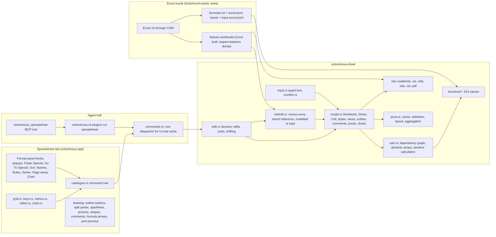
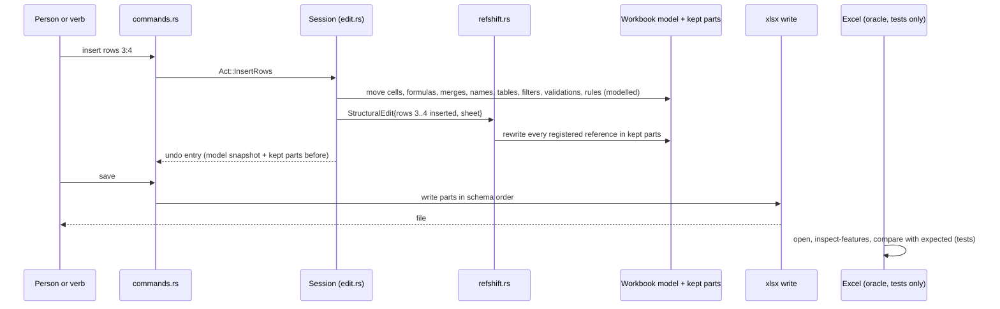

# Spreadsheet round 2: Excel parity gaps and how to close them (task-2357)

## Introduction

Round 1 (task-2338) shipped the Spreadsheet plugin in Unluminous 1.13.0: the `unluminous-sheet` engine crate, the `.xlsx`/`.xlsm`/`.csv`/`.tsv` reader and writer, the plugin tab, and the `plugins run spreadsheet` verbs. This ticket audited that work against Microsoft Excel 16 (build 20527, installed on this machine and driven through COM) and against Microsoft's own documentation, to find everything that still has to change before the plugin has feature parity with Excel for a person working a workbook offline.

The audit produced five reports under `C:/jason/dev/ai-service/_agent_output/task-2357-excel-round-2/`. Their data (probe corpora, Excel's answers, the feature workbooks Excel built, the harness that drives the engine headlessly) is the input to the implementation ticket. This document turns the findings into a design: what parity means here, the exact gaps, how each is closed, and how the Excel oracle proves it.

| Report | Path | What it holds |
|---|---|---|
| Inventory | `01-inventory.md` | What the engine, plugin and verbs implement today, with file paths |
| Excel reference | `02-excel-reference.md`, `02-excel-functions.txt` | Microsoft's function list (523 names), limits, formats, data features, UI behaviour, package parts |
| Function gaps | `03-function-gaps.md`, `fn-probe/` | 149 missing functions; 1,884 edge case formulas computed by Excel and by the engine, 95 mismatches; 95 typed inputs, 22 mismatches |
| File format gaps | `04-file-format-gaps.md`, `file-probe/` | 21 feature workbooks Excel built, round tripped, inspected again in Excel; what edits do to kept XML; CSV; the writer's own output |
| UI gaps | `05-ui-gaps.md` | 700 Excel behaviours compared with the plugin: 216 present, 52 partial, 418 absent, 14 different |

## Goals and non goals

### What parity means for this plugin

A workbook a person can make in Excel opens in Unluminous with nothing lost, every formula computes the value Excel computes, every edit a person makes in Excel's grid can be made here (through the command tree and through a verb), the saved file opens in Excel with no repair and nothing moved, and the same holds the other way round. "Excel" is the installed Excel 16; "a person working offline" excludes everything that needs Microsoft's services or another person.

### Goals, each measurable with the oracle

1. **Functions.** Every one of the 130 Excel worksheet functions that compute locally and are missing today is implemented (section 4.1). The 19 names that need a service are known to the engine and keep the file's cached value. The oracle corpus grows from 666 to at least 2,600 formulas, every function has at least five cases, and every case matches Excel's answer.
2. **Behaviour.** The 95 counted mismatches in `03-function-gaps.md` section B.3 and the 22 typed input mismatches in section C are fixed, with Excel's answer as the definition of correct.
3. **File fidelity.** Every one of the 64 feature rows in `04-file-format-gaps.md` section 2c is "preserved" after a round trip, the protected workbook opens, and every edit row in section 3 is "shifted correctly" (today 15 of 35 are left pointing at old cells). Excel opens every file the writer produces with no repair.
4. **Editing and UI.** Every row marked Absent or Different in `05-ui-gaps.md` that is inside the parity definition is Present (section 4.4 lists them by area and names the few that are not).
5. **Verbs.** Every command a person can run has a verb with the same words, every verb's help text names every word the code accepts, and the read back verbs exist (rules, validations, names, charts, links, comments, protection, page setup).
6. **Legacy and other formats.** `.xls`, `.xlsb` and `.ods` open. `.xlsx`, `.xlsm`, `.csv`, `.tsv`, `.txt`, `.pdf` and `.ods` save.
7. **Docs.** `CLAUDE.md`, the round 1 PRD and TDD say what the code does (function count, oracle file names, component file names).

### Non goals

These need Microsoft's services, another person, or are not spreadsheet editing. They stay out of scope; the files that hold them are preserved byte for byte, which already works.

- Copilot, Analyze Data, Python in Excel (`PY`), `IMAGE`, `STOCKHISTORY`, linked data types (Stocks, Geography), `WEBSERVICE`, `TRANSLATE`, `DETECTLANGUAGE`, `RTD`, the cube functions, `CALL`, `REGISTER.ID`, `EUROCONVERT` (unknown to this Excel build anyway), `COPILOT`, `JIS` (unknown to this build).
- Co-authoring, share links, version history, AutoSave to a cloud, track changes, presence, Inspect Document, Accessibility Checker, Mark as Final.
- Running VBA, the VBA editor, macro recording, add ins, Office Scripts, Power Query (Get and Transform), the Data Model, Power Pivot, Solver, Forecast Sheet, external data connections and Refresh All.
- Excel's ribbon, Key Tips (Alt sequences), F1 help, Excel's own window management (Ctrl+F6, Ctrl+Tab between workbooks, Alt+F4), Office clipboard history, text to speech, thesaurus, SmartArt and WordArt authoring, equation editor, 3D models, ActiveX authoring. Shapes, SmartArt, form controls and OLE objects are drawn where the format allows and preserved always; only pictures, text boxes and basic shapes are authored.
- Writing `.xls` and `.xlsb` (Excel itself steers to `.xlsx`). Reading them is a goal.
- Encrypted workbooks (password to open). Refused with a message, as today. Sheet and workbook structure protection are in scope.

## Problem statement

Round 1 measured itself with 666 oracle formulas and one feature workbook, and on those it is clean. Round 2 measured wider, and the picture changes:

- **A protected workbook Excel made cannot be opened by Excel after Unluminous saves it.** The writer puts `workbookProtection` before `mc:AlternateContent` in `workbook.xml`; Excel refuses the file outright, and repair mode refuses it too (`04`, section 2a). A person who protects a workbook's structure and saves it here loses the ability to open it in Excel.
- **Edits silently break kept features.** Inserting two rows and a column above a sparkline, a pivot table, a chart, a threaded comment, an x14 data bar, a manual page break or a slicer leaves the kept XML pointing at the old cells. Excel opens the file with no repair and shows the feature in the wrong place or reading the wrong data (`04`, section 3: 15 of 35 rows). Two edits produce files Excel has to repair (an array formula losing a row, a table losing its header row). Nothing tells the person.
- **Formulas inside tables compute 0.** `Fruit[[#This Row],[Units]]*Fruit[[#This Row],[Price]]` and a totals row `SUBTOTAL(109,Fruit[Units])` are saved with cached value 0, so Excel shows zeros until it recalculates (`04`, section 2b). A future function (`_xlfn.REGEXTEST`) loses its prefix on save and turns into `#NAME?` in Excel.
- **149 of Excel's 523 functions are missing**, 145 of which this Excel build recognises: complex numbers and Bessel (30), bonds and securities (26), statistics including `LINEST`, `LOGEST`, `GROWTH`, `FORECAST.ETS` and the test functions (23), the database functions (12), 13 legacy names, 10 byte functions, `REGEXTEST`/`REGEXEXTRACT`/`REGEXREPLACE`, `GROUPBY`, `PIVOTBY`, `PERCENTOF`, `TRIMRANGE`, `INFO`.
- **Implemented functions disagree with Excel at the edges.** 95 counted mismatches in 1,884 new probes: the engine returns a value where Excel raises an error (43), an error where Excel returns a value (20), a different value (15), a different spill shape (6), a different text for a number (6), a different error kind (5). Typed input differs on 22 of 95 inputs (`1-2` and `2 Jan` are dates in Excel, `2/29/1900` is serial 60, `€5` is a number, `25:00` gets `[h]:mm:ss`).
- **Iterative calculation is not performed**, so a workbook with circular references and iteration on saves zeros where Excel saved converged values.
- **Split panes, scroll position, selection, hidden headings, right to left and page break preview are dropped** on every save, because `sheetViews` is regenerated from three fields.
- **418 of 700 Excel editing behaviours are absent** and 14 keys do something other than what Excel does (Ctrl+Y redoes instead of repeating, F4 outside editing does nothing, Ctrl+G focuses the name box instead of Go To, Page Up moves a fixed 20 rows). Whole areas are missing: outline grouping and subtotals, split panes, drag and drop of ranges, fill series options, Paste Special beyond four modes, Go To Special, Name Manager, multi key sort, text and date and colour filters, advanced filter, fixed width text to columns, validation message authoring, the conditional format manager and icon set drawing, named cell styles and themes, chart editing and eleven chart types, pictures and shapes authoring, sparklines, threaded comments, sheet and workbook protection, page setup, print and PDF, show formulas, formula auditing, pivot tables, goal seek and data tables, `.xls`/`.xlsb`/`.ods`.
- **The verbs stop where the UI stops**, and their help text omits words the code accepts (`format` accepts about 20 more words than its help lists).

The business impact is the one the ticket states: the plugin was announced as an Excel editor, and a person who brings a real workbook to it today can lose work in ways that are only visible later, in Excel.

## Architectural overview



Two principles carry over from round 1 and decide most of the design below:

1. **One command tree.** Every new capability is an entry in `catalogue.rs` and therefore a verb, a menu entry, a panel level and a searchable command at once. Nothing is added to the grid or a key that is not reachable from the tree.
2. **Excel is the oracle.** A function, a typed input, a round trip or an edit is correct when Excel says so through COM. New behaviour lands with its oracle cases in the same commit.

The new principle for round 2:

3. **Nothing that holds a cell reference is kept as opaque text.** Either the item is modelled (and shifts through the printer as formulas do today), or it is registered with the reference shifter, which knows which attributes and elements of each kept part carry references and rewrites them on every structural edit. "Kept" without a shifter entry is allowed only for parts that hold no references (theme, media, printer settings, custom XML, VBA).

## Detailed technical sections

### 4.1 Function library completeness

**Where.** `crates/unluminous-sheet/src/functions/`. New modules: `complex.rs` (COMPLEX and the 27 IM functions, Bessel), `securities.rs` (the 26 bond functions plus AMORDEGRC, AMORLINC, VDB, DOLLARDE, DOLLARFR), `database.rs` (the 12 D functions over a criteria range), `regex.rs` (REGEXTEST, REGEXEXTRACT, REGEXREPLACE on the `regex` crate with Excel's PCRE flavoured semantics for flags and groups; `fancy-regex` if lookaround is needed, which Excel supports), `grouping.rs` (GROUPBY, PIVOTBY, PERCENTOF, TRIMRANGE), additions to `stats.rs` (LINEST, LOGEST, GROWTH, TREND already present, FORECAST.ETS family, BETA.INV, BINOM.INV, BINOM.DIST.RANGE, NEGBINOM.DIST, HYPGEOM.DIST, GAMMA.INV, F.INV, F.INV.RT, CONFIDENCE.T, CHISQ.TEST, F.TEST, T.TEST, Z.TEST, PROB, FISHER, FISHERINV, and the 13 legacy aliases), `text.rs` (the byte functions as width aware variants: in a single byte locale `LENB` equals `LEN`, `DBCS` maps half width to full width, `PHONETIC` returns the phonetic runs the reader currently ignores), `info.rs` (INFO; CELL gains `color`, `parentheses`, `prefix`, and `width` returns a 1x2 array), `web.rs` (ENCODEURL, FILTERXML on `roxmltree` with an XPath subset), `BAHTTEXT`.

**Service names.** The 19 names in `03-function-gaps.md` A.2 "needs an external service" get a table entry flagged `offline`. The completion list shows them, the argument hint says "needs Excel's service", evaluation keeps the file's cached value when there is one and returns `#BLOCKED!` otherwise, and the printer writes them with their `_xlfn.` prefix. `ErrorKind` gains `#BLOCKED!`, `#CONNECT!`, `#FIELD!`, `#GETTING_DATA`, `#UNKNOWN!`, `#PYTHON!`, `#BUSY!` so a file holding them round trips (today `#SPILL!` and `#CALC!` are already written as `#VALUE!`; that is fixed too, with the `t="e"` cell value Excel uses).

**FORECAST.ETS.** Excel's AAA exponential smoothing is not documented to the parameter. Implement the published model (additive error, trend, seasonality, with seasonality detection by autocorrelation) and set the oracle tolerance for the ETS family to 1e-6 relative, as IRR has today; if the oracle shows a larger difference the implementation ticket records the measured gap and the reason in the test file rather than loosening the tolerance further.

**Acceptance.** `functions` verb lists 523 names. Every name in `02-excel-functions.txt` has an entry. Each new function has at least five oracle cases including an error case.

### 4.2 Behaviour parity in the engine

The 95 counted mismatches group into rules. Each rule is one change; the formulas listed under it in `03-function-gaps.md` B.3 become oracle cases.

| Rule | What changes | Cases it fixes |
|---|---|---|
| Array constants are not ranges | `AGGREGATE` functions 1 to 13 with an array constant, `INDEX(range, row)` with no column on a 2D range, `FVSCHEDULE` with text in the schedule, `TOCOL` with an invalid ignore code, `TEXTSPLIT` with an empty delimiter return `#VALUE!` (or `#REF!` for INDEX) | 17 |
| A lambda helper returning an array is `#CALC!` | `MAP`, `BYROW`, `BYCOL`, `MAKEARRAY` whose lambda returns more than one value; `LAMBDA` called with fewer arguments than it declares is `#VALUE!` (ISOMITTED is only true for omitted optional parameters) | 7 |
| Text to date and time parsing follows Excel | One parser for `DATEVALUE`, `TIMEVALUE`, `VALUE`, `NUMBERVALUE`, criteria strings and typed input. Numbers are not dates (`DATEVALUE(5)` is `#VALUE!`). Years below 1900 are text. A date with no year takes the current year. `"2/29/1900"` is 60. `"1:60"` is 1 hour. `"(5)"` is -5, `"$5"` and `"€5"` are 5, `"1 1/2"` as a date text follows Excel (it read it as a date: 46328). `"20260102"` is `#VALUE!`. `"Jan 2 2026"` is `#VALUE!` in DATEVALUE but `"January 2 2026"` typed is text | 14 formula cases and 10 typed input cases |
| Overflow is `#NUM!` | Any infinite or NaN result of a numeric function (`SINH(710)`, `1E308*10`) | 2 |
| Simple Unicode case mapping | `UPPER` and `LOWER` use one to one mapping: `ß` stays, `İ` lowers to `i` | 3 |
| Number to text uses 15 significant digits | `TEXT`, `FIXED`, `DOLLAR` round to 15 significant digits before formatting; `TEXT` keeps literal characters in a format that has no placeholders (`"abc"` on 12.5 gives `a43c` because `b` is not a code but `c` is); `TEXT(-1,"mm/dd/yyyy")` is `#VALUE!`; `DOLLAR(-0.001)` is `($0.00)` | 7 |
| Criteria and condition arrays lift | `SUMIFS` with an array criterion spills; `IFS` and `SWITCH` with array conditions spill; `TEXTAFTER` with a delimiter array does not (the array means "any of these") | 4 |
| A spill that does not fit is `#SPILL!` | `evaluate` takes the anchor and the sheet bounds; `INDIRECT("A:A")` at Z100 is `#SPILL!` | 1 |
| Financial validation | `XNPV`/`XIRR`: rate must be above -1 and not 0 for XNPV, dates before the first date are `#NUM!`; `RATE` returns the converged value even when tiny rather than `#NUM!`; `DDB` with a fractional period uses Excel's formula; `CUMIPMT` truncates fractional periods; `MIRR` with no positive flows is -1; `NPER(0,0,pv)` and `NPV(-1,...)` are `#DIV/0!` | 12 |
| Statistics at boundaries | `SKEW.P` of two values is `#DIV/0!`; `WEIBULL.DIST(0,1,1,FALSE)` is 0; `CHISQ.DIST(0,1,FALSE)` is `#NUM!`; `F.DIST(0,5,5,FALSE)` is 0; `T.INV.2T(1,df)` is exactly 0 | 5 |
| Lookup search modes | `XLOOKUP` and `XMATCH` with search_mode 2 and -2 do a binary search in the stated order and return what Excel returns on unsorted data | 3 |
| Logical coercion | `AND`/`OR`/`XOR` ignore text arguments that do not coerce (direct arguments included); `ISEVEN(TRUE)`/`ISODD(TRUE)` are `#VALUE!` | 3 |
| Remaining singletons | `DATEDIF "YD"` across leap years, `WEEKNUM` return type validation as Excel accepts it, `NETWORKDAYS.INTL` with all days weekend returns 0, `TIME` arguments above 32767 are `#NUM!`, `TYPE` of an array is 64, `UNICHAR` of a surrogate is `#N/A`, `BIN2DEC` rejects leading spaces, `CONVERT` unit table matches Excel's (`pc`, `ly`, `Nmi` spelling), `BITLSHIFT(1,53)` is 0, `LET` accepts a name that looks like a cell reference, `FILTER` with a text include array is `#VALUE!`, `MAP` with more lambdas than arrays is `#VALUE!`, `CELL("width")` is 1x2 | 17 |
| Accepted differences | `TAN(PI()/2)` differs in the 4th significant digit because Excel's argument reduction differs from the platform libm. Record it in `tests/oracle.rs` as an excluded formula with this reason. Nothing else is excluded | 1 |

**Typed input** (`input.rs`): the 13 value mismatches and 9 format mismatches in `03` section C are fixed through the shared parser above plus Excel's result formats: `[h]:mm:ss` for hours of 24 or more, `mm:ss.0` for fractional seconds, `$#,##0_);[Red]($#,##0)` for currency, `#,##0.00` for `1,000.`, `d-mmm` for `1-2` and `2 Jan`, `mmm-yy` for `1/0`, the typed number ceiling 9.99999999999999E+307 (above it the text stays text), `true ` with a trailing space is text, and `=1+` is a formula error shown in the cell as Excel does (a message, the edit stays open).

**Iterative calculation** (`calc.rs`): honour `calcPr iterate`, `iterateCount` (default 100) and `iterateDelta` (default 0.001). Cycles are evaluated in sheet order repeatedly until every cell in the cycle changes by less than the delta or the count is reached. The View menu gains Calculation options (automatic, manual, iterative with count and delta, precision as displayed); `precision as displayed` rounds stored values to their shown digits on entry and on recalculation, as Excel does.

**Structured references in cached values** (`eval.rs`): `Table[[#This Row],[Col]]` and `[@Col]` must resolve relative to the formula's row during `recalculate_all`, and `SUBTOTAL` over a table column must see the column's data body. The saved cached values of `07-table.xlsx` must equal Excel's (60, 60, 54, 75, 80, 45, 46.5, 114; 8, 700, 1.33125, 45).

**Unknown names keep their prefix** (`print.rs`): a formula read with `_xlfn.`/`_xlws.` on a name the engine lacks is written back with the same prefix and its cached value; the hidden `_xlfn.<NAME>` defined name Excel writes is preserved.

**`ca` and `aca`** (`read.rs`, `write.rs`): the calculate always attributes are kept on the formula and written back.

### 4.3 File fidelity

#### 4.3.1 Element order in `workbook.xml` (fix first)

The writer emits elements in a fixed list. `mc:AlternateContent` (Excel writes it after `workbookPr` for `x15ac:absPath`) must stay in the position Excel uses, with `workbookProtection` after `fileVersion`, `fileSharing`, `workbookPr`, `mc:AlternateContent`, `xr:revisionPtr`, and before `bookViews`. Add every schema element to the order table rather than only the ones the model emits, and add a test that round trips `02-protection.xlsx` and opens it in Excel. Audit `write.rs` for the same fault in `worksheet` (the `CT_Worksheet` sequence) and `styles.xml`.

#### 4.3.2 Model the sheet view completely

`SheetView` replaces the three fields (frozen pane, gridlines, zoom):

```rust
pub struct SheetView {
    pub kind: ViewKind,              // normal, pageBreakPreview, pageLayout
    pub zoom: u16, pub zoom_normal: u16, pub zoom_layout: u16, pub zoom_page_break: u16,
    pub show_gridlines: bool, pub show_headings: bool, pub show_zeros: bool, pub show_formulas: bool,
    pub right_to_left: bool, pub tab_selected: bool, pub top_left: CellRef,
    pub pane: Option<Pane>,          // x_split, y_split (frozen counts or split positions in twips), top_left, active_pane, state frozen|split|frozenSplit
    pub selections: Vec<Selection>,  // pane, active_cell, sqref
    pub color_id: Option<u8>, pub extra: Vec<Attr>,
}
```

The grid draws split panes (four scroll regions with draggable split bars), honours `showRowColHeaders`, `rightToLeft`, `showZeros`, `showFormulas` (this is also the Show Formulas command), and restores the saved selection and scroll when a workbook opens. `readingOrder` on alignment and `pivotButton` and `applyNumberFormat` on `xf` are modelled as attributes and written back.

#### 4.3.3 Model what is kept today and holds references

| Item | Today | Round 2 |
|---|---|---|
| `sortState` under `autoFilter` and `table` | dropped | modelled: `Vec<SortCondition>` with ref, descending, sort by (value, cell colour, font colour, icon), custom list; written back; drives the multi key sort UI |
| x14 conditional formats (`extLst` data bars, icon sets with custom icons, rules with `xm:f` and `xm:sqref`) | kept raw | modelled as the same `Rule` type with an `x14` payload; `sqref` and formulas shift; icon sets drawn (every built in set, custom icon lists, reverse, icons only) |
| x14 data validation (list from another sheet) | kept raw | modelled with the ordinary validations; `sqref` and formulas shift |
| Conditional format and validation formulas | text, not shifted | parsed with the rule's first cell as origin, shifted through `print.rs` like cell formulas (Excel stores them relative to the first cell of the range) |
| Sparkline groups (`x14:sparklineGroups`) | kept raw, not drawn | modelled (`SparklineGroup`: type, sources, locations, colours, markers, axis, negative points); shifted; drawn; created from the Insert menu |
| Threaded comments and persons | kept parts, not read | modelled (`Thread`: anchor cell, author person, text, replies, resolved); the legacy note that carries the thread is generated as Excel does; shifted; shown and edited |
| Row and column breaks | kept raw | modelled (`Vec<Break>`); shifted; shown in page break preview; inserted and removed from the Page setup level |
| Drawing anchors (`xdr:from`, `xdr:to`) of charts, pictures, shapes, form controls, slicers | kept raw | the drawing part is modelled as `Vec<Anchor>` with the object bytes kept; anchors shift on insert and delete; objects move and resize by pointer |
| Chart and chartEx series formulas (`c:f`, `cx:f`) | kept raw in chart parts | parsed and shifted through `print.rs`; sheet renames apply |
| Pivot cache `worksheetSource` (ref, sheet, name) and pivot table `location` | kept raw | modelled (section 4.6); shift on edits and renames |
| Defined names referring to a deleted sheet | left as is | become `#REF!` as Excel does |
| Legacy array formula `ref` | not moved on row delete | moved and shrunk; deleting part of an array formula's range is refused with Excel's message ("You can't change part of an array") |
| Table header row deletion | leaves names over wrong cells | refused with Excel's message for deleting a table's header row through a row delete; deleting whole table rows resizes the table |
| Note `visible` flag | lost when comments are regenerated | kept |
| `calcChain.xml` | dropped | still dropped (Excel rebuilds it); documented |

#### 4.3.4 The reference shifter for everything still kept

`refshift.rs` is one function `shift_kept(part: &mut KeptXml, op: &StructuralEdit)` driven by a registry of selectors per part type: element name, attribute name, and the reference syntax (sqref list, single ref, A1 formula, R1C1 formula, sheet name). Every structural edit (insert or delete rows, columns or cells; rename, move or delete a sheet) runs the registry over every kept part before saving. The registry is data, so adding an item is one row. Initial rows: `pivotCacheDefinition/cacheSource/worksheetSource@ref @sheet`, `pivotTableDefinition/location@ref`, `slicer`/`slicerCache` source names, `queryTable@ref`, `tableSingleCells`, `customSheetView` children, `x14:conditionalFormatting`, `x14:dataValidation`, `x14:sparklineGroup`, `xdr:from`/`xdr:to`, `c:f`, `cx:f`, `threadedComment@ref`, `comment@ref`, `hyperlink@ref`, `mergeCell@ref`, `dataValidation@sqref`, `conditionalFormatting@sqref`, `protectedRange@sqref`, `ignoredErrors@sqref`, `cellWatch@r`, `rowBreaks/brk@id`, `colBreaks/brk@id`, `definedName` text. A unit test asserts that every element name in the OOXML worksheet and pivot schemas that carries `ref`, `sqref`, `r` or a formula is either modelled or in the registry (list the names; fail on an unknown).

#### 4.3.5 CSV

Write the UTF-8 byte order mark when saving as "CSV UTF-8" (the default; a plain CSV option writes none). Write numbers as Excel's General does (15 significant digits, `1.23457E+20`, `0.333333333` at the column's width rule), keep text cells that look like numbers as their text (`007`), write dates in the cell's number format, and do not emit the trailing space that the accounting format's `_)` produces. Reading stays as it is (it already matches Excel's typing).

#### 4.3.6 Legacy and other formats

- `.xls` (BIFF8): a reader for the workbook stream (BOF, BOUNDSHEET, SST, cell records, FORMULA with the ptg decoder to A1 text, XF and FORMAT for styles, MERGEDCELLS, PANE, WINDOW2, COLINFO, ROW, NOTE/OBJ/TXO for notes, HLINK, NAME, CONDFMT/CF, DV, AUTOFILTER) over a compound file reader (the `D0 CF 11 E0` container the code already recognises in order to refuse). Charts and pictures in BIFF are read as kept objects and drawn as a card naming them; saving a `.xls` writes `.xlsx` beside it, with the message Excel's own "Save As" would give.
- `.xlsb`: a reader for the binary records (BrtRow, BrtCell*, BrtFmla*, BrtXF, BrtFmt, BrtMergeCell, BrtPane, BrtWsView, BrtColInfo, BrtName, BrtDVal, BrtCFRule, BrtHLink, BrtComment*), reusing the formula ptg decoder. Parts that are not records (charts, drawings, pivots) are kept and shown as in `.xls`.
- `.ods`: read `content.xml` and `styles.xml` (table, row, cell, formula with the `of:` namespace translated to A1, number styles, merges, column widths, row heights, frozen panes from `settings.xml`, named expressions, conditional styles, validations). Save `.ods` with the same scope. Formulas keep their `of:` text when a function has no Excel equivalent.
- `.txt` and `.prn`: `.txt` opens as tab separated (the existing path) and saves as tab separated; `.prn` opens fixed width through the text to columns wizard's fixed width mode.
- `.pdf`: section 4.5 (print).

### 4.4 Editing and UI parity

`05-ui-gaps.md` lists 418 absent and 14 different rows. They are grouped here by the component that implements them; the acceptance list is the report's "Every Absent item" section minus the non goals in section 2. The design rule for every dialog Excel has: a panel level (drill down, searchable) or a small popup anchored to the selection, never a modal window with tabs, so the round 1 UX stays.

**Keys (14 different, 77 absent).** `keys.rs` gets a repeat stack: Ctrl+Y and F4 outside editing repeat the last command when the redo stack is empty (as Excel does), otherwise redo. Ctrl+G and F5 open the Go To popup (reference or name field, Special button). Page Up and Page Down move by the visible row count. Ctrl+Shift+Plus and Ctrl+Minus on a partial row or column selection ask shift down or right (a two button popup); on whole rows or columns they act at once. Add: Ctrl+O, Ctrl+N, Ctrl+W (Unluminous's own file commands), Ctrl+P and Ctrl+F2 (print preview), Ctrl+3 and Ctrl+4, Ctrl+Shift+F and Ctrl+Shift+P (Font level of the panel; command search moves to Alt+Q and Ctrl+Shift+P stays as the Unluminous command search only when no spreadsheet tab has focus), Ctrl+Shift+Underscore, Ctrl+Shift+Tilde, Ctrl+8, Ctrl+6, Ctrl+Backtick, Ctrl+Apostrophe, Ctrl+Shift+Quote, Ctrl+Shift+F2, F7, Ctrl+Alt+V sequence (Paste Special popup with its letter keys), F8 and Shift+F8 (extend and add modes shown in the status bar), Ctrl+Shift+Asterisk, End mode, Alt+Page Up/Down, Ctrl+Shift+Page Up/Down, Ctrl+Alt+Plus/Minus, Ctrl+Shift+U, F3, Shift+F3 (Insert Function popup with search and argument fields), Ctrl+A inside a formula (argument popup), Ctrl+Shift+A, Ctrl+E (Flash Fill), Shift+F9, Ctrl+Alt+F9, Ctrl+Alt+Shift+F9, Alt+Shift+F10 on an error indicator, Alt+F1 and F11 (default chart, chart sheet), Alt+Shift+F1, Shift+F10 and the Menu key, F12 (Save as), Ctrl+Backspace, Ctrl+Period, Ctrl+Shift+O, Ctrl+Shift+F3 (create names from selection), Ctrl+F3 (Name Manager). Keys claimed but inert today (Ctrl+8, F3, F4, F11, End, Ctrl+Backtick) must act.

**Mouse and selection (19).** Drag a selection by its border to move, Ctrl to copy, Shift to insert; right drag menu (move, copy, link, shift variants); double click the fill handle to fill down to the adjacent column's extent; right drag the fill handle for the series menu; Auto Fill Options and Paste Options buttons after a fill or paste; Ctrl+drag the fill handle toggles copy and series; double click a row boundary to autofit; double click a cell border to jump; split handles at the scroll bar ends and drag to freeze or split; zoom slider in the tab's status area and zoom to selection; Ctrl+drag a sheet tab to copy, drag a tab to another open workbook tab; scroll bars; Shift+wheel horizontal scroll.

**Cell editing and entry (16).** Enter direction setting (down, right, up, left, none) in the Spreadsheet settings page; AutoComplete of column values while typing (Alt+Down picks from the list on a plain cell); Insert Function and Function Arguments popups; AutoCorrect of two initial capitals and of common replacements, with a settings switch; hyperlinks auto detected for URLs and mail addresses on entry; error indicator triangles with Excel's rules (inconsistent formula, number stored as text, formula omits adjacent cells, unlocked formula cell, empty cell reference, two digit years) and the Alt+Shift+F10 menu (fix, ignore, options); Show Formulas mode; formula bar expand (Ctrl+Shift+U); the status area shows Ready, Enter, Edit, Point, Extend, Add; spell check through the editor's existing dictionary (F7 walks text cells).

**Fill and series (15).** `Session::fill_series` grows to Excel's rules: linear and growth with step and stop, dates by day, weekday, month and year, custom lists (stored in the settings, editable), formatting only, without formatting, justify, across sheets (grouped sheets), trend fitting, and the Series popup. Flash Fill (Ctrl+E): the pattern inference Excel does for text splits, joins and case changes, implemented as the documented set of transforms over the adjacent columns; when no pattern fits, say so.

**Clipboard (24).** Paste Special popup with every option: all, formulas, values, formats, comments and notes, validation, all using source theme, all except borders, column widths, formulas and number formats, values and number formats, all merging conditional formats, transpose, paste link, skip blanks, operation add/subtract/multiply/divide. Insert Copied Cells (shift down or right). Paste into a filtered range writes only visible rows as Excel does. Paste from other applications: HTML tables (parse `<table>` to cells with basic formats), images (a picture over the grid), plain text through the existing typing path. Copy as picture and paste as picture (render the range to a bitmap).

**Rows, columns, sheets (19).** Outline: group and ungroup rows and columns (Shift+Alt+Right/Left), levels 1 to 8, outline buttons and level buttons drawn in the headers (Ctrl+8 toggles), collapse and expand, Auto Outline, summary row below or above setting, Subtotal popup (at each change in, use function, add subtotal to, replace current, page break between groups, summary below data). Autofit rows (double click and command). Sheet copy and move to another open workbook. Select all sheets and group editing (an edit applies to every grouped sheet). Merge Across. Split panes (4.3.2). Tab scrolling buttons when tabs overflow. Unhide by dragging a header edge.

**Formatting (21 absent, 23 partial).** The Format panel's levels gain: Number > Special (ZIP, ZIP+4, phone, SSN); Alignment > reading order and text direction; Font > superscript, subscript, accounting underline (single and double); Borders > diagonal up and down, inside horizontal and inside vertical separately, every one of the 13 line styles with a style and colour picker; Fill > pattern style and pattern colour, gradient (two colours, direction) ; Styles > named cell styles applied as styles (not direct formatting): Normal, Good, Bad, Neutral, Input, Output, Calculation, Check Cell, Linked Cell, Note, Warning Text, Explanatory Text, Heading 1 to 4, Title, Total, Accent 1 to 6 with their percent variants, Comma, Comma [0], Currency, Currency [0], Percent; New style, Modify style, Merge styles from another workbook; Format as Table styles gallery and table design options (header row, totals row, banded rows and columns, first and last column, filter button); Themes (apply a theme, theme colours, theme fonts); format painter already exists as Copy and Paste format. Rules: a Manage rules level listing every rule on the selection or sheet with edit, delete, move up and down, stop if true, applies to; new rule kinds (a date occurring, above or below standard deviation 1, 2, 3, icon sets with every built in set and custom icons, data bar options: fill, border, axis, direction, negative colour; colour scale options), live preview of a custom format code as it is typed.

**Data tools (45).** Sort popup with levels (add, delete, copy level, up, down), each level by values, cell colour, font colour or icon, order ascending, descending or a custom list, options (case sensitive, top to bottom or left to right), header detection. Filter menu additions: search box, text filters (equals, does not equal, begins, ends, contains, does not contain, custom with wildcards), number filters (comparisons, between, top 10, above and below average, custom), date filters with the year, month and day tree and the dynamic periods, filter by cell colour, font colour and icon, Reapply, Clear. Advanced Filter (criteria range, copy to, unique records). Remove Duplicates with column choice and header switch. Text to Columns wizard: delimited with text qualifier and consecutive delimiters, fixed width with draggable break lines, column data formats (general, text, date with order, skip). Data validation popup with the Input Message and Error Alert levels (style stop, warning, information; title; message), ignore blank and in cell dropdown switches, Circle Invalid Data and Clear Circles. Consolidate (function, references, labels, link). What If: Goal Seek (set cell, to value, by changing; Newton with Excel's stopping rule), Data Table (row and column input cells, written as `TABLE()` array formulas as Excel does), Scenario Manager (define, show, summary report). Group and Subtotal (above). Data form (the record popup for a table). Sparklines creation (line, column, win/loss; data range, location; style options). Pivot tables (4.6). Table design: resize, convert to range, totals row functions per column, calculated column auto fill when a formula is typed in a table column, style options.

**Charts and objects (38).** The chart model becomes editable and complete: every chart type and subtype Excel inserts (column and bar clustered, stacked, 100% stacked, 3D variants drawn as their 2D kind with depth shading, line with and without markers, smooth, stacked; pie, pie of pie, bar of pie, doughnut; area variants; scatter with lines, smooth, markers; bubble; stock OHLC and volume variants; surface and contour; radar and filled radar; treemap, sunburst, histogram with bin options, Pareto, box and whisker, waterfall, funnel; combo with a secondary axis; map charts are drawn as a card because they need Bing). Chart elements: title, axis titles, axis options (bounds, units, number format, log scale, reverse, crossing, tick marks, label position), gridlines major and minor, legend position, data labels with position and content options, data table under the chart, trendlines (linear, exponential, logarithmic, polynomial, power, moving average, with equation and R squared), error bars (fixed, percent, standard deviation, standard error, custom). Change chart type, Select Data (add, edit, remove series, switch row and column, hidden and empty cells), move and resize by pointer, move to another sheet or a chart sheet (chart sheets are read and drawn), chart styles and quick layouts (the 14 layouts Excel ships), chart filters (series and categories), a Format pane for the selected element (fill, border, text). Recommended Charts: pick by the data's shape (one series, categories versus values, time axis, two numeric columns) with the five choices Excel offers in each case. Pictures: insert from file or clipboard, move, resize, crop, place in cell (the `IMAGE` in cell form is a non goal; Place in Cell uses the rich value part Excel writes). Shapes: rectangle, rounded rectangle, ellipse, line, arrow, text box; fill, border, text; z order, align, group; alt text. Form controls, SmartArt, WordArt, icons, equations, OLE objects, 3D models: drawn from their stored picture where one exists, otherwise a card; preserved always.

**Find, navigate, view (41).** Find and replace: search by rows or columns, look in formulas, values, notes or comments, match case, entire cell, wildcards `?` `*` `~`, format match (choose or pick from a cell), Find All list with click to go, workbook or sheet scope. Go To popup with recent locations and Go To Special with every option (notes, comments, constants by kind, formulas by kind, blanks, current region, current array, objects, row and column differences, precedents and dependents direct or all levels, last cell, visible cells only, conditional formats all or same, data validation all or same). Name Manager level (list, new, edit, delete, filter, value column) and Create from Selection. New window on the same workbook, arrange all, view side by side with synchronous scrolling (the tab system opens a second tab on the same `Session`). Custom Views (store and apply view, print settings and filters). Page Layout view and Page Break Preview (4.5). Show Formulas, headings toggle, formula bar toggle, zoom to selection. Status area: configurable aggregates (average, count, numerical count, min, max, sum). Watch Window panel. Formula auditing: trace precedents and dependents with arrows drawn on the grid (direct and all levels), remove arrows, trace error, Error Checking walk with Excel's rule list, Evaluate Formula stepper (evaluate, step in, step out), calculation options (4.2), Workbook Statistics (sheets, cells with data, formulas, tables, charts, pivots, external links). Hidden windows and tab bar and scroll bar visibility settings.

**File operations (29).** New from the templates folder; open `.xls`, `.xlsb`, `.ods`, `.txt`, `.prn` (4.3.6), `.xml` spreadsheet 2003 and `.json` (rows of objects to a table); the import wizard for text (delimiters, qualifier, encoding, column formats) reused from Text to Columns; Open with repair (when the zip or XML is damaged, recover what parses and say what was lost); Save As `.xlsx`, `.xlsm`, `.csv` UTF-8, `.csv` (code page), `.tsv`, `.txt`, `.ods`, `.pdf`, `.html` (one table per sheet); Export PDF with options (selection, sheet, workbook, page setup applied); Print and Print Preview (4.5); Page Setup level (orientation, paper, margins, scale or fit to, print area, print titles, gridlines, headings, comments, errors as, page order, first page number); headers and footers editor with the code buttons; page breaks insert, remove, reset; Protect Workbook (structure, with password), Protect Sheet (password and the allowed actions list), Allow Edit Ranges, unprotect; document properties (title, author, keywords, custom); external link update prompt when a workbook with `externalLink` parts opens (update is a non goal; the prompt and "keep values" are not); macro notice when a `.xlsm` opens (macros never run); read only recommended and open as read only; recent files through Unluminous's own list; recover unsaved through Unluminous's own autosave of the tab.

**Comments (21).** Notes: show and hide one or all, next and previous, resize and move the note box, format its text, author name from settings, convert notes to threaded comments. Threaded comments: new, reply, edit, resolve and reopen, delete, a Comments pane listing every thread with jump to cell, `@mention` stored as Excel stores it (a mention element; no notification). Comment printing options in Page Setup.

### 4.5 Print, page layout and PDF

A paginator in `unluminous-sheet` (`print.rs` is taken by the formula printer; name it `pages.rs`) takes a sheet, its `PageSetup` (modelled from the kept `pageSetup`, `pageMargins`, `printOptions`, `headerFooter`, `rowBreaks`, `colBreaks`, and the print area and print titles names) and produces pages: the cell ranges per page in the chosen order, scaled to fit when asked, with repeated title rows and columns, header and footer text with the codes expanded (`&P` `&N` `&D` `&T` `&F` `&A` `&Z` `&[Tab]`, fonts and alignment sections), gridlines and headings when asked, notes at the end or in place, and errors shown as blank, dashes or `#N/A`. The app draws a page as it draws the grid (same `grid.rs` cell painter with a page transform), so Print Preview, Page Layout view and Page Break Preview are the paginator plus the painter. PDF export writes each page through the `printpdf` crate (text with the embedded fonts the grid uses, filled rectangles, lines, pictures and charts drawn by the existing chart painter into the page). Print sends the PDF to the OS print dialog (Windows: `ShellExecute` print verb or the `PrintTo` path with the chosen printer; macOS: `NSPrintOperation` through the app's existing bridge). The Word plugin (task-2341, task-2358) needs the same page and PDF plumbing; the implementation ticket checks whether that plugin has already added a shared `unluminous-core` PDF writer and uses it if so.

### 4.6 Pivot tables

`pivot.rs` in the engine: a `PivotCache` built from a range or table (field names, unique items per field with types, records), a `PivotTable` definition (row fields, column fields, filter fields, value fields with aggregation sum, count, average, max, min, product, count numbers, stddev, stddevp, var, varp; show values as percent of total, row, column, parent, difference from, running total, rank, index; subtotals and grand totals on or off; compact, outline or tabular layout; sort by label or value; manual grouping of items; date grouping by years, quarters, months, days; number grouping by range; calculated fields and items; style options), a layout step that writes the pivot's cells (values and the pivot cell styles) into the sheet, and a writer and reader for `pivotCacheDefinition`, `pivotCacheRecords` and `pivotTableDefinition` parts that Excel opens with no repair and refreshes to the same result. The app adds a Pivot Table panel (field list with drag between areas, value field settings, sort, filter, group, refresh, change source, move, delete, pivot style). Pivot charts are ordinary charts bound to the pivot's output range with the `pivotSource` element. Slicers for tables and pivots: drawn, click to filter, created from the Insert level, with the `slicer` and `slicerCache` parts. Timelines for date fields likewise. `GETPIVOTDATA` moves from the service list to the implemented list once pivots exist (it reads the pivot's output).

### 4.7 Agent verbs

Every new command tree entry is a verb automatically through `commands.rs`. In addition:

- Help text is generated from the parser's accepted words (one table per verb, used by both the parser and the help), so `format`, `validate`, `conditional`, `filter`, `split`, `sort` and `sheet` can no longer drift from what they accept.
- Read back verbs: `rules [range]` (every conditional format with its kind, range, formulas, format), `validation [range]`, `names` (every defined name with its reference and scope), `charts` (every chart with its kind, range, title, anchor), `links`, `comments [cell]` (notes and threads), `protection`, `page-setup`, `outline`, `sparklines`, `pivots`, `styles` (named styles), `views` (panes, zoom, selection), `calc` (mode, iteration settings).
- The verbs in `05-ui-gaps.md` area 13, each with the words of its command: `group`, `ungroup`, `outline level|show|hide`, `subtotal`, `protect sheet|book [password] [allow ...]`, `unprotect`, `page-setup ...`, `print`, `print-preview`, `export pdf|html|ods|txt <file>`, `print-area set|clear|add`, `print-titles`, `page-break insert|remove|reset`, `pivot create|refresh|fields|move|delete|style`, `pivot-chart`, `slicer`, `timeline`, `sparkline line|column|winloss <source> <location>`, `comment new|reply|resolve|reopen|delete|list`, `note show|hide|size|author`, `chart edit <n> title|axis|labels|legend|series|type|trendline|errorbars|move|size|style|layout`, `chart list`, `picture insert|move|size|crop|delete`, `shape`, `textbox`, `style apply|new|modify <name>`, `advanced-filter`, `paste ... add|subtract|multiply|divide|skip-blanks|comments|validation|widths|number-formats|link|all-except-borders|source-theme|merge-conditional`, `goto-special <kind>`, `autofit rows|columns`, `split <cell>|off`, `window new|arrange|side-by-side`, `consolidate`, `goal-seek <set> <to> <by>`, `scenario`, `data-table`, `flash-fill`, `text-to-columns fixed <breaks>|delimited <delims> [qualifier] [formats]`, `calc-mode automatic|manual|iterative <count> <delta>|precision on|off`, `calculate sheet|all|full`, `show-formulas on|off`, `headings on|off`, `formula-bar on|off`, `status-bar <aggregates>`, `table resize|style|totals|to-range|column`, `copy-sheet <book>`, `move-sheet <book>`, `sheet very-hidden|protect`, `select-sheets`, `properties`, `save-as <file>` for every format, `links update|values|list`, `insert copied`, `merge across`, `custom-list`, `find ... wildcards|format|notes|by-rows`, `replace ... wildcards|format`, `trace precedents|dependents|clear|error`, `evaluate <cell>`, `watch add|remove|list`, `error-check`, `fill series linear|growth|date <unit> <step> [stop]|formats|values|justify|across`, `series`, `autocomplete on|off`, `enter-direction down|right|up|left|none`, `theme <name>`, `zoom selection`, `view normal|layout|page-break`.

### 4.8 Data flows and security



Error handling: a structural edit that would damage a kept item Excel protects (part of an array formula, a table header row, cells a pivot table occupies, a merged cell inside a sort range) is refused before any change with Excel's message, so the model and kept parts never diverge. The undo stack snapshots kept parts with the model, so undo after a shifter run restores both. A reader that meets a part it cannot parse keeps the bytes (as today) and records a "kept unparsed" note the `read` verb and a tab notice show, so a person knows a feature is present but not shown.

Risks and how they are held:

| Risk | Control |
|---|---|
| A shifter rewrite corrupts a part Excel then refuses | Every registry row has an oracle test: Excel built workbook, edit, Excel opens with no repair and the inspect dump matches the expected moved values. `check-folder.ps1` runs over every edit output in CI on this machine |
| New functions disagree with Excel in ways the corpus misses | Every function has at least five cases, including empty, text, boolean, error and array arguments; the 1,925 probe formulas from this audit join the corpus; a weekly job regenerates `excel.jsonl` so an Excel update that changes an answer is seen |
| Element order faults elsewhere in the writer | The order tables cover the full schema sequence for `workbook`, `worksheet`, `styleSheet`, `table`, `pivotTableDefinition`, and a test writes every modelled element at once and opens the file in Excel |
| `.xls` and `.xlsb` readers meet files from many producers | Fixture corpus: Excel saves each feature workbook as `.xls` and `.xlsb` through COM (`SaveAs` formats 56 and 50); the reader's cell values and formulas must match Excel's inspect of the same file |
| Macros | `.xlsm` and `.xls` macros are never executed; VBA parts are bytes. The macro notice names the file as containing macros |
| Formula injection through CSV and HTML paste | A pasted or imported cell starting with `=`, `+`, `-`, `@` is typed, not evaluated, unless the person chose "paste formulas"; `HYPERLINK` and external links open only on Ctrl+click as today |
| Passwords for sheet and workbook protection | Hashed with Excel's SHA-512 spin (`algorithmName`, `saltValue`, `spinCount`) and never stored in plain text; the legacy 16 bit `password` attribute is read but written only when it was present |
| Regular expressions from a cell (`REGEX*`) | `regex` crate with a size limit and no backtracking blowup; `fancy-regex` only when lookaround appears, with a step limit, and `#VALUE!` on timeout |
| Print to the OS | The PDF is written to the temp folder and handed to the OS; no shell string is built from the sheet's text |

## Alternatives considered

| Option | For | Against | Decision |
|---|---|---|---|
| Implement the 130 functions natively (chosen) | Works on macOS and offline, testable against the oracle, same engine for the agent | Large: complex numbers, bonds, ETS, database criteria | Chosen. The oracle makes each function a bounded task |
| Call Excel through COM at run time for missing functions | Zero implementation | Needs Excel and Windows, slow, cannot run in the agent half or tests on another machine, silently wrong when Excel is busy | Rejected |
| Embed another formula engine (a C++ engine or a JavaScript one) | Fewer functions to write | Licence and size, a second number formatter and date system, parity still unknown and now two engines to keep aligned | Rejected |
| Keep raw XML and rewrite references generically (the shifter) for everything | Small model | Cannot draw or edit the feature, formulas in kept XML need the sheet's context, and any unregistered attribute is a silent fault | Used only for parts that are not modelled (pivot internals, slicers, chart series), with a schema completeness test |
| Model every part | Everything shifts and draws | Pivot internals and chartEx are large schemas | Model what a person edits or sees; register the rest |
| Modal dialogs for Paste Special, Sort, Go To, Format Cells | Matches Excel one to one | Breaks the round 1 UX decision (no ribbon, drill down) | Popups anchored to the selection and panel levels, with the same options and the same keys |
| Skip `.xls`, `.xlsb`, `.ods` | Saves a reader each | A person's old files do not open; Excel opens them | Read all three; write only `.ods` |
| Print by rendering the grid to an image | Cheap | Blurry text, huge PDFs, no text selection | Vector PDF through `printpdf`, shared with the Word plugin |
| Pivot tables by keeping Excel's parts and showing cached cells (today) | No engine | Cannot create, refresh or change a pivot; the most used analysis feature in Excel | Build the pivot engine |

## Testing strategy

Functional tests against the oracle first, unit tests for the pieces that need them. Every test that starts Excel is skipped with a printed line when `EXCEL.EXE` is absent and required when `UNLUMINOUS_REQUIRE_EXCEL=1`, as `tests/files.rs` does today.

**Oracle corpus (`crates/unluminous-sheet/tests/oracle/`).**
- Add the 1,925 probe formulas and their `excel.jsonl` answers from `fn-probe/` (500 main, 1,425 extended, 41 refused lines dropped) to `formulas.txt`; add the new functions' cases; regenerate `excel.jsonl` with `evaluate.ps1`. Target: 2,600 or more formulas, every one of the 523 names covered at least five times, `every_formula_computes_to_what_excel_computed` passes with the existing tolerances and one documented exclusion (`TAN(PI()/2)`).
- The harness stores setup values with their number formats (fixing the `CELL("format")` blind spot) and evaluates at a chosen anchor with sheet bounds so `#SPILL!` is testable.
- `tests/oracle/inputs.txt` plus `input-excel.jsonl` (from `fn-probe/input-excel.ps1`, moved to `tools/excel-oracle/typed.ps1`): every typed input's value and number format match Excel. Start from the 95 in this audit and add the fraction, currency and date forms the parser handles.

**Round trip tests (`tests/files.rs`).**
- `tools/excel-oracle/make-fixtures.ps1` grows to build the 21 feature workbooks from `file-probe/make-features.ps1` into `tests/fixtures/features/`. For each: open, save, Excel opens with no repair (`check-folder.ps1`), `inspect-features.ps1` dump of the output equals the dump of the input (the comparison from `file-probe/compare_feat.py` ported to the test), cell values, formulas, texts and number formats equal with recalculation, and the saved cached values equal Excel's for formula cells.
- Element order: a workbook with every modelled workbook, worksheet and style element set at once opens in Excel.
- Legacy formats: each feature workbook saved by Excel as `.xls` and `.xlsb` and by LibreOffice as `.ods` (if present; otherwise an `.ods` Excel can read, saved through Excel's own `.ods` export, format 60) opens, and the engine's values and formulas match Excel's inspect of the same file.

**Edit consistency tests (`tests/edits.rs`, new).**
- For each feature workbook: insert two rows at the top and one column at the left, delete a row inside the feature, rename the sheet, move the sheet, delete a sheet the feature refers to, sort a range under a rule, then save. Excel opens the result with no repair, and `inspect-features.ps1` shows every reference moved to the expected cells (the expected dump is produced by performing the same edits in Excel through COM, so Excel defines the answer). Refused edits (array formula part, table header, pivot cells) raise the expected message and leave the file unchanged.
- The schema completeness test over the shifter registry (4.3.4).

**CSV tests.** Excel's `csv/excel-written.csv` reads to the same typed cells; writing it back is byte identical except where this design says otherwise (none expected after 4.3.5); Excel reads Unluminous's CSV to the same values and formats.

**Print and PDF tests.** The paginator's page ranges for the page setup fixtures equal Excel's (`HPageBreaks` and `VPageBreaks` through COM, with `PageSetup.Pages.Count`); a PDF export opens with a PDF reader crate and has the expected page count and the header text on each page.

**Pivot tests.** A pivot built here from the `17-pivot` data equals Excel's pivot cell by cell after Excel refreshes it; a pivot Excel built is read into the model and re-laid out to the same cells; refresh after the source changes matches Excel's refresh.

**Provider tests (`services/spreadsheet/tests.rs`).** The walk over every command tree entry stays and now covers the new levels and popups; every verb has a test that runs it and reads the result back through its read back verb; the generated help equals the parser's accepted words (a test that diffs them).

**Window tests (`crates/unluminous-app/tests/spreadsheet.rs`).** One picture per new drawn thing on light paper and theme: split panes, outline buttons, icon sets, sparklines, threaded comment pane, pictures and shapes, every chart type, formula arrows, show formulas, print preview, Paste Special popup, Go To Special, Sort levels, Name Manager, Rules manager, Pivot panel. Key tests for the 14 different keys and for the repeat stack.

**Docs.** `CLAUDE.md` spreadsheet section states the function count from `functions::all().len()` (a test fails when the number in the text differs), the oracle file names, and the component files. The round 1 PRD's "not in this version" list is updated to what this round removes from it.

## Appendix A: the gap register, by priority for the implementation ticket

| Priority | Area | Items | Why first |
|---|---|---|---|
| P0 | Files Excel cannot open or that move things | `workbookProtection` order; the 15 stale reference rows and the 2 repaired rows of `04` section 3; `_xlfn.` lost; table formula cached zeros; `sortState` dropped; sheet view fields dropped | Data loss that shows up later in Excel |
| P1 | Engine parity | 130 functions; 95 mismatches; 22 typed input mismatches; iterative calculation; precision as displayed; error kinds; `ca` | The ticket's "100% parity" is measurable here first |
| P2 | Editing parity in the grid | Keys (14 + 77), mouse (19), entry (16), fill (15), clipboard (24), rows and sheets (19), formatting (44), find and view (41), comments (21) | Daily editing |
| P3 | Large features | Data tools (45) including pivot tables, charts and objects (38), print and PDF, protection, legacy formats | Each is a sub project with its own oracle fixtures |
| Always | Verbs, tests, docs | Every command a verb; oracle cases with every change; `CLAUDE.md` | Round 1's rule |

## Appendix B: inputs for the implementation ticket

- Reports and data: `C:/jason/dev/ai-service/_agent_output/task-2357-excel-round-2/` (`01` to `05`, `fn-probe/`, `file-probe/`). `fn-probe/harness/` and `file-probe/harness/` are scratch Cargo projects that depend on the engine crate by path and use `D:/agent-worktrees/cargo-target/task-2357-*` as their target; they show how to evaluate, round trip and edit headlessly, and `fn-probe/run-all.sh` and the "How to reproduce" sections give the exact commands.
- Excel through COM is `tools/excel-oracle/*.ps1` in this repository; `file-probe/make-features.ps1`, `inspect-features.ps1`, `input-excel.ps1`, `check-all.ps1` are the additions this audit wrote and the implementation ticket moves into `tools/excel-oracle/`.
- Round 1 design: `tasks/task-2338-spreadsheet-prd.md`, `tasks/task-2338-spreadsheet-tdd.md`. The UX decisions there (no ribbon, one command tree, drill down panel, Excel's keys) stand.
