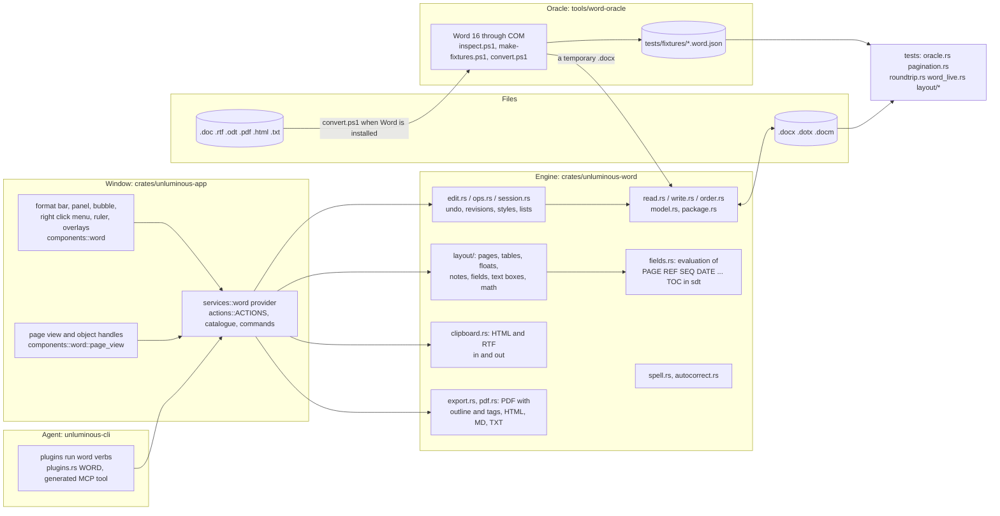
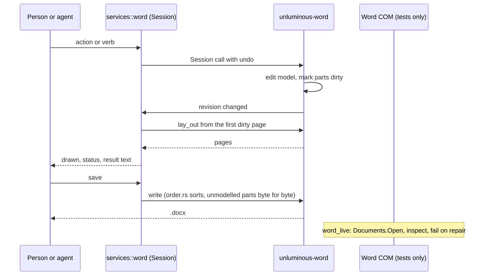

# task-2358: Unluminous Word round 2. The parity gap and how to close it

Design document for the second round of the Word plugin. It records what the plugin does today against
what Word does, ranks the gaps, and specifies the work for one implementation ticket on Opus 5.5. It does
not change any code. Companion documents, all in this folder:

| File | What it is |
|---|---|
| `task-2358-word-implemented-inventory.md` | What the plugin does today, read from the code at `5b719826` (release 1.14.2), with file and line references. 584 lines. |
| `task-2358-word-feature-inventory.md` | Word 365 for Windows, feature by feature, in 24 categories. Every row is tiered `core`, `common` or `niche`. Section 23 lists the WordprocessingML constructs that matter for round trip. 1523 lines. |
| `task-2358-word-gap-matrix.md` | The two crossed: every Word feature with its status in Unluminous (DONE, PARTIAL, PRESERVED, MISSING), the interoperability table with the constructs that are damaged on save, counts, the ranked gap list (Part 4), corrections to the inventory (Part 5) and what the current tests do not catch (Part 6). 1187 lines. |
| `task-2341-word-prd.md`, `task-2341-word-tdd.md` | The round 1 design. Section numbers cited as "PRD 151" refer to lines in those files. |

The inventories were produced by reading code and documentation. Nothing was executed, so every claim marked
"derived from code" in the companions is to be confirmed by the implementation ticket by running it, and the
first thing the implementation does is turn each one into a test.

## 1. Introduction

task-2341 shipped a Word plugin that opens, lays out, edits and saves `.docx` files, with Word itself as the
oracle through COM. It is good at what it covers: every fixture round trips byte for byte, paragraph text and
properties match Word's report for every paragraph of every fixture, page counts match on every fixture, and
lines break where Word breaks them for Calibri, Times New Roman and Arial.

It does not cover enough of Word. Of the 231 features the feature inventory tiers as `core` (every serious
word processor has them), 81 are done, 104 are partial, 7 are preserved in the file but not shown, and 37 are
missing. Two findings damage files: an equation is written back inside a `w:r`, where the schema does not
allow it, and setting a header's text from the panel deletes everything else that header held. The layout
engine ignores keep with next, never splits a table row across pages, never wraps text around a floating
picture, and lets a tall header overlap the body. The test suite would not catch any of this: the oracle
tests compare paragraph text and six paragraph properties, the pagination test accepts one paragraph in five on
the wrong page, and no fixture contains an equation, a text box, a content control, a `.dotx` or a `.docm`.

This document specifies round 2: fix the damage, make the layout match Word on the things real documents
hit, finish the editing operations and controls a person expects, give every one of them an agent verb, and
make the oracle compare everything it already collects.

## 2. Goals and non goals

### Goals, each measurable

| # | Goal | How it is measured |
|---|---|---|
| G1 | No construct in a Word made file is damaged by open, edit elsewhere, save. | `word_live` opens every fixture, including new ones with an equation, a text box, a content control, a header with a table and a picture, `.dotx`, `.docm`, after a one word edit, and Word reports no repair. The release gate runs with `UNLUMINOUS_REQUIRE_WORD=1`. |
| G2 | Pagination matches Word exactly on every fixture. | `pagination.rs` compares the page of every top level paragraph with Word's report and requires equality, with no tolerance, on every fixture including `pictures`, `comments` and the new layout fixtures. The Aptos line break case is in the test and passes. |
| G3 | Every `core` tier row of the gap matrix is DONE, or is listed in section 2 of this document as a non goal with a reason. | The implementation ticket updates `task-2358-word-gap-matrix.md` Part 1 statuses as it goes; the closing comment lists the `core` rows that remain and why. |
| G4 | Every `common` tier row named in section 6 of this document is DONE. | Same. |
| G5 | Everything a person can do in the window, an agent can do through `plugins run word`, and both are tested. | `every_action_runs_on_a_document` covers every new action id; the catalogue test fails for a verb with no documentation; a window test exists for every new control. This is the repository rule in `CLAUDE.md`. |
| G6 | The oracle compares everything Word reports. | `oracle.rs` compares run formatting, list labels, table cells, headers, footers, footnotes, endnotes, comments and revisions from the `.word.json` reports, which already hold them. |
| G7 | Released and installed. | `pwsh tools/release.ps1` from `C:\jason\dev\unluminous`, the About box shows the new version, and the pictures in `_agent_output/task-<N>-word-round2/` are of the installed build. |

### Non goals, with the reason

| Excluded | Reason |
|---|---|
| Mail merge, envelopes, labels | PRD 244 to 248 put it out of scope; it needs a data source model of its own. |
| Co authoring, OneDrive, SharePoint, sharing links, version history, Present Online, Copilot, Dictate, Read Aloud, Translate, Researcher, Smart Lookup, online pictures, stock images, icons, 3D models, ink | Bound to Microsoft services or hardware. The gap matrix marks them OUT-OF-SCOPE. |
| A grammar checker | No offline grammar engine of acceptable quality is available as a Rust crate. Spelling stays; grammar is a later ticket if one is found. |
| Running VBA | `.docm` is opened, edited and saved with `vbaProject.bin` untouched. Macros never run. |
| Native readers for `.doc`, `.odt`, `.rtf`, `.pdf` | Each is a file format project of its own. Round 2 opens them through Word COM when Word is installed (section 5.6) and refuses with a message when it is not. |
| Writing Strict OOXML | Strict files are read; they are written as Transitional, which Word opens. The root namespaces are kept as read so a Strict file saved unchanged still round trips byte for byte. |
| A ribbon | The product decision from the PRD stands: the format bar, the drill down panel, the bubble, the right click menu, `/` and `Ctrl+/`. |
| Authoring SmartArt, charts, WordArt, 3D | Drawn from their cached pictures or as a labelled placeholder; preserved on save; not editable. |
| East Asian typography (character grid, punctuation compression, vertical text), ruby editing | Ruby base text is drawn (D7) and everything is preserved; the typography rules are a later ticket. |
| Table of authorities, index (`XE`, `INDEX`), citations and bibliography | `niche` tier. Fields are preserved and their stored results drawn. Cross references and captions are in scope; these are not. |

## 3. Problem statement

The gap matrix counts, categories 1 to 18, 20 and 22 of the feature inventory (833 rows):

| Tier | Rows | DONE | PARTIAL | PRESERVED | MISSING |
|---|---|---|---|---|---|
| core | 231 | 81 | 104 | 7 | 37 |
| common | 302 | 22 | 69 | 73 | 128 |
| niche | 300 | 3 | 12 | 148 | 109 |

What a person hits, in the order they hit it:

1. **Files can be damaged.** A document with an equation is saved with `m:oMath` inside a new `w:r`
   (`W/read.rs:269-278`, `W/write.rs:324-348`); Word is expected to report unreadable content. Setting a
   header's text from the Page level replaces the header story with one paragraph (`W/ops.rs:695-698`): a
   letterhead loses its logo and table. A `.dotx` or `.docm` saved as `.docx` keeps its original main part
   content type (`W/package.rs:208-215`). Enter under Track Changes writes `w:id="0"` on every paragraph mark
   (`W/edit.rs:255-263`). Deleting across paragraphs drops the bookmark and comment marks inside the middle
   paragraphs (`W/edit.rs:392-405`), which can orphan a range end. None of these has a fixture.
2. **Pages differ from Word's on ordinary documents.** Keep with next is parsed and shown in the panel and
   read nowhere in the page flow (`W/layout/mod.rs:475`, `W/layout/paragraph.rs:199`), so every Word heading
   style's rule is ignored and headings strand at the foot of a page. A table row is one indivisible piece
   (`W/layout/mod.rs:717-737`), so every long table paginates differently and a row taller than a page
   overflows. A floating picture's wrap is stored and never read (`Float.wrap`), so text runs under pictures
   Word wraps around. A header taller than the top margin overlaps the body (`W/layout/mod.rs:538-570`). A
   footnote that does not fit is not continued on the next page. Table widths ignore `w:tcW`, `dxa` `w:tblW`
   and `w:tblLayout`. Columns at a continuous break do not balance. `w:ptab` draws as zero width, so Word's
   three column header designs collapse. `PAGE` in the body keeps its stored value. The default font of a new
   document, Aptos, wraps about three percent differently and its line break case is skipped in the test.
3. **Objects are grey boxes.** Text boxes, shapes, charts, SmartArt and WordArt watermarks draw as a grey
   outlined box; the text inside a text box is never read (no `txbxContent` handling anywhere in `W/`).
   Equations have zero width. EMF, WMF and SVG pictures do not decode.
4. **Editing stops short.** No right click menu (right click opens the spelling card only). A footnote is
   inserted empty and the pointer cannot enter a note story, so a person cannot write a footnote in the
   window. Pictures cannot be selected, moved, resized or cropped. Styles cannot be modified. The clipboard
   is plain text plus an in process fragment: nothing from Word, a browser or a PDF arrives formatted. No
   autocorrect or autoformat as you type (smart quotes, URLs, capitals, ordinals, fractions, dashes). No
   hyperlink follow, edit or remove. No multi cell table selection, no column drag, no split table, no
   convert text to table, no sort. A TOC Word wrote is inside a content control and `find_toc` skips every
   paragraph not at path length 1 (`W/ops.rs:1189-1192`, `1253-1257`), so Update Fields leaves Word's TOC
   alone; a TOC made here is not in Word's `w:sdt docPartGallery` shape. F9 updates only `TOC`, `DATE`,
   `TIME`, `CREATEDATE`, `SAVEDATE`. No cross references, no go to page, no find with wildcards or format.
   Formatting under Track Changes is not recorded as `rPrChange`. No display for review modes, no next or
   previous change or comment. A comment's text cannot be edited.
5. **Controls and chords are missing.** `Ctrl+G`, `Ctrl+T`, `Ctrl+Shift+T`, `Ctrl+Shift+E`, `Ctrl+Shift+O`,
   `Ctrl+D`, `F4`, `Shift+F3` are unbound; `Ctrl+Alt+1` and `Ctrl+Alt+2` run line spacing because the
   `Ctrl+1` and `Ctrl+2` arms match first and ignore Alt (`C/keys.rs:162-169`); the heading chords need an
   extra Shift; `Ctrl+Alt+M` indents instead of commenting. No ruler, no Fit Width or Fit Page, no third
   panel level, no `...` menu, no page thumbnails, no Read Mode or Outline view, no print.
6. **The tests would not catch any of it.** `oracle.rs` compares paragraph text, style, alignment, indents,
   spacing, `keepNext` and `pageBreakBefore` and nothing else, although every `.word.json` already holds
   runs, list strings, tables, headers, footers, notes, comments and revisions. `pagination.rs` passes with
   80 percent of paragraphs on Word's page, returns early without checking anything when Aptos is not
   installed, and leaves out `blank`, `builtin-styles`, `comments`, `pictures` and `revisions`. `word_live`
   passes with a printed line when Word is absent, and the release used `-SkipTests`. There are no layout
   unit tests with `FixedMetrics` (TDD 334 to 337 promised them).

## 4. Architectural overview

Nothing new is added to the architecture. Round 2 fills in the engine, the provider and the drawing that
round 1 laid out, and adds one new plugin wide piece: a Word COM conversion path for the formats the crate
does not read.

Four rules from round 1 continue to hold and every section below is written under them:

- What is not modelled is kept and written back in the schema's order (`order.rs`). A new modelled element
  is read into a typed form only when the engine needs it to lay out or edit; otherwise it stays an `El`.
- Word is the oracle. A behaviour that differs from Word is fixed to Word's measured answer. Every layout
  rule added below gets a fixture made by Word and a comparison against Word's report before the code
  changes, so the change is measured.
- One tree of commands. A new control is an action in `services::word::actions::ACTIONS` (with a `/`
  flag where it belongs), reached by the panel, the right click menu, the bubble, the chord, `Ctrl+/` and
  `plugins run word action <id>`; where it takes arguments it is also a verb in `WORD`.
- A popup over the pages calls `overlays::remember_popup`, or it will not take clicks.

## 5. Detailed design

Each subsection names the gap matrix ranks it closes (Part 4: `D` rows are damage, `C` rows are core tier,
`M` rows are common tier), the files it changes, the design, and the acceptance test. Work packages are
ordered; section 7 gives the order of work.

### 5.1 Round trip damage (D1 to D8)

**Paragraph level objects (D1).** `read.rs` stores `m:oMath`, `m:oMathPara`, `w:subDoc` and any unknown
paragraph level element as a run's `Content::Object`, and `write_runs` wraps every content in `<w:r>`.
Change: add `Content::ParagraphObject(El)` for elements the schema puts directly under `w:p` (the list is
`m:oMath`, `m:oMathPara`, `w:subDoc`, `w:customXml`, `w:smartTag` when not unwrapped, `w:sdt` inline, and
any element whose namespace is not `w`), written back as a direct child of `w:p` in its original position.
`w:object`, `w:pict`, `w:drawing` stay inside `w:r` as they are children of `w:r`. Test: a fixture
`equations.docx` (make-fixtures adds an inline and a display equation through `OMaths.Add`); round trip
byte for byte; `word_live` opens it after an edit with no repair.

**Header text replacement (D2).** `ops.rs:695-698` replaces the header story. Change: `set_header_text`
edits the first paragraph that holds text and keeps the rest of the story; if the story has no text
paragraph it appends one. The Page level's "Header" field becomes "Edit header" (enters header edit
mode, section 5.5) and the text field stays for the agent verb. Test: fixture `letterhead.docx` (a header
with a picture, a table and two paragraphs); `section header "x"` keeps the picture and the table;
`word_live` confirms 1 inline shape and 1 table in the header.

**Content type on Save As (D3).** `Package::set_override` for the main part when the extension changes:
`.docx` → `wordprocessingml.document.main+xml`, `.dotx` → `template.main+xml`, `.docm` →
`document.macroEnabled.main+xml`, `.dotm` → `template.macroEnabledTemplate.main+xml`. Saving `.docm` or
`.dotm` as `.docx` also drops the `vbaProject.bin` part and its relationship, as Word does. Tests: each of
the four saves opens in Word unrepaired.

**Revision ids (D5).** One `RevisionIds` counter per document, seeded from the largest `w:id` in the
package on read, used by every `w:ins`, `w:del`, `w:rPrChange`, `w:pPrChange`, comment range and bookmark
Unluminous writes. Test: a document with twenty tracked Enters has twenty distinct ids and opens in Word.

**Marks on delete (D4).** `edit.rs` delete across paragraphs: before draining a middle paragraph, move its
`Mark`s (bookmark and comment range starts and ends) to the join point; a start whose end was deleted, or
an end whose start was deleted, is removed with its partner. Test: a fixture with a bookmark and a comment
spanning three paragraphs; delete the middle paragraph; `word_live` reports the comment still present and
Word unrepaired.

**Strict namespaces (D6).** Keep the root element's namespace declarations exactly as read (they are;
confirm with a Strict fixture made by Word's "Strict Open XML Document" save) and write Transitional
element names. If Word refuses the result, write the whole document in the namespaces it was read with.
Test: `strict.docx` round trips and opens.

**Zero width constructs (D7).** `w:ptab`: lay out as an absolute tab to the margin, centre or right
alignment per `w:alignment`, with `w:relativeTo` margin or indent. `w:ruby`: draw `w:rubyBase` as the
visible text; `w:rt` above it at `w:hps` size when `w:rubyAlign` places it, otherwise skipped. Test: Word's
"three column" footer design fixture lays out the three texts at left, centre and right.

**Comment parts (D8).** When a comment is deleted, remove its rows from `commentsIds.xml` and
`commentsExtensible.xml`; when one is added, add them with a fresh `durableId`; add the author to
`people.xml` when absent. Test: the `comments` fixture after add and delete has consistent parts and Word
shows the right count.

### 5.2 Layout fidelity (C1 to C10, C29, M8, M9, M11)

All in `crates/unluminous-word/src/layout/`. Each item gets a fixture made by `make-fixtures.ps1` and a
Word report before the engine changes, and the `pagination.rs` comparison for that fixture is exact.

**Keep with next and keep lines (C3).** In the page flow, a paragraph with `keepNext` is placed with the
first line of the next block; if that line does not fit the column, the chain (every consecutive keepNext
paragraph plus the first line, or the whole next paragraph when it has `keepLines`) moves to the next
column. Word gives up and splits when the chain is longer than a column. A table row following a keepNext
paragraph counts as the next block. Fixture: `keeps.docx`, headings at every position relative to the page
foot.

**Table rows across pages (C1).** A row splits between lines of its cells when it does not fit, unless
`w:cantSplit` is set, in which case the whole row moves. The split row's cells continue on the next page
with the repeated header rows above them. A row taller than a page splits as many times as needed. Cell
borders at a split: the bottom border is drawn at the split on the first page and the top border on the
continuation, as Word does. Fixture: `long-table.docx`, 60 rows with one tall cell and one `cantSplit` row.

**Floating objects and wrapping (C2, M5).** `Float.wrap` is read. For each line in a column, the
rectangles of the floats anchored on this page whose wrap is `square`, `tight` or `through` (tight and
through use the bounding box in round 2; the polygon is a later ticket) and whose vertical extent meets
the line reduce the line's width on the side the float occupies; `wp:wrapSquare w:wrapText` left, right,
bothSides and largest decide which side; `wp:effectExtent` and the distances `distL`, `distR`, `distT`,
`distB` pad the rectangle. `topAndBottom` skips every line that meets the float. `none` and `behindDoc`
affect no line; `behindDoc` draws under the text, `none` with `relativeFrom` draws over it, in `relativeHeight`
order. A float anchored in a paragraph that moves to the next page moves with it, and `wp:positionV
relativeFrom=paragraph` is resolved after the paragraph's position is known (two pass within the column).
Fixture: `wrapping.docx` with one picture per wrap kind beside a long paragraph, plus a text box with
square wrap.

**Header and footer fit (C4).** The body's top is `max(top margin, header distance + header height)` and
the bottom is `min(bottom, page height - footer distance - footer height)`, per section and per page kind
(first, even, default). Fixture: `tall-header.docx`, a three line header with a 0.5 inch margin.

**Footnote continuation (C8).** A footnote whose lines do not fit at the foot of the page continues at the
foot of the next page under a continuation separator (`w:continuationSeparator` story), and the body
leaves room for the continuation first, as Word does. Fixture: `long-footnote.docx`.

**Table widths (C6).** Implement Word's width resolution: `w:tblLayout fixed` uses `w:tcW` per cell with the
grid as fallback; autofit (the default) starts from `w:tblGrid`, then `w:tcW` where present, then widens
columns to their content's minimum and preferred widths within `w:tblW` (`dxa`, `pct`, `auto`), then
distributes the remaining width; `w:tblW auto` fits the content; `w:tblInd` and `w:jc` place it. `w:gridAfter`,
`w:wBefore`, `w:wAfter` are read. Fixture: `table-widths.docx`, six tables covering fixed, autofit to
contents, autofit to window, percentage, `dxa`, and `tcW` without a grid.

**Body `PAGE` fields (C10).** Layout runs twice when the body holds a page field: the first pass numbers
pages, the second draws the values; repeat while a value's width changed the line count, at most three
times. `NUMPAGES` and `SECTIONPAGES` likewise.

**Column balancing and separators (C29, M8).** At a continuous section break and at the end of the document,
columns of the ending section are balanced to equal height. `w:cols w:sep` draws the separator rule.

**Hyphenation (M9).** `w:autoHyphenation` in settings turns on hyphenation with `w:hyphenationZone` and
`w:consecutiveHyphenLimit`, using the `hyphenation` crate's en_US patterns (the same language scope as
spelling). Non breaking hyphen and non breaking space never break. Soft hyphen stays an opportunity.

**Paragraph spacing rule, measured.** The code takes the larger of space after and space before and the
inventory says Word sums them. Both are right in their setting: Word collapses by default and sums when
`w:doNotUseHTMLParagraphAutoSpacing` is set in `w:compat`. Read the setting. Fixture: `spacing-compat.docx`
with the option on and off; Word's paragraph positions settle it.

**Compatibility mode.** Read `w:compatSetting compatibilityMode`. Round 2 applies exactly two mode rules
because they are what the fixtures show: the spacing rule above and, for mode 14 and lower, Word 2010's
line height rounding; everything else stays one rule set. Record which rules were measured in `CLAUDE.md`.

**Aptos (C5).** Measure Word's Aptos advances against the file in `FontCache/4/CloudFonts` with
`WT/probe.rs fonts_probe`. If Word uses the cloud font's `hdmx`/`VDMX` or a different variant, load the
same; if the difference is Word's own, record a per family advance scale for Aptos in `WordFonts`, derived
from the measurement, and add the Aptos paragraph to `lines_break_where_word_breaks_them_in_installed_fonts`.
The outcome, either way, is that the Aptos case is in the test and passes.

**Notes (M11).** `w:footnotePr`, `w:endnotePr`: `w:numFmt`, `w:numRestart` (each page, each section),
`w:numStart`, `w:pos` (endnotes at section end or document end). Custom marks (`w:customMarkFollows`) are
drawn and not counted.

**Incremental layout.** Not a Word parity item but a cost of the above: with floats and split rows, a full
relayout per keystroke on a 100 page document will be slow. Lay out from the first dirty block's page
onwards and stop when a page starts with the same block at the same offset as before. Measure on `long.docx`
and a generated 200 page document; a keystroke must lay out in under 16 ms on `long.docx`.

### 5.3 Objects: text boxes, shapes, equations, pictures (C18, C44, M1, M5, M21)

**Text boxes.** Read `wps:wsp` with `wps:txbx/w:txbxContent` (and the VML `v:textbox/w:txbxContent`
fallback when no Choice is readable) into a `Story` held by the `Float` or inline object. Lay the story out in
the box's rectangle minus `wps:bodyPr` insets, with `vert` (horizontal only in round 2; vertical text is
preserved and drawn as a placeholder), `anchor` top, centre, bottom, and `wrap`. Draw the shape's fill and
outline from `wps:spPr` (solid fill, no fill, line colour and width). The text box is editable: a press
inside it puts the caret in its story, and every editing operation works on a story, which `Session` already
has for headers and notes. Linked text boxes (`wps:linkedTxbx`) draw the first box's overflow into the
next. Agent: `read` and `select` take a `--story <kind> <n>` argument (`body`, `header <section> <kind>`,
`footer`, `footnote <n>`, `endnote <n>`, `comment <id>`, `textbox <n>`), which also closes the round 1 gap
that `read` and `text` were body only.

**Shapes.** `a:prstGeom` rect, roundRect, ellipse, line, straightConnector1, rightArrow, leftArrow, upArrow,
downArrow, triangle, diamond, with solid fill, gradient fill reduced to its first stop, outline colour,
width and dash: drawn with the painter's primitives. Any other preset, `a:custGeom`, group shapes and 3D:
drawn as the shape's cached picture if `mc:Fallback` has one, otherwise a labelled placeholder ("Shape",
"Chart", "SmartArt", "WordArt") in the theme's placeholder colour with the extent of the object. Charts and
SmartArt with no fallback picture stay placeholders. Insert: "Text box" and "Shape" (the ten presets) in
the Insert level and the `/` menu; verbs `insert textbox [width height]` and `insert shape <preset> <width>
<height>`.

**Equations.** `m:oMath` is drawn as its linear text (the PRD promise): walk `m:r/m:t`, `m:f` (num/den as
`(a)/(b)`), `m:sSup`, `m:sSub`, `m:rad`, `m:d`, `m:nary`, `m:func`, in Cambria Math at the run's size,
inline or as a display paragraph for `m:oMathPara`. Editing an equation is not in round 2; it is a kept
object with a visible representation. Insert is a later ticket. Test: the `equations` fixture draws the
linear text and the width is non zero.

**Pictures.** A press on a picture selects it: eight handles resize (Shift keeps the ratio by default, as
Word's corner handles do), a drag moves a floating picture (changes `wp:positionH/V` offsets) and an inline
one is cut and pasted at the drop position. Crop: a Crop action shows crop handles and writes `a:srcRect`;
`srcRect` is applied when drawing. A Picture level in the panel (third level, under Insert when a picture
is selected): width, height, lock ratio, wrap kind, position relative to, alt text, reset. Paste a picture
from the clipboard (egui gives image bytes on Windows and macOS) as an inline PNG. Decode EMF and WMF
through the `emf` crate to a raster at the drawn size; SVG through `resvg`, which the Markdown preview
already uses. Verbs: `picture size <w> [h]`, `picture wrap <kind>`, `picture position <relative> <x> <y>`,
`picture crop <l> <t> <r> <b>`, `picture alt <text>`.

### 5.4 Editing operations (C7, C9, C11, C13 to C17, C19 to C21, C23, C30, C31, C33 to C35, C43, M4, M12, M17, M19, M20, M24 to M26)

All operations are `Session` calls in `crates/unluminous-word` with undo, reached by an action, a verb, or both.

**Notes and comments editable (C7, C31).** A press in a footnote, endnote or comment card puts the caret in
that story; typing, formatting, paste and undo work there as in headers. The footnote action inserts the
note and moves the caret into it. Comment cards gain an edit field for the text and a Delete All action;
Next and Previous comment actions and chords (`Ctrl+Alt+N`, `Ctrl+Alt+P` are not Word's; use the Review
level and the `comment next` verb). A comment cannot be added in a header or footer; the action is absent
there (the repository rule: absent, not dimmed).

**Table of contents (C9, M12).** Insert writes Word's shape: a block `w:sdt` with `w:docPartObj
docPartGallery "Table of Contents"`, the `TOC \o "1-3" \h \z \u` complex field around the entries, `TOC
Heading` and `TOC n` styles. Update finds a TOC by its `docPartGallery` or its `TOC` field anywhere in the
body, at any path length, and rebuilds the entries inside the field keeping the field code. A Custom TOC
dialog in the References level: levels 1 to 9, show page numbers, right align, leader, use hyperlinks.
Remove TOC deletes the `w:sdt`. A table of figures (`TOC \c "Figure"`) is inserted and updated the same
way from `SEQ` captions. Test: the `fields` fixture's Word made TOC updates after a heading is added and
Word reports the entry.

**Fields (C35, C36, M15).** `fields.rs` evaluates at update time: `REF` and `PAGEREF` (to bookmarks, with
`\h`, `\p`, `\n`, `\r`, `\w`), `SEQ` (per identifier, `\c`, `\r`, `\s`, `\* ARABIC` and friends), `STYLEREF`,
`NUMWORDS`, `NUMCHARS`, `NUMPAGES`, `PAGE`, `SECTION`, `SECTIONPAGES`, `AUTHOR`, `TITLE`, `SUBJECT`,
`KEYWORDS`, `FILENAME` (with `\p`), `FILESIZE`, `DOCPROPERTY`, `DATE`, `TIME`, `CREATEDATE`, `SAVEDATE`,
`PRINTDATE` with the full `\@` picture (`dddd`, `ddd`, `h`, `hh`, `am/pm`, `AM/PM`, `'literal'`), `HYPERLINK`
(the display text), `=` formulas over bookmarks and table cells (`SUM(ABOVE)`, `SUM(LEFT)`, `AVERAGE`, `COUNT`,
`MAX`, `MIN`, `PRODUCT`, arithmetic, `\#` pictures), `IF`, `COMPARE`. Every general switch: `\* Upper`,
`Lower`, `FirstCap`, `Caps`, `Arabic`, `Roman`, `roman`, `ALPHABETIC`, `alphabetic`, `Ordinal`, `CardText`,
`OrdText`, `Hex`, `DollarText`, `MERGEFORMAT`, `CHARFORMAT`. Unknown fields keep their stored result. Toggle
field codes (`Alt+F9` all, `Shift+F9` one) shows the instruction text in place; Unlink (`Ctrl+Shift+F9`)
replaces a field with its result; Lock and Unlock (`Ctrl+F11`, `Ctrl+Shift+F11`) set `w:fldLock`. Field
shading: a setting (`always`, `when selected`, `never`) with Word's grey. Insert Field in the Insert level
lists the codes above with a text field for switches.

**Cross references and captions (C33, C34).** Cross reference: to a heading (text, page number, number),
a bookmark, a footnote or endnote (`NOTEREF`), a caption (label and number, text, page), written as `REF`,
`PAGEREF` or `NOTEREF` with a hidden `_Ref` bookmark, as Word does. Caption: label (Figure, Table,
Equation, a new label), position above or below, `SEQ` renumbering on insert, delete and update, chapter
numbers (`\s`). Bookmarks: delete, go to, show as grey brackets when formatting marks are on.

**Hyperlinks (C13).** `Ctrl+click` follows an external link (the system opener) or goes to the anchor;
hovering shows the address and the screen tip (`w:tooltip`); Edit Hyperlink in the bubble and the right
click menu (address, display text, screen tip); Remove Hyperlink. AutoFormat turns a typed URL into a link
on the following space (section 5.4 autocorrect).

**Clipboard (C11, M20).** `clipboard.rs`: copy writes plain text, `text/html` (the HTML export of the
selection, with Word's `StartFragment` markers so Word pastes it) and `text/rtf` (a minimal RTF writer:
paragraphs, runs, bold, italic, underline, colour, size, font, lists as plain text). Paste reads HTML first
(the `html5ever` parser, mapping `p`, `h1` to `h6`, `b`, `strong`, `i`, `em`, `u`, `s`, `span` styles, `ul`,
`ol`, `li`, `table`, `img` with data URIs or fetched files, `a`), then RTF (a reader for the same subset),
then an image, then plain text. Paste Options after a paste: Keep Source Formatting, Merge Formatting (the
destination paragraph style, source run properties), Keep Text Only, as a small popup under the caret and
as `paste --as source|merge|text` for the agent. `Ctrl+Shift+V` pastes text only (Word's default for it);
paste formatting moves to the Text level and `Ctrl+Shift+C` / the format painter button. Picture paste
goes to section 5.3. Drag and drop of selected text moves it (Ctrl copies).

**Autocorrect and autoformat as you type (C15, C16, M26).** `autocorrect.rs`, applied on the key that ends
a word (space, punctuation, Enter) and undone as one step with the typed character: straight quotes to
smart quotes (with the apostrophe rule), `--` to en dash and `---` to em dash between words, `1st` to
superscript ordinal, `1/2` `1/4` `3/4` to fraction characters, capitalize the first letter of a sentence and
of a table cell, correct TWo INitial CApitals, days of the week, a replacement list seeded from Word's
defaults (`(c)`, `(r)`, `(tm)`, `teh`, `adn`, and the rest of Word's English list, shipped as a text file)
and read from Office's `MSO1033.acl` when present is a later ticket. Lists: `*`, `-`, `>` and `1.`, `a)`,
`i.` followed by a space start a list, as now; a list item that gets Enter on an empty item ends the list,
as Word does. Border lines: `---`, `===`, `___`, `***`, `~~~`, `###` and Enter make the matching paragraph
border. A `Ctrl+Z` right after any correction undoes only the correction. Every rule is a checkbox in a
Proofing level (third level under Review) and `autocorrect <rule> on|off`.

**Tables (C19 to C22, M2 to M4).** Multi cell selection by drag, by Shift+arrows, and by the row and column
selectors that appear when the pointer is in the left margin or above a column; select cell, row, column,
table actions and `table select <cell|row|column|table>`. Operations apply to the selection: merge,
delete, shade, borders, alignment, text direction. Column borders drag to resize (`w:tcW` and the grid
update; Shift moves the whole table edge); row borders drag for `w:trHeight`. Distribute rows and columns.
Split table at the caret row (`table split-table`). Convert text to table (tabs, commas, paragraphs) and
table to text. Sort rows by a column (text, number, date; ascending or descending; header row excluded).
Table Properties as a third panel level: alignment, indent, preferred width, cell margins, row height rule,
repeat header, allow row to break, cell vertical alignment, text direction. Table styles: apply any table
style in the document, Table Grid plus Word's plain, grid and list built in styles shipped in
`builtin.rs`, with the six Table Style Options checkboxes (`w:tblLook`); layout applies `w:tblStylePr`
conditional formatting (first row, last row, first column, last column, banded rows and columns, the four
corners) and the table style `basedOn` chain. Formulas: `=SUM(ABOVE)` and friends through the `=` field
above; Update Field recalculates. View Gridlines draws dotted guides for borderless tables.

**Styles (C23 to C25, M24).** Modify Style: a third level under Styles with every property the Text and
Paragraph levels expose plus based on, style for the following paragraph, add to template; writes
`styles.xml` through `XmlPart` marked dirty. Update to match selection; delete a custom style (paragraphs
fall back to its base); revert a built in style to Word's default from `builtin.rs`; `w:link` followed so a
linked style applies as a character style to a selection inside a paragraph. The Styles level shows each
style in its own font and size. Theme fonts (Heading and Body) and theme colours with their shades appear
in the font and colour pickers and write `w:asciiTheme` and `w:themeColor`. Style sets and theme switching
stay out.

**Lists (C16, C17, M25).** All of Word's number formats drawn: `decimal`, `upperRoman`, `lowerRoman`,
`upperLetter`, `lowerLetter`, `ordinal`, `cardinalText`, `ordinalText`, `decimalZero`, `decimalEnclosedCircle`,
`bullet`, `none`; the East Asian and other formats fall back to decimal with the fallback recorded. Picture
bullets (`w:lvlPicBulletId`) drawn. Continue numbering joins the paragraph's list to the previous list of
the same kind; Set Numbering Value writes a `w:lvlOverride/w:startOverride`. Define new bullet (symbol from
the Symbol picker, or a picture), define new number format (format, text before and after, font), define
new multilevel list (levels 1 to 9, format, text, start, link to style, indent and tab per level), adjust
list indents. `List Bullet` and `List Number` styles in `builtin.rs`.

**Find and replace (C43, M19).** Options: match case, whole word, wildcards (Word's wildcard language: `?`,
`*`, `[a-z]`, `[!x]`, `{n,m}`, `@`, `<`, `>`, `\(\)` groups and `\1` in the replacement), sounds like and
forms are out, special characters (`^p`, `^t`, `^l`, `^m`, `^n`, `^s`, `^-`, `^~`, `^#`, `^$`, `^?`, `^g`,
`^&`), find and replace formatting (bold, italic, underline, colour, highlight, style, paragraph alignment),
direction, search in headers and notes. A results list in the Navigation pane (`Ctrl+F` opens it with
the match count, each match goes to its page). Go To (`Ctrl+G`): page, section, line, bookmark, footnote,
comment, heading, table, picture. `F4` repeats the last formatting or insertion action. Select text with
similar formatting; `Ctrl+click` selects a sentence; the left margin selects a line or, with a double
press, a paragraph; `Alt` drag selects a block (rectangle of text); `Ctrl` adds a second range.

**Review (C30 to C32, M17).** Display for Review: Simple Markup (changed lines marked in the margin,
revisions shown as final), All Markup (as now), No Markup (final), Original; a setting per document and the
`track view <mode>` verb. Show Markup checkboxes: insertions and deletions, formatting, comments, by
author. Formatting changes under tracking write `w:rPrChange` and `w:pPrChange` with the previous
properties. Next and Previous change (`track next`, `track previous`), accept or reject the change under
the caret, Lock Tracking with a password (`w:documentProtection w:edit=trackedChanges` plus the hash Word
writes). Word count includes notes, text boxes, headers and footers with the same checkbox Word has.
Thesaurus from the `wordnet` crate's offline data (synonyms only) in the right click menu; Language level
sets `w:lang` on the selection (affects spelling skip rules; only en_US is checked). Accessibility checker:
alt text missing, headings skipping a level, a table without a header row, low contrast colours against the
page; listed in the Review level with a go to for each. Document Inspector: comments, revisions, hidden
text, personal information in `docProps/core.xml`, with Remove for each.

### 5.5 Window: controls, chords and views (C12, C24 to C28, C36 to C43, C46, M10, M14, M16, M22, M23, M29, M30)

**Right click menu.** Over text: Cut, Copy, Paste, Paste Options, then Font..., Paragraph..., Bullets,
Numbering, Styles, Hyperlink (or Edit / Open / Remove Hyperlink on a link), New Comment, Synonyms (the
thesaurus list), Look Up (out), and the spelling suggestions when the word is misspelled. Over a table cell:
Insert (row above, below, column left, right), Delete (cells, rows, columns, table), Merge, Split, Distribute,
Borders and Shading, Table Properties. Over a picture or shape: Wrap Text (every kind), Size and Position,
Crop, Edit Alt Text, Bring Forward, Send Backward. Over a header or footer: Edit Header, Remove Header, Page
Number. Over a field: Update Field, Toggle Field Codes, Edit Field. Over a footnote reference: Go To Footnote,
Convert to Endnote. Built from `ACTIONS` entries with a `context` list, so an agent runs the same ids;
`Shift+F10` and the context menu key open it; a press inside it is a popup (`remember_popup`).

**Chords.** Fix `C/keys.rs` matching so Alt is part of the match: `Ctrl+Alt+1/2/3` Heading 1 to 3,
`Ctrl+1/2/5` spacing. Add `Ctrl+Shift+N` Normal (exists), `Ctrl+Shift+L` List Bullet, `Ctrl+Alt+M` New Comment,
`Ctrl+Shift+E` Track Changes, `Ctrl+Shift+O` Navigation pane (replaces the Outline chord meaning in Word, as
the PRD chose), `Ctrl+G` Go To, `Ctrl+T` hanging indent, `Ctrl+Shift+T` reduce hanging indent, `Ctrl+D` Font
level, `Ctrl+Shift+D` double underline, `Ctrl+Shift+W` underline words, `Ctrl+Shift+K` small caps,
`Ctrl+Shift+A` all caps, `Ctrl+Shift+H` hidden, `Ctrl+Shift+Q` Symbol font, `Shift+F3` cycle case,
`Ctrl+Shift+F` font picker, `Ctrl+Shift+P` size picker, `Ctrl+]` and `Ctrl+[` by 1 point (they currently
step the size list), `Ctrl+0` space before 12 pt toggle, `Ctrl+Q` reset paragraph, `Ctrl+Shift+*` marks
(exists as Shift+8), `Ctrl+Shift+F5` bookmark, `Ctrl+Alt+F` footnote, `Ctrl+Alt+D` endnote, `Alt+F9`,
`Shift+F9`, `F9`, `Ctrl+Shift+F9`, `F11` and `Shift+F11` next and previous field, `Ctrl+F11`, `Ctrl+Shift+F11`,
`F4` repeat, `Ctrl+Y` redo and repeat, `Ctrl+Shift+Enter` column break (exists as Shift+Enter with Ctrl),
`Ctrl+Alt+Period` ellipsis, `Alt+Ctrl+C/R/T` ©, ®, ™, `Alt+X` Unicode toggle, `Ctrl+Shift+>` and `<`
(exist), `Ctrl+Shift+Alt+S` Styles level, `Ctrl+Alt+Shift+S` Styles pane, `Ctrl+Alt+Z` go back, `Shift+F5`
last edit, `Ctrl+Alt+PageUp/PageDown` top and bottom of window, `Ctrl+Shift+F8` block selection, `F8`
extend selection, `Ctrl+Alt+V` Paste Special, `Alt+Shift+Left/Right` promote and demote heading,
`Alt+Shift+Up/Down` move paragraph, `Ctrl+Shift+Alt+Space` nonbreaking space (Word: `Ctrl+Shift+Space`),
`Ctrl+Shift+Hyphen` nonbreaking hyphen, `Ctrl+Hyphen` optional hyphen, `Ctrl+Alt+Enter` style separator
(out), `F6` cycles between the panel, the pages and the navigation pane, `Ctrl+P` print. Every chord is a
menu entry so the keymap moves it (`CLAUDE.md`, `task-2286`), and `read_the_menu_shortcuts` claims it. The
full list is section 21 of `task-2358-word-gap-matrix.md`; the ones above are its core and common rows.

**Ruler.** A horizontal ruler above the pages (toggle in the Document level and `view ruler on|off`) in the
section's units showing margins, indents (first line, hanging, left, right, draggable) and tab stops (press
to add, drag to move, drag off to remove, the tab selector cycles kinds including bar), and the column and
table cell boundaries when the caret is in one. A vertical ruler in header and footer edit mode shows the
header distance. Drawn with the painter in the window's theme.

**Panel.** A third level is allowed: `Page -> Margins -> Custom`, `Insert -> Picture -> (selected picture)`,
`Styles -> (style) -> Modify`, `Insert -> Table -> Properties`, `Review -> Proofing`. The breadcrumb shows
all three. New leaves: Page: Mirrored and custom margins, custom size (width and height), gutter, vertical
alignment, line numbers (restart each page, section, continuous, count by, from text), hyphenation, page
border (box, colour, width, art is out), page colour from the full colour picker, Different first page,
Different odd and even, Link to previous, Page number format and start at, header and footer distance.
Text: theme fonts and colours, 15 highlights, character scale and position, kerning on and off,
ligatures, text effects outline and shadow (drawn), Symbol picker (every character of the current font by
block, recent, and special characters: nonbreaking space and hyphen, optional hyphen, em and en space,
section and paragraph signs). Paragraph: outline level, don't add space between same style, tab leaders
and bar tabs, borders on each side with style, width and colour, shading from the picker, sort. Lists:
section 5.4. Insert: Text box, Shape, Equation (preserved objects only: out), Cover page from the five
built in pages in `builtin.rs`, Blank page, Date and time formats, Document property field, Signature
line (out), Object (out), Text from file (`.docx`, `.txt`, `.md`). References: the TOC dialog, table of
figures, cross reference, caption dialog, footnote and endnote options, next footnote. Review: display for
review, show markup, next and previous, lock tracking, thesaurus, language, accessibility, inspector.
Document: Read Mode, Outline view, ruler, gridlines, page thumbnails, zoom presets, print.

**Views and zoom (C42, M30).** Fit Width and Fit Page, One Page, Multiple Pages, Page Width, Zoom
dialog with a percent field; a zoom slider in the status area; page thumbnails in the Navigation pane
(the page view at 10 percent, cached as a texture per page) with Headings, Pages and Results tabs. Read
Mode: no pages, text reflowed to the pane width in the reading font, no editing, `Esc` leaves it. Outline
view: headings only to a chosen level with promote, demote, move up and down, expand and collapse, and
body text shown as first lines; writes the real styles. Dark page: a setting `paper = theme` as the
spreadsheet has, which draws the page in the theme's ground and inverts dark text colours; `paper = light`
stays the default. Gridlines: the drawing grid (`w:docGrid`) when turned on. New Window: a second tab on
the same document, which the plugin tab contract already allows when keyed `word:<path>#2`.

**Status area (C46).** Page n of m, words (of the selection when there is one), the language, Track
Changes state, the zoom slider, and the view buttons; a press on each opens its level.

**Print (C12, M28).** Print produces the PDF export and hands it to the operating system: on Windows
through the `PrintDocument` route of the Windows PDF printer API (`windows` crate,
`Windows.Graphics.Printing` is not available to a desktop app without packaging, so use the Print verb on
the PDF through `ShellExecuteW` with the default PDF handler, which opens the system print dialog), on
macOS through `NSPrintOperation` on the PDF. The Print level offers page range, copies, odd or even, scale
to paper, pages per sheet and duplex where the route carries them; where the route does not carry an
option it is applied to the PDF before handoff (range, odd or even, pages per sheet by imposition). Print
Preview is the PDF export opened in a tab, which Unluminous already shows.

### 5.6 Files (C37, C38, M6, M7, M28, M29)

**Open.** `.txt` and `.md` open in the Word plugin when chosen from the Word menu ("Open as document") or
through `plugins run word open --as-document <path>`; `.txt` becomes paragraphs in Normal, `.md` is
converted with the existing Markdown reader to headings, lists, tables, code (`HTML Code` style), links and
pictures. `.html` and `.htm` open through the HTML paste reader of section 5.4. `.doc`, `.rtf`, `.odt`, `.wps`
and `.pdf` open through `tools/word-oracle/convert.ps1`, a new script that has Word open the file and save
a `.docx` beside a temporary name (`Documents.Open` read only, `SaveAs2 wdFormatXMLDocument`, PDF Reflow for
`.pdf`), when Word is installed; the tab then holds the converted document under the original path and
Save asks for a `.docx` name. Without Word the tab says what is needed, as the switched off plugin does
now. `Protected View` is not reproduced: a converted document is editable.

**Save.** `.docx`, `.dotx`, `.docm`, `.dotm` with the content types of section 5.1. Save As `.rtf` and
`.odt` through Word when installed, and `.txt`, `.html`, `.md`, `.pdf` natively. Export to PDF gains an
outline from the headings, document information from `docProps/core.xml`, tagged structure (paragraph,
heading level, list, table, figure with alt text) through the `pdf-writer` crate's structure tree, and an
option to write PDF/A-2b. AutoSave: a setting (off by default) that saves a document a few seconds after
the last change, as the text editor does for files; AutoRecover writes a `.asd` copy beside the plugin's
settings every ten minutes and offers it at the next open after a crash.

**New from template.** New Word Document uses `Normal.dotm` from the Office template folder when present
(the person's own default style set), otherwise the shipped blank; its page size follows the locale (Letter
for en-US and en-CA, A4 otherwise) and its font is Word's current default (Aptos 11 in Word 16, Calibri 11
in older templates), read from the template. New from a `.dotx` or `.dotm` chosen in a file dialog, from
the explorer's right click menu on a template, and `new --template <path>`; the new document has no
template relationship unless the template is in the Office folder, as Word does.

**Properties and protection (M29).** Properties: Summary (title, subject, author, manager, company,
category, keywords, comments), Statistics (created, modified, printed, last saved by, revision, editing
time, pages, words, characters, lines, paragraphs), Custom (`docProps/custom.xml` name, type, value).
Encrypt with password and Password to modify through the ECMA-376 Agile encryption in the `office-crypto`
crate for open and save; a protected file prompts for the password in a modal. Restrict editing:
`w:documentProtection` for read only, comments, tracked changes, forms, with the hash Word writes, and
the plugin refuses the edits the document forbids.

### 5.7 The agent's half

Every new action id is in `ACTIONS`; every operation with arguments is a verb in `WORD`. New verbs, each
with one line of documentation in `plugins.rs` and a paragraph in a new `unluminous-cli/docs/word.md`
(the documentation test fails without it): `read --story`, `select --story`, `picture ...`, `table select`,
`table split-table`, `table convert`, `table sort`, `table properties`, `table style`, `table borders`,
`table distribute`, `table width <column> <pt>`, `style modify <name> <property> <value>`, `style delete`,
`style update`, `list format`, `list define`, `list continue`, `list value`, `fields update|codes|unlink|lock`,
`insert cross-reference`, `insert caption`, `insert textbox`, `insert shape`, `insert cover-page`, `insert
text-from-file`, `link edit|remove|open`, `paste --as`, `autocorrect <rule> on|off`, `track view <mode>`,
`track next|previous`, `track lock <password>`, `comment edit <id> <text>`, `comment next|previous`, `comment
delete all`, `find --wildcards --format`, `goto <page|section|line|bookmark|note|comment|heading|table|picture> <n>`,
`view ruler|thumbnails|read|outline|fit-width|fit-page|paper`, `print [range] [copies]`, `open --as-document`,
`new --template`, `properties custom`, `protect ...`, `export pdf --tagged --outline --pdfa`, `thesaurus <word>`,
`language <tag>`, `accessibility`, `inspect`, `outline promote|demote|move-up|move-down`.

The MCP grouped schema is measured after the verbs are added and the ceiling in the CLI test is raised
with a recorded reason, as task-2341 did (42,000 today).

## 6. Scope of the implementation ticket

One ticket on `opus[1m]`, `agentProjectId: unluminous`. Its scope is sections 5.1 to 5.7 and section 8 in
the order of section 7. The `core` tier rows of the gap matrix are all in scope except those section 2 lists
as non goals. The `common` tier rows in scope are the ones named by rank in the headings of section 5 (M1 to
M12, M14 to M17, M19 to M26, M28 to M30); the rest of the `common` and all of the `niche` tier stay as
they are, preserved in the file, and are listed in the ticket's closing comment for a round 3.

The ticket is deliberately large. It is one ticket because every part shares the fixtures, the oracle
comparison and the release, and because splitting it across tickets in one repository would put two agents
in `layout/` and `ops.rs` at the same time.

## 7. Order of work

Measurement before change, damage before polish:

1. **Instruments first (section 8).** Extend `oracle.rs` to compare every field the reports hold; make
   `pagination.rs` exact and include every fixture; put `UNLUMINOUS_REQUIRE_WORD=1` in the release gate.
   Record which of these fail today in a task comment; that is the baseline.
2. **Fixtures for everything in sections 5.1 and 5.2**, made by `make-fixtures.ps1`, with Word's reports
   committed, before the engine changes.
3. **Section 5.1** damage, each with its `word_live` assertion.
4. **Section 5.2** layout, one rule at a time, each turning its fixture's pagination test green.
5. **Section 5.3** objects, then **5.4** editing, then **5.5** window, then **5.6** files, with the agent
   verbs of 5.7 added with each operation, not after.
6. `cargo fmt --all`, clippy with `-D warnings`, the whole window suite, the test gate, `pwsh
   tools/release.ps1 -Part minor` from the main checkout after the merge, pictures of the installed build.

Progress comments every twenty minutes; the gap matrix statuses updated in the companion file as rows close.

## 8. Testing strategy

Integration tests against Word first, unit tests where a rule needs isolating.

| Test | File | What it checks | New or changed |
|---|---|---|---|
| Oracle, every field | `WT/oracle.rs` | For every fixture and every paragraph: text, style, alignment, indents, spacing, keepNext, pageBreakBefore (today), plus run formatting (font, size, bold, italic, underline kind, colour, highlight, caps, strike, sub and superscript, spacing, scale), list string and level, table cell coordinates and merges, header and footer text per kind, footnote and endnote text and numbers, comment text, author, parent and done, revision kind, author and text. All of it is already in `.word.json`. | changed |
| Pagination, exact | `WT/pagination.rs` | Page count equal and every top level paragraph on Word's page, on every fixture including `pictures`, `comments`, `revisions` and the new layout fixtures. No percentage. The Aptos case is in the line break test. Fails, not skips, when Aptos is absent in the release gate. | changed |
| Round trip | `WT/roundtrip.rs` | Every fixture saved unchanged is byte for byte, including the new ones (equation, text box, content control, letterhead, `.dotx`, `.docm`, strict, wrapping, long table, keeps, widths, tall header, long footnote, spacing compat, ptab footer, notes options, hyphenation). | changed |
| Word live | `WT/word_live.rs` | Every fixture after an edit opens unrepaired, with counts; the every feature document gains an equation, a text box, a table style, a cross reference, a caption, a custom TOC, a split table, a wrapped picture, a modified style, a tracked formatting change, a locked tracking password, a custom property, and asserts each through `inspect.ps1`. Save As `.dotx`, `.docm`, `.dotm` and back open unrepaired. `UNLUMINOUS_REQUIRE_WORD=1` in the gate. | changed |
| Conversion | `WT/convert.rs` | `.doc`, `.rtf`, `.odt`, `.html` and `.pdf` fixtures made by Word open through `convert.ps1` with Word's paragraph count; refused with the message when Word is absent. | new |
| Layout rules | `W/layout/tests/*.rs` with `FixedMetrics` | keepNext chains, row splitting with and without `cantSplit`, each wrap kind's line widths, header push down, footnote continuation, each width resolution case, body PAGE two pass, column balancing, hyphenation zone, the two spacing rules, ptab positions, text box inset and anchor. One file per rule, each case named for the fixture it mirrors. | new |
| Fields | `W/fields.rs` tests | Every field code and switch above against Word's result for the same code (collected by `inspect.ps1` as `Fields(n).Result`). | new |
| Clipboard | `W/clipboard.rs` tests | HTML written is what Word pastes (checked once by hand and recorded); HTML and RTF read from fixtures saved by Word, a browser and Google Docs produce the expected paragraphs and runs. | new |
| Autocorrect | `W/autocorrect.rs` tests | Each rule, and that one undo removes only the correction. | new |
| Provider | `S/tests.rs` | Every new verb runs on a document; `every_action_runs_on_a_document` covers every new id; the refusal names the verbs; `read --story` lists a header, a footnote and a text box. | changed |
| Window | `crates/unluminous-app/tests/word.rs` | One test per new control: the right click menu over text, a table and a picture; the ruler drags an indent and adds a tab; a picture is resized by its handle and wrapped; a footnote is typed into; a table column is dragged; the Modify Style level changes a heading's font; Paste Options; Go To; Fit Width; Read Mode; Outline view promotes a heading; the thumbnails pane; the Print level produces a PDF; `Ctrl+Alt+1` makes Heading 1 and not single spacing. Pictures recorded for each. | changed |
| Documentation | `unluminous-cli` documentation test | Fails while a new verb has no paragraph in `docs/word.md`. | changed |
| Performance | `S/tests.rs` | A keystroke on `long.docx` lays out in under 16 ms; a 200 page generated document opens in under 2 s. | new |

Measured against Word, never against documentation: when a rule's fixture disagrees with the inventory,
Word's report wins and the inventory row is corrected.

## 9. Data flows and risks

| Risk | Mitigation |
|---|---|
| A layout rule added for one fixture moves paragraphs on another. | Exact pagination on every fixture runs on every change; a rule lands only when every fixture stays on Word's pages. |
| The `pictures` fixture's square wrap is wrong today, and making pagination exact makes the suite red. | Step 1 of section 7 records the baseline red list in a comment; those tests are the work list, not failures to hide. |
| Word COM is flaky on a busy machine (task-2341 saw a hung test binary on the shared window lock). | COM tests run in their own binary, with a timeout per `Documents.Open`, and Word is quit in a `finally`; the oracle reports are committed so only `word_live` and `convert` need Word. |
| HTML paste from arbitrary pages brings scripts, remote images and huge markup. | The reader keeps only the element subset listed; no script, style sheets or remote fetch; remote `img` becomes a placeholder with the URL as alt text; size capped at 10 MB. |
| Encrypted documents hold the password in memory. | The password is held for the tab's life only, never written to settings or logs; the sealed store is not used because Word does not remember passwords either. |
| The conversion script runs Word on an untrusted file. | Word opens it read only with macros disabled (`AutomationSecurity = msoAutomationSecurityForceDisable`) in a private instance, as `inspect.ps1` already does. |
| A `.docm` edited and saved keeps a macro project the person did not write. | The status area shows "Macros kept, never run" on a `.docm`, and Save As `.docx` removes the project. |
| The MCP schema grows past the ceiling. | Measured and the ceiling raised with a reason, as task-2341 did; the grouped shape keeps each verb's arguments in one tool. |
| Font measurement for Aptos cannot be made to match. | The test still includes Aptos and the deviation is recorded as a number in `CLAUDE.md`; page counts stay exact because they already are. |

## 10. Alternatives considered

| Alternative | Why not |
|---|---|
| Split round 2 into several tickets by area (layout, editing, UI, files). | Every area edits `layout/`, `ops.rs`, `actions.rs` and the fixtures; two agents in one repository on those files collide, and the release at the end is one event. One ticket, in the order of section 7, with progress comments. |
| Round 2 as fixes to the top ten gaps only. | The ticket asked for full parity. The core tier is 231 rows; stopping at ten leaves 131 partial or missing and the test suite still blind. The instruments and the damage fixes alone are worth a release, which is why they are first. |
| Write native `.doc`, `.rtf`, `.odt` readers. | Months each; Word is installed on this machine and converts them in a second. Native readers are a later ticket if a machine without Word needs them. |
| Embed a browser engine for HTML paste. | The window already has native browser tabs, but their rules (`CLAUDE.md`, three rules that keep them from hanging the window) make them wrong for a clipboard read; a small HTML subset reader is enough for what Word, browsers and Google Docs put on the clipboard. |
| Equation editing in round 2. | OMML layout (fractions, radicals, n-ary with limits, matrices) is a renderer of its own. Round 2 stops the damage and shows linear text; a round 3 ticket renders and edits OMML. |
| Grammar through an LLM call. | The plugin must work offline and never send a document anywhere without being asked. Left out. |
| Keep the 80 percent pagination allowance and add rules. | An allowance hides exactly the regressions the rules are meant to fix. Exact, with the current failures listed as work. |
| A ribbon. | Decided against in the PRD and confirmed by Jason's acceptance of the format bar and panel. The third panel level and the right click menu give access to every dialog Word has without one. |

## 11. What this document does not decide

- Whether Word's Aptos difference is a font file difference or a layout difference. `fonts_probe` decides
  it in step 4 of section 7.
- Whether the thesaurus and hyphenation crates' data are acceptable to ship (size and licence). The
  implementation ticket checks `wordnet` (WordNet licence) and `hyphenation` (LGPL patterns, data only) and
  records the decision in `CLAUDE.md`.
- The exact list of compatibility mode rules beyond the two named in section 5.2. Each is added only when a
  fixture shows it.
