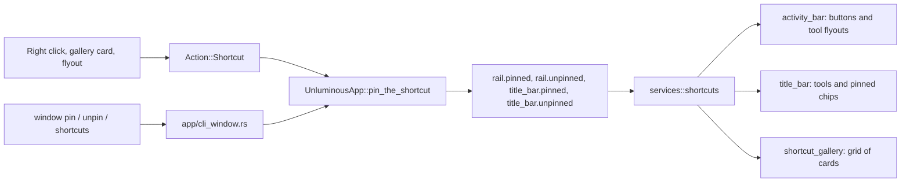

# task-2404: Pinned shortcuts on the side bar and the top bar

## What the ticket asks for

1. Release the current nightly as stable. Done first: `pwsh tools/promote.ps1` promoted 1.21.3, and
   stable.json, latest.json, the unluminous.com page, blackrainbowlabs.com and GitHub's latest release on
   both repositories answer 1.21.3.
2. Every shortcut on the left side bar (the rail) and on the top bar (the title bar) can be unpinned with a
   right click, and pinned again.
3. A right click on the empty part of the rail or of the top bar opens a popup holding a grid of cards, one
   card a shortcut, each with its icon and its name.
4. The tools that live in the top bar today, Text options (the font and formatting panel), the view modes
   and the run configurations, can be pinned to the rail. On the rail each one is an icon, and hovering over
   it opens a flyout to the right holding that tool's controls. The run configurations flyout holds the
   configuration dropdown, Run and Debug.
5. The look is the window's own design (`design/style-guide.md`, the Editing code design).

## How the parts fit

## Alternatives considered

| Option | Why not |
|---|---|
| One list per bar of every pinned name | A plugin installed later would be missing from a bar until somebody pinned it |
| The rail flyout as an `egui::Popup` | egui keeps one popup open, so the run configuration dropdown inside it would close it |
| Hide a rail tool that cannot apply | The buttons under it would move every time the tab changed |
| Pinned top bar chips in front of the text tools | They would slide along the bar whenever the text tools came and went |

## Words used here

| Word | Meaning |
|---|---|
| rail | the 44 point column of round buttons down the left of the window, `components::activity_bar` |
| top bar | the 46 point title bar, `components::title_bar` |
| shortcut | one thing that can sit on the rail or the top bar: a pane button, a tab button, or a tool |
| home | the bar a shortcut is on when nothing has been changed |
| tool | one of the three top bar controls: Text options, View modes, Run configurations |
| gallery | the popup of cards a right click on an empty part of a bar opens |

## The shortcuts there are

`UnluminousApp::shortcuts()` builds the list every frame from what the window knows, so a plugin that is
switched on adds its buttons and one that is switched off takes them away. The order is the gallery's order.

| Name | Kind | Home | Mark |
|---|---|---|---|
| `Project` | pane | rail | `rux::Icon::Project` |
| `Editing Area` | pane | rail | `rux::Icon::Document` |
| `Version Control` | pane | rail | `rux::Icon::Git` |
| `Realm` (only while the Realm plugin is on) | pane | rail | `rux::Icon::Realm` |
| each contributed pane, `<label> pane` | pane | rail | the manifest's `pane.icon` |
| each contributed tab, its `tab.label` | tab | rail | the manifest's `tab.icon` |
| `Debug tile` | pane | rail | `debug-continue` |
| `Run tile` | pane | rail | `rux::Icon::RunTile` |
| `Terminal tile` | pane | rail | `rux::Icon::Terminal` |
| `Text Options` | tool | top bar | `rux::Icon::Letters` |
| `View Modes` | tool | top bar | `rux::Icon::Halves` |
| `Run Configurations` | tool | top bar | `rux::Icon::Start` |

A shortcut's name is the name the rail already gives its button, so `rail.order` keeps working unchanged and
every existing test that finds `Project` or `Terminal tile` still finds it.

## Where the choice is kept

Four settings, each a comma separated list of names. Each one records a difference from the default, so a
plugin installed later gets its button on the rail with nothing written, and a person who changed nothing has
nothing written.

| Setting | Holds |
|---|---|
| `rail.pinned` | shortcuts whose home is the top bar that were pinned to the rail |
| `rail.unpinned` | shortcuts whose home is the rail that were taken off it |
| `title_bar.pinned` | shortcuts whose home is the rail that were pinned to the top bar |
| `title_bar.unpinned` | shortcuts whose home is the top bar that were taken off it |

A shortcut is on a bar when it is home there and not in that bar's `unpinned`, or when it is in that bar's
`pinned`. Pinning takes the name out of `unpinned` and, when the bar is not its home, puts it in `pinned`.
Unpinning does the opposite. The two bars are independent, so a tool can be on both at once.

`services::shortcuts` holds this arithmetic and nothing else. It has no egui in it and is tested with no window:
`is_pinned`, `pin`, `unpin`, `names` and `reset`.

## The rail

`activity_bar::show_with` is given the pins. A button that is unpinned is left out of the rail before the
order is applied, so the buttons below it close up. A tool pinned to the rail is an `Entry` like any other: it
takes part in `rail.order`, it can be carried to another place, and by default it joins the top group after the
panes.

A tool's button never moves when the tab changes. Text options and View modes cannot apply to a `.rs` file, and
on the top bar they are absent then, which is the window's rule for a control that cannot apply. On the rail the
button is dimmed instead and stays where it is, for the reason `Version Control` is dimmed outside a repository:
a rail whose buttons closed up every time the tab changed would move the button a person is reaching for.

### The flyout

A tool's button opens its flyout when the pointer rests on it, and a click opens it too and keeps it open
until the pointer leaves and comes back or Escape is pressed. The flyout is an `egui::Area`, not an
`egui::Popup`, because egui keeps one popup open at a time and the run configurations flyout holds a dropdown.
An `Area` holding a popup is allowed.

- It is drawn with `controls::menu_frame` (the raised card, 18 point corners), 10 points to the right of the
  rail, its top level with the button's top, and kept on the screen.
- A heading at the top in the quiet ink: `Text Options`, `View Modes`, `Run Configurations`.
- It closes once the pointer has been outside the button, the flyout and the corridor between them for
  a quarter of a second, and never while a popup it opened is open. The quarter second is what lets a pointer
  travel diagonally from the button to the flyout's lower rows.
- `Text Options` holds the panel the top bar's `F` chip opens, the same function, so `Bold` is the same
  control in both places.
- `View Modes` holds the carved track of three modes the top bar draws, the same function.
- `Run Configurations` holds the run widget, the same function: the configuration dropdown, Run, Debug, and
  Stop while it runs.
- When the tool cannot apply to the tab that is showing, the flyout holds one line that says so, such as
  `Text options apply to Markdown and text files.`

## The top bar

The top bar gains a group of pinned shortcuts at its right hand end, after the run widget and before the window
buttons, so neither the run widget nor the text tools move when the group is empty (the default). A pane pinned
there is a 32 point round chip, the text options chip's shape, carved in while its pane is showing, its mark in
the strong ink then and the quiet ink otherwise, sky under the pointer. The chip is named `<name> in the top bar`,
because the rail button of the same shortcut may be drawn at the same time and no two controls share a name.

`Text Options`, `View Modes` and `Run Configurations` unpinned from the top bar are not drawn there and leave no
gap: `title_bar::tools_rect` and `run_rect` are given a width of nothing for them.

## Right click on a shortcut

Every shortcut on either bar opens a menu built by `actions::shortcut_menu`:

- On a rail button that is a panel (Project, the tiles, the Realm, a contributed pane): the panel's own menu
  as it is today, then a separator, then the shortcut rows.
- Everywhere else: the shortcut rows alone.

The shortcut rows are:

- `Unpin from Side Bar` or `Unpin from Top Bar`, for the bar it was opened on;
- `Move to Top Bar` or `Move to Side Bar`, which pins it to the other bar and takes it off this one;
- a separator, then `Customize Shortcuts...`, which opens the gallery for the bar it was opened on.

## Carrying a shortcut from one bar to the other

A rail button carried off the rail follows the pointer as a raised disc with its mark. Over the top bar, the room
at its right hand end, from the text tools to the window buttons, is lit; let go there and the shortcut moves to the
top bar. The top bar's items carry the other way: the text options chip, the view modes track, the run widget and
each pinned chip have a drag handle laid under them, so a press that does not move still presses the control. Over
the rail the rail is lit and the accent line says where it lands; let go and it moves there, at that place in
`rail.order`. Either way it is `window move` underneath.

## Right click on an empty part of a bar

On the rail, anywhere no button is. On the top bar, the room that moves the window. Either opens the gallery for
that bar at the pointer.

### The gallery

`components::shortcut_gallery`, an `egui::Area` framed by `controls::menu_frame`, closed by a click outside it or
by Escape.

- A heading, `Side Bar Shortcuts` or `Top Bar Shortcuts`, and a line under it in the quiet ink:
  `Click a card to pin or unpin it.`
- Two sections, `Panels` and `Tools`, each a grid of cards three across.
- A card is a toggle on one line, 46 points tall with a 14 point radius, raised with a shadow whether it is on or
  off: its mark in a carved well at the left, its name, and the Settings window's switch at the right. Every card is
  as wide as the longest name needs, so no name is cut short in the usual window.
- Clicking anywhere on a card flips it at once; the gallery stays open so several can be changed.
- A footer with `Reset to Default` (a ghost button), which clears both of that bar's settings.
- Each card is a control named `Shortcut: <name>`, selected while pinned.

The same gallery is `View -> Customize Shortcuts...` (the rail's) so it can be found without knowing about the
right click, and that row is what makes it an action an agent can run.

## Actions and commands

`Action::Shortcut(ShortcutAction)`:

| Action | Name | Does |
|---|---|---|
| `Pin { name, bar }` | `pin-shortcut-<bar>-<name>` | puts the shortcut on the bar |
| `Unpin { name, bar }` | `unpin-shortcut-<bar>-<name>` | takes it off |
| `Gallery(bar)` | `customize-shortcuts-<bar>` | opens the gallery |
| `Move { name, bar }` | `move-shortcut-<bar>-<name>` | pins it to `bar` and unpins it from the other |
| `Reset(bar)` | `reset-shortcuts-<bar>` | clears that bar's two settings |

`<bar>` is `rail` or `top`. `UnluminousApp::pin_the_shortcut` is the one place the settings change, and the
menus, the gallery and the command line all call it.

The command line half is three commands in the `window` area:

- `window shortcuts [--bar rail|top]`: every shortcut with its kind, its home, and whether it is on each bar.
- `window pin <name> [--bar rail|top]`: the rail when `--bar` is left out.
- `window unpin <name> [--bar rail|top]`.
- `window move --bar rail|top <name>`: what `Move to Top Bar` and a carry do.

A name that is not a shortcut is refused with the list of names. The names are matched without regard to case.

## Tests

- `services::shortcuts`: the arithmetic, both bars, a name pinned and unpinned twice, reset.
- `activity_bar`: an unpinned button is not drawn and the ones below close up; a tool joins the top group.
- Window tests (`tests/window_and_chrome.rs`):
  - a right click on `Project` and `Unpin from Side Bar` takes it off the rail and writes `rail.unpinned`;
  - a right click on the empty rail opens the gallery, and clicking `Shortcut: Project` puts it back;
  - `Run Configurations` pinned to the rail: hovering its button opens the flyout, which holds
    `Choose a run configuration` and the Run button, and pressing Run is the same action as the top bar's;
  - `Text Options` pinned to the rail with a Markdown file open: the flyout holds `Bold`, and pressing it bolds;
  - a pane pinned to the top bar is a chip there, and pressing it shows the pane;
  - `window pin`, `window unpin` and `window shortcuts` from the command line reach the same state.
- Snapshots of the gallery, each flyout, a rail with a tool on it and a top bar with a pinned chip, looked at
  before they are accepted.
- Screenshots of the installed build, in each state, under `_agent_output/task-2404-pinned-shortcuts/`.

## What does not change

With nothing set, the rail and the top bar are drawn exactly as they are now, so every accepted snapshot that does
not open the `View` menu is unchanged.
