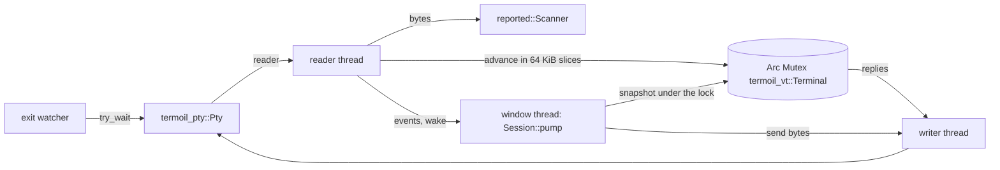

# task-2489: Termoil replaces alacritty_terminal

## The ask

> We want to replace alacritty terminal emulator in Unluminous with termoil, so that termoil is solely used for all
> terminal use cases (terminal panel, agent tasks, etc). We need the integration to work perfectly and be of a world
> class UX. Research the code, create a TDD, and fully implement. Make any adjustments to either repo needed.

Termoil is Black Rainbow Labs' own terminal (`C:/jason/dev/termoil`, `github.com/Black-Rainbow-Labs/Termoil`). Its
README measures it against Ghostty and against `alacritty_terminal`: it reads program output 226% faster than
Alacritty's core and keeps a million lines of scrollback in 143 MB.

## Where alacritty_terminal is used today

Every terminal in Unluminous is a `unluminous_terminal::Session`: the terminal tile, the run tile, the debug console,
a terminal node on the Realm canvas, a ticket's agent terminal and the supervisor's terminal. The window never touches
the emulator. It reads a `Screen` (plain cells with colours already resolved) and calls `Session` methods. Only four
files in `crates/unluminous-terminal` name `alacritty_terminal`:

| File | What it takes from alacritty |
|---|---|
| `session.rs` | `tty::new` (the pseudoterminal), `Term` (grid, scrollback, modes, selection), `EventLoop` (the reader thread), `Notifier` (writes and resizes), the events channel |
| `palette.rs` | the colour types `Color`, `NamedColor`, `Rgb` and the `Colors` table of program overrides |
| `foreground.rs` | `Pty::file()` on Unix and `child_watcher().raw_handle()` on Windows |
| `reap.rs` | the raw child handle, to put the program in a job object |

`keys.rs` and `mouse.rs` are Unluminous's own encoders. They do not know the kitty keyboard protocol or
`modifyOtherKeys`, so `Shift+Enter` reaches `claude` as a plain carriage return.

So the change is contained: the crate's public API stays, and its inside moves to Termoil. No caller in
`unluminous-app` or `unluminous-cli` has to change for the emulator to change.

## What Termoil offers an embedder

Termoil is split so another program can embed it.

| Crate | Used here | What it is |
|---|---|---|
| `termoil-vt` | yes | the parser, the paged screen and scrollback, modes, selection, search, the graphics store. A plain value with no thread and no lock |
| `termoil-pty` | yes | `openpty` on Unix and ConPTY on Windows, spawn, resize, typed exit status, a job object so killing a session ends its whole process tree |
| `termoil-input` | yes | key and mouse encoding: legacy xterm, `modifyOtherKeys`, the kitty keyboard protocol with all five flags, every mouse tracking mode and encoding, paste and focus |
| `termoil-font`, `termoil-render` | no | Termoil's own glyph rasterizer and renderers |
| `termoil-app` | no | Termoil's window, tabs and splits |

Unluminous keeps drawing the grid itself. Its painter (`components::terminal_panel::grid`) draws with the window's own
glyph atlas, theme and zoom, inside egui, in panes, canvas nodes and modals. `termoil-render` draws into its own
surface and would need a second texture path through egui for every terminal. The emulator, the pseudoterminal and the
input encoding are what decide whether a terminal behaves correctly, and all three become Termoil's.

## Dependency

Termoil is not on crates.io. Unluminous takes the three crates as a git dependency pinned to a commit, the way it takes
`rux`:

```toml
termoil-vt = { git = "https://github.com/Black-Rainbow-Labs/Termoil.git", rev = "<commit>" }
termoil-pty = { git = "...", rev = "<commit>" }
termoil-input = { git = "...", rev = "<commit>" }
```

A path dependency would make a release depend on a folder on one machine. `alacritty_terminal` and `polling` leave the
workspace. The `windows` crate that `termoil-pty` uses is already in the tree through `wry`.

## The new Session



### Threads

- **Reader.** Reads the pseudoterminal into a 64 KiB buffer, passes every byte through `reported::Scanner` (the shell's
  own report of its folder, unchanged), applies the bytes to the terminal in slices of at most 64 KiB under the lock,
  takes the terminal's replies and events, hands the replies to the writer, queues the events and wakes the window. It
  runs until the pseudoterminal closes. This is Termoil's own design (`termoil-app/src/session.rs`) without the separate
  parser thread, which a window that draws at most sixty frames a second does not need.
- **Writer.** Takes byte vectors from a channel and writes them to the pseudoterminal. Writing on the window's thread
  would stop the window drawing while a program that is not reading its input has a full pipe, which a large paste into
  a busy program does.
- **Exit watcher.** Polls `Pty::try_wait` every 50 ms. On an exit it waits 100 ms more, so the last thing the console
  host writes after the program has gone is read, and then records the exit status and wakes the window. The reader is
  not stopped: on Windows the pipe stays open until the pseudoconsole closes, so output that arrives late still reaches
  the screen. This covers both faults `task-2353` found in alacritty's exit handling, by construction rather than by
  wrapping the pseudoterminal.

### Mapping

| Session method | alacritty | Termoil |
|---|---|---|
| `spawn` | `tty::new`, `EventLoop` | `Pty::spawn_with_config` with `ConptyChoice::Inbox`, the three threads |
| `detached`, `feed` | a `Processor` | `Terminal::advance` on the window's thread |
| `send` | `Notifier` | the writer channel; a detached session keeps the bytes |
| `resize` | `Term::resize`, `on_resize` | `Terminal::resize`, `Terminal::set_cell_pixels`, `Pty::resize` (skipped once the program has ended) |
| `kill` | shut the loop down, `Reaper::kill` | `Pty::kill`, which ends the job object or process group |
| `scroll`, `scroll_to_bottom` | `Term::scroll_display` | a scroll anchor held by the session (below) |
| selection | `Term::selection` | `termoil_vt::selection::Selection` on the shown screen's page list |
| `mode`, `mouse_mode` | `TermMode` bits | `Terminal::mode`, `kitty_keyboard.flags()`, `modify_other_keys()` |
| `snapshot`, `screen_and_history`, `written_text` | the grid at negative lines | `PageList::for_rows` over the history and the active rows |
| `pump` | alacritty `Event`s | Termoil `Event`s plus the exit the watcher recorded |
| `clear` | `clear_screen`, `goto` | `Terminal::advance(b"\x1b[H\x1b[2J\x1b[3J")` on the emulator, never sent to the program |

### Scrolling back

`termoil-vt` leaves the view to the host. The session keeps the **serial** of the row at the top of the view while it
is scrolled back (`PageList::serial_of`). Each snapshot works out the offset from that serial, so output arriving while
somebody reads the history does not move what they are reading, which is what alacritty did. A serial that has been
pruned out of the scrollback puts the view at the oldest row. Typing puts the view back at the bottom, as before.

### Colours

`Palette` keeps its sixteen named colours, cube and grey ramp. The session gives the terminal the 256 entries with
`Terminal::set_palette` and the defaults with `Terminal::set_default_colors`, so a program asking for a colour with
`OSC 4`, `OSC 10` or `OSC 11` is answered with Unluminous's colours. A cell is resolved like this:

- `Color::Default` is the dynamic colour the program set with `OSC 10` or `OSC 11`, or the palette's foreground and
  background. Bold text in the default foreground is `bright_foreground`.
- `Color::Palette(n)` is the terminal's palette entry, which a program may have changed. Bold text in one of the first
  eight is the bright entry, as every terminal does.
- `Color::Rgb` is used as given.
- Faint is the palette's dim mix. Inverse swaps the two. `INVISIBLE` is `hidden`.

A theme change still reaches each session the next time it is drawn (`follow_the_palette`).

### What else maps

- Title (`OSC 0`, `OSC 2`), bell, `OSC 52` clipboard writes. Clipboard reads stay refused (`allow_osc52_read: false`).
- The colour scheme query (`CSI ? 996 n`) is answered from `Palette::light`.
- Scrollback: `ScrollbackLimit { lines: Some(SCROLLBACK) }`, the same 10,000 lines.
- `TERM=xterm-256color` and `COLORTERM=truecolor` on Unix, `TERM_PROGRAM=Unluminous` everywhere, before the caller's own
  `env`. These are set per child rather than in Unluminous's own environment, so the `setup_env` race that
  `Session::spawn` guarded against cannot happen.
- A tab character: Termoil does not write `\t` into a cell, so `task-2325`'s box cannot appear. The mapping still turns
  one into a space.

### Keys and the mouse

`keys::encode`, `keys::paste`, `keys::focus` and `mouse::report` keep their signatures and call `termoil-input`.
`keys::Mode` gains the application keypad, the `modifyOtherKeys` level and the kitty flags. `keys::text` is new: the text
egui reports goes through it, so a program that asked the kitty protocol to report every key as an escape code gets
codes instead of letters. What changes for a person:

- `Shift+Enter`, `Ctrl+Enter` and `Alt+Enter` reach `claude`, `codex` and other programs that turn on the kitty
  keyboard protocol or `modifyOtherKeys`, so a new line in a prompt works.
- `Ctrl+Backspace`, `Ctrl+Tab` and modified function keys are told apart in those programs.
- The mouse is reported in every encoding a program can ask for, including `urxvt` and UTF-8.

### Pseudoconsole on Windows

`ConptyChoice::Inbox`. Termoil ships a newer `conpty.dll` and `OpenConsole.exe` so kitty images reach its window, and
Unluminous's painter does not draw images, so shipping them buys nothing yet. `unluminous_cli::restore` is measured
against the inbox console host, and that stays true. Termoil starts the child with `STARTF_USESTDHANDLES` and no
standard handles, as alacritty did, so `unluminous-cli` stays the replay shim for the reason `restore.rs` gives.

### foreground and reap

- `foreground::Master` is built from the child's process id on Windows (`Pty::pid`) and from a duplicate of the
  controller descriptor on Unix. Termoil gains `Pty::clone_controller` for that.
- `reap::Reaper` is no longer needed by `Session`: Termoil puts the child in a job object that kills on close and kills
  the process group on Unix, and dropping the `Pty` ends the tree. `reap.rs` goes, and the test that a busy program goes
  with its session stays and runs against Termoil.

## Changes to Termoil

1. **`Pty::clone_controller` on Unix**, so a host can ask `tcgetpgrp` what program is in the foreground.
2. **`OSC 104` and `RIS` put back the host's palette, not xterm's.** Both reset to `default_palette()`, so after a theme
   was given with `set_palette`, a program running `tput reset` or resetting its colours got xterm's colours. This was a
   bug in Termoil's own window as well. The terminal keeps the palette the host gave as `base_palette`.

Both get a test in Termoil and ship in a Termoil release before Unluminous pins the commit.

## Tests

- Every test in `session.rs` that was about behaviour stays and runs against Termoil: colours, wide characters,
  combining marks, the alternate screen, modes, titles, scrollback, resize and reflow, selection, bell, clipboard, a real
  shell, exit codes, output before an exit, environment, kill, the verbatim working directory.
- The tests of the `Watching` wrapper go, because the wrapper goes. Two take their place: a program that ends before
  the reader runs is seen to end, and output written just before the end is on the screen.
- New: scrolling back holds its place while output arrives; `OSC 104` puts Unluminous's colour back; `Shift+Enter` with
  the kitty protocol on sends `CSI 13;2u`; with `modifyOtherKeys` 2 it sends `CSI 27;2;13~`.
- The window suite and the agent task tests run unchanged, because the `Screen` they read did not change shape.
- By hand on the installed build: the terminal tile, the run tile, a Realm terminal node, a ticket's agent terminal,
  `claude` with `Shift+Enter`, and the restore of a terminal node's screen.

## Not in this change

- Drawing kitty, sixel and iTerm2 images in Unluminous's painter. `termoil-vt` already stores them; the painter would
  need to draw them.
- Five underline styles and underline colours in the painter. `Screen` keeps one underline flag.
- `OSC 8` hyperlinks drawn and followed as links. Unluminous already follows web addresses with `Ctrl`/`Cmd` and a click.
- `OSC 133` prompt marks (jump to the previous prompt). Termoil records them; nothing in Unluminous asks yet.
