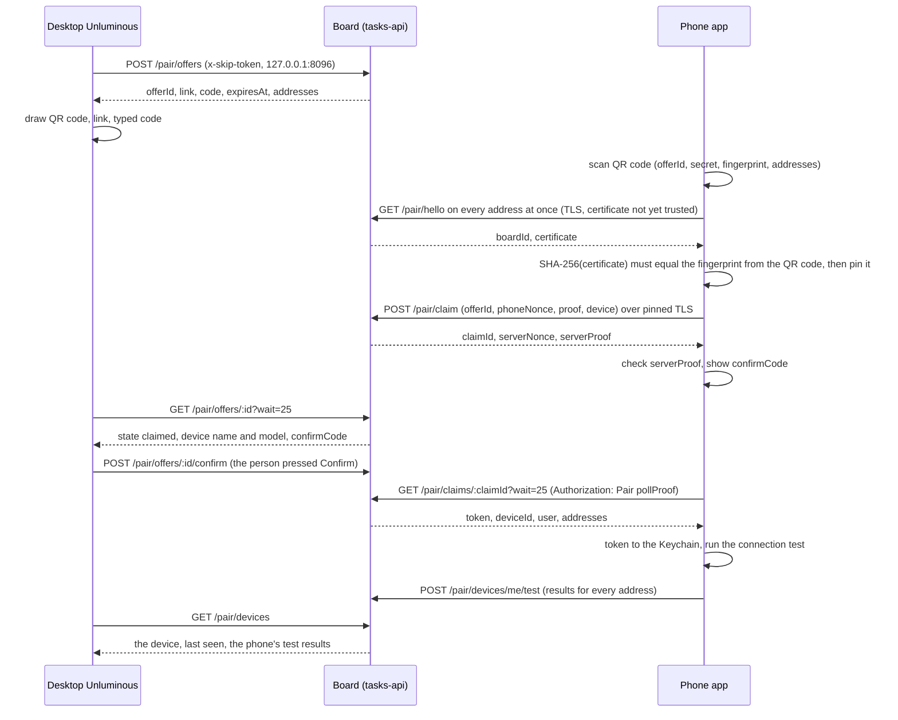

# task-29: Pairing the phone app with desktop Unluminous by QR code

Technical design. The implementation ticket is filed separately and names this file.

## 1. The request

> We want to easily and securely pair the desktop Unluminous app and the mobile app. Eg a setup flow on
> the desktop that allows you to scan a link/qr code/etc with your phone and securely pair the 2. That
> way you don't need to enter user and pass, configure ip, etc. It should give Tailscale option and
> instructions, and test connections.

## 2. What exists today

| Program | Repository | What it does for the phone today |
|---|---|---|
| The board, `tasks-api` | `~/Documents/dev/agent-tasks-service` | Listens on `127.0.0.1:8096` only, plain HTTP, no TLS. Accounts in `board_user`, sessions in `board_session` (only the SHA-256 of the token secret is stored, `label`, `last_seen_at`). A token is `<session id>.<secret>` and expires after 14 idle days or 90 days. `x-skip-token` is the machine secret and is accepted on a request that is not on a public host. `POST /auth/users` is machine only. |
| The phone and iPad app | `~/Documents/dev/unluminous-mobile` | Asks for a username, a password and a board address. `tasks_client::Settings` keeps `base_url`, `username` and `session_token` as plain JSON in the app sandbox. The token is not in the Keychain. `ureq 3` is built with no TLS feature. No QR scanner, no URL scheme, no Keychain bridge. Native bridges are Rust with `objc2` in `shells/ios/src/`. |
| Desktop Unluminous | `~/Documents/dev/unluminous` | Has no HTTP client for the board and runs no server. The board finds a window through `<Unluminous settings folder>/instances/<pid>.conf` and talks to its control channel. |
| How the phone reaches this Mac | `agent-tasks-service/docs/operations.md` | On the home network through `unluminous-mobile/tools/lan-forward.py` (plain HTTP on `192.168.0.48:8096`). Over Tailscale through `tailscale serve --bg --tcp=8096 tcp://127.0.0.1:8096`, which is TCP passthrough, so plain HTTP inside WireGuard. The Mac is `macbook-pro-board`, `100.75.142.76`, and its `tailscaled` runs in userspace mode, so the Mac cannot connect to its own tailnet address. The iPhone is on the tailnet. The iPad is not. |

Two facts decide the design:

- Every request from the home network arrives at the board from `127.0.0.1` because of the forwarder, and
  the bearer token crosses the home network in clear text on every request.
- App Transport Security does not apply to `ureq`, because `ureq` uses sockets directly. It does apply to
  a `WKWebView`.

## 3. Which program the phone pairs with

**The phone pairs with the board.** Everything the phone shows comes from the board's HTTP API, and the
board is the program that issues and checks tokens.

**Desktop Unluminous is where pairing is started, confirmed and managed.** It is a client of new machine
only routes on the board, on the same computer. The desktop draws the QR code, shows the confirmation
code, lists the paired devices and revokes them. The desktop never talks to the phone and the phone never
talks to the desktop.

How the desktop finds and authenticates to the board: the board writes
`<Unluminous settings folder>/boards/<port>.conf` when it starts (keys `pid`, `port`, `token`, `name`),
with file mode `0600`, and deletes it on a clean exit. `token` is the machine secret, which the same user
can already read in the board's `.env`. This mirrors `instances/<pid>.conf`, which the window writes for
the board. The board already resolves the Unluminous settings folder in
`tasks-core/src/services/designs/projects.rs` (`unluminous_home`, `AGENT_TASKS_UNLUMINOUS_HOME`). The
desktop reads the folder, keeps the entries whose process is running, and uses the first whose
`GET /health` answers. `UNLUMINOUS_BOARD_CONF` names one file for a test.

## 4. Security design

### 4.1 What has to hold

1. A phone that scanned the code needs nothing typed.
2. The pairing secret works once and for a short time.
3. The pairing secret never crosses the network.
4. A person who photographs the QR code cannot pair without the desktop user seeing it and refusing.
5. The long lived token is never readable on the home network, during pairing or afterwards.
6. A paired device can be listed and revoked on the desktop.

### 4.2 Design A: a one time secret presented as a bearer

The QR code holds a random secret. The phone sends it to `POST /pair/claim` and the board answers with a
device token.

- Simple: one route, no state on the phone.
- On the home network the board speaks plain HTTP, so the secret and the token are both readable by any
  device on that network.
- Whoever presents the secret first is paired. A photograph of the screen is enough. The desktop user
  learns of it only when their own phone fails.

### 4.3 Design B: a key exchange with a confirmation code

The QR code holds an X25519 public key of the board. The phone makes its own key pair, both sides derive
a shared key, both show six digits derived from the exchange, the desktop user confirms the digits
match, and the token is sent encrypted under the shared key.

- The token is not readable while it is issued, and a second device is caught at the confirmation.
- After pairing the token is still sent as a bearer on every request in clear text on the home network.
  Closing that needs either every request encrypted under the shared key, which is a private transport
  protocol to design, test and keep, or TLS, which makes the key exchange unnecessary.

### 4.4 Recommended: pinned TLS, a proof of the secret, and a confirmation code

This takes the confirmation step from B and replaces the key exchange with TLS that the phone pins from
the QR code. It meets all six points in 4.1.

**The board gets a second listener for devices, with TLS.** Port 8196 by default. The certificate is self
signed, ECDSA P-256, made once by the board and valid for 20 years, with one DNS name,
`b-<board id>.unluminous-board.internal`. The QR code carries the SHA-256 of the certificate. The phone
trusts exactly that certificate and no other, on every address, for every request after pairing. The
existing listener on `127.0.0.1:8096` is unchanged.

**The phone proves it holds the secret with an HMAC.** The secret is the HMAC key and is never sent:

```
proof        = HMAC-SHA256(secret, "unluminous-pair-v1|claim|"  + offerId + "|" + phoneNonce + "|" + fingerprint + "|" + deviceName)
serverProof  = HMAC-SHA256(secret, "unluminous-pair-v1|server|" + offerId + "|" + phoneNonce + "|" + serverNonce + "|" + fingerprint)
confirmCode  = decimal6(HMAC-SHA256(secret, "unluminous-pair-v1|confirm|" + offerId + "|" + phoneNonce + "|" + serverNonce + "|" + fingerprint))
pollProof    = HMAC-SHA256(secret, "unluminous-pair-v1|poll|"   + claimId + "|" + phoneNonce)
```

`fingerprint` is the SHA-256 of the certificate the phone actually received. `decimal6` is the first four
bytes as a big endian integer modulo 1,000,000, printed with leading zeros. `serverProof` tells the phone
that the board holds the secret too.

**Nothing is issued until the desktop user confirms.** After a claim the desktop shows the device's name
and model and the six digits, the phone shows the same six digits, and the token is created only after
`Confirm` is pressed on the desktop. An offer accepts one claim.

**The long lived token is a `board_session` row of kind `device`.** It has the same form as a login
token, so the existing bearer check is unchanged. It has no absolute expiry and expires after 180 idle
days (`AGENT_TASKS_DEVICE_IDLE_DAYS`). On the phone it is stored in the iOS Keychain (section 7.5).

**What each attacker gets:**

| Attacker | Result |
|---|---|
| Listens on the home network during or after pairing | Sees TLS only. The secret is never sent. The token is inside TLS. |
| Photographs the QR code and claims first | Their device appears on the desktop as waiting, with six digits. The owner's phone says the code was already used by another device and shows no digits. The owner presses `Reject`. No token exists yet. |
| Photographs the QR code and claims second | `409 already_claimed`. |
| Photographs the QR code after it was used or after 5 minutes | `404 offer_gone`. |
| Answers on the board's address with their own certificate | The phone's check of the fingerprint fails before anything is sent. In the typed code flow the phone's proof contains the wrong fingerprint and the board refuses it. |
| Guesses the typed code | 5 wrong proofs end the offer. |
| Steals the phone's sandbox backup | The token is a Keychain item with `kSecAttrAccessibleAfterFirstUnlockThisDeviceOnly`, which is not restored to another device. |
| Reaches the device listener and sends `x-skip-token` | Refused. The device listener never accepts the machine secret and never serves a machine only route. |

**Residual risks, accepted:**

- A typed code is 60 bits. An attacker in the path who records a proof and tests 2^60 keys within the 5
  minutes the offer lives could pair. That is far beyond a home network attacker. A password
  authenticated key exchange (SPAKE2) would remove it and is not built.
- A link sent through Messages puts the one time secret in that conversation. The expiry, the single use
  and the confirmation code still apply.
- Another iOS app could register the `unluminous` URL scheme and receive a link opened from the Camera
  app. It would still need the desktop user to confirm digits the owner's phone does not show. Scanning
  inside the app does not use the URL scheme.

**Rejected: Tailscale only.** WireGuard already encrypts the tailnet path, so plain HTTP would do there.
The iPad is not on the tailnet, and one transport for every address is simpler to test.

### 4.5 The pairing sequence



## 5. The pairing payload

### 5.1 The link

```
unluminous://pair?v=1&o=<offerId>&s=<secret>&f=<fingerprint>&n=<board name>&a=<host:port>,<host:port>,...
```

| Field | Content |
|---|---|
| `v` | `1`. The phone refuses a version it does not know and says to update the app. |
| `o` | The offer id, 16 random bytes, base64url without padding. |
| `s` | The secret, 32 random bytes, base64url without padding. |
| `f` | SHA-256 of the certificate in DER form, base64url without padding. |
| `n` | The board's name, percent encoded (the computer's host name unless changed). |
| `a` | The addresses in the order of section 6.1, each `host:port`, an IPv6 host in brackets. |

About 300 characters with four addresses, which is a version 13 QR code at error correction level M.

The QR code encodes this link exactly. The iOS Camera app offers `Open in Unluminous` for it.

`Copy Link` on the desktop copies the web form, for Messages, Mail and AirDrop, because Messages only
makes `http` and `https` links tappable:

```
https://unluminous.com/pair#v=1&o=...&s=...&f=...&n=...&a=...
```

`https://unluminous.com/pair` is a static page. The values are in the fragment, which a browser does not
send to the server. The page's script builds the `unluminous://pair?...` link from the fragment and shows
one button, `Open in Unluminous`, plus the text of the link to copy. The phone app's `Paste Link` accepts
both forms.

### 5.2 The typed code

Twelve characters of Crockford base32 shown as `XXXX-XXXX-XXXX` (60 bits). It is a second secret for the
same offer. The phone screen asks for the computer's address and the code. Letters are accepted in either
case, `O` is read as `0`, `I` and `L` as `1`, and dashes and spaces are dropped. The claim says
`method: "code"` and sends no offer id: the board tries the proof against every live offer, of which
there are at most three.

With a typed code the phone has no fingerprint. It reads the certificate from `GET /pair/hello`, puts
that certificate's fingerprint in its proof, and pins it only after `serverProof` checks out.

### 5.3 Validity

- An offer lives 5 minutes (`ttlSeconds`, 60 to 900).
- One claim per offer. A rejected claim ends the offer.
- 5 wrong proofs end the offer.
- A claimed offer waits up to 5 more minutes for `Confirm`, then expires.
- A confirmed claim's token must be collected within 2 minutes and is handed out once.
- Offers and claims are kept in memory only. Restarting the board ends them.
- While the desktop screen is open it asks for a new offer 20 seconds before the old one expires and
  redraws the code. Closing the screen deletes the offer.

## 6. Addresses

### 6.1 What goes in the payload, in this order

| Order | Kind | Example | Included when |
|---|---|---|---|
| 1 | `lan` | `192.168.0.48:8196` | One for each IPv4 address in 10/8, 172.16/12 or 192.168/16 on an interface that is up, when the device listener is bound to all interfaces. |
| 2 | `mdns` | `Jasons-MacBook-Pro.local:8196` | macOS only, the local host name, when a `lan` address exists. It survives a new DHCP address. |
| 3 | `tailscale-name` | `macbook-pro-board.tail1234.ts.net:8196` | Tailscale is running and MagicDNS is on. `Self.DNSName` without the trailing dot. |
| 4 | `tailscale-ip` | `100.75.142.76:8196` | Tailscale is running. The IPv4 entry of `Self.TailscaleIPs`. |

Loopback, link local, IPv6 and VPN interfaces other than Tailscale are left out. The desktop screen shows
the list with a tick box for each, so an address can be left out of one offer.

### 6.2 How the phone picks one

- The phone always requests `https://b-<board id>.unluminous-board.internal:<port>`. The certificate
  carries that name, so the certificate check is the same on every address. A resolver the phone gives
  `ureq` answers that name with the address in use (section 7.4).
- **Choosing:** `GET /pair/hello` is sent to every address at once with a 3 second timeout. An answer
  counts when TLS completed with the pinned certificate and `boardId` matches. The first answer starts a
  400 ms wait, and the earliest kind in the order of 6.1 that answered by the end of the wait is used.
  The home network address therefore wins when the phone is at home and the tailnet address when it is
  away.
- **Falling back:** when a request fails without an HTTP status, the phone chooses again and repeats the
  request once. It chooses again at most once every 10 seconds, and also every time the app comes to the
  foreground.
- **Keeping the list current:** the phone asks `GET /pair/devices/me` after pairing, on each launch and
  once a day, and replaces its stored list with the answer. A computer whose DHCP address changed is
  found through the `mdns` or Tailscale entry, and the next refresh brings the new address.

## 7. Changes in each repository

Follow each repository's own `CLAUDE.md` or `AGENTS.md`. Build in this order: the board, the phone's
client crate, the phone's screens and iOS bridges, the desktop, the web page.

### 7.1 Board: `agent-tasks-service`

**New modules**, in the existing layers:

- `tasks-core/src/models/pair.rs`: `Offer`, `Claim`, `Device`, `Address`, `TailscaleReport`, `Probe`.
- `tasks-core/src/services/pair/`:
  - `proof.rs`: the four HMAC functions and `decimal6`, with fixed test vectors that the phone's crate
    repeats.
  - `offers.rs`: the offers and claims held in memory and their states, taking the clock as a parameter.
  - `identity.rs`: the board id, the name, and the certificate and key in `<data folder>/pair/cert.pem`
    and `key.pem` (mode `0600`), made with `rcgen` on first use.
  - `network.rs`: the interface addresses and the list of 6.1.
  - `tailscale.rs`: section 8.
  - `probe.rs`: the board's own connection test, section 9.1.
  - `discovery.rs`: writes and removes `boards/<port>.conf`.
- `tasks-core/src/repositories/devices.rs`: the `board_device` table.
- `tasks-api/src/routes/pair.rs` and a second listener in `main.rs`.

**The device listener.** `axum-server` with `rustls` and the `ring` provider (no `aws-lc`, which needs
cmake and nasm on Windows). Port `AGENT_TASKS_DEVICE_PORT`, default 8196. Its bind address follows the
`listen` setting: `all` binds `0.0.0.0`, `loopback` binds `127.0.0.1` (only a forwarder or
`tailscale serve` reaches it), `off` binds nothing. The setting starts as `off` and becomes `all` when
the first offer is made. Changing it rebinds without a restart. Every request on this listener carries a
marker, and `authenticate` treats a marked request the way it treats a public host: bearer only, no
`x-skip-token`, no machine only path, and the short `/health`.

**Routes.** JSON in camelCase. `M` is machine only (the `x-skip-token` on the existing loopback
listener). `O` is open. `D` is a bearer token of a device session.

| Route | Who | Request | Answer |
|---|---|---|---|
| `GET /pair/status` | M | | `{listen, port, boardId, name, fingerprint, deviceCount, liveOffers}` |
| `PUT /pair/settings` | M | `{listen?, name?}` | the status |
| `GET /pair/network` | M | | `{addresses:[{kind, host, port, interface, note}], tailscale:{...}}` (section 8) |
| `POST /pair/tailscale/serve` | M | | `{ok, command, output}` |
| `POST /pair/test` | M | | `{results:[Probe]}` (section 9.1) |
| `POST /pair/offers` | M | `{username?, addresses?, ttlSeconds?}` | `{offerId, link, webLink, code, expiresAt, addresses, fingerprint}` |
| `GET /pair/offers/:id?wait=<s>` | M | | `{state, expiresAt, claim?:{deviceName, platform, model, appVersion, confirmCode, via, claimedAt}, device?}` |
| `POST /pair/offers/:id/confirm` | M | | `{device}` |
| `POST /pair/offers/:id/reject` | M | | `204` |
| `DELETE /pair/offers/:id` | M | | `204` |
| `GET /pair/devices` | M | | `[{id, name, platform, model, appVersion, username, pairedAt, lastSeenAt, lastSeenVia, lastTest}]` |
| `PATCH /pair/devices/:id` | M | `{name}` | the device |
| `DELETE /pair/devices/:id` | M | | `204`. Deletes the device's session. |
| `GET /pair/hello` | O | | `{v, boardId, name, certificate, fingerprint, time}` |
| `POST /pair/claim` | O | `{method, offerId?, phoneNonce, proof, device:{name, platform, model, appVersion}}` | `{claimId, offerId, serverNonce, serverProof, expiresAt}` |
| `GET /pair/claims/:claimId?wait=<s>` | O, `Authorization: Pair <pollProof>` | | `{state}` and, once confirmed, `{token, tokenId, deviceId, user, boardId, name, addresses}` |
| `GET /pair/devices/me` | D | | `{device, boardId, name, addresses}` |
| `POST /pair/devices/me/test` | D | `{results:[Probe]}` | `204`. Stored as the device's `lastTest`. |
| `DELETE /pair/devices/me` | D | | `204`. The phone removes its own pairing. |

- Offer `state`: `waiting`, `claimed`, `confirmed`, `rejected`, `expired`, `cancelled`.
- Claim `state`: `pending`, `confirmed`, `rejected`, `expired`, `delivered`.
- `wait` holds the answer until the state changes or the seconds pass, 25 at most.
- `username` is the account the device signs in as. Left out, it is `AGENT_TASKS_OWNER_USERNAME`.
- Errors are `{error, message}`: `404 offer_gone`, `409 already_claimed`, `403 bad_proof` with
  `attemptsLeft`, `410 already_delivered`, `429 too_many_attempts` (30 claims a minute for the whole
  board).
- The open routes are served on both listeners, so a test can run the whole flow against loopback.
- The session is created when the phone collects a confirmed claim, because only its hash is stored.

**Data stored.**

- `board_session` gains `kind TEXT` (`login` when empty, or `device`), added by the probe and
  `ALTER TABLE ... ADD COLUMN` pattern `ensure_task_columns` uses.
- `board_device`: `id`, `user_id`, `session_id`, `name`, `platform`, `model`, `app_version`, `paired_at`,
  `last_seen_at`, `last_seen_via`, `last_test` (JSON text), added to `ensure_schema`.
- `pair_setting`: `key`, `value` (`listen`, `name`, `board_id`).
- `<data folder>/pair/cert.pem` and `key.pem`.
- `<Unluminous settings folder>/boards/<port>.conf`.

`authenticate` updates `last_seen_at` and `last_seen_via` (the `Host` the request named) for a device
session at most once a minute. `GET /auth/sessions` leaves device sessions out.

**Scripts and documents.** `scripts/mac-board.sh` sets `AGENT_TASKS_TAILSCALE` to its own `ts` wrapper and
adds `--tcp=8196` to its `tailscale serve`. `docs/authentication.md` and `docs/operations.md` describe
pairing, and the forwarder section says it is needed only for a password sign in.

### 7.2 Desktop Unluminous

The desktop is a view of the board's routes. Every feature needs the control, the command and tests, as
its `CLAUDE.md` requires.

- `services/pairing.rs`: finds the board (section 3), and a worker thread with a channel and a waker in
  the shape of `services/update.rs` for every request. `ureq` plain HTTP to loopback. The typed values of
  7.1.
- `services/qr.rs`: the `qrcode` crate with no image feature, giving a square of booleans.
- `components/pair_dialog.rs`: a `modal::show_unframed` dialog in the shape of `report_dialog`, with
  three cards.
  - **Connection**: the addresses with a tick box each, each one's result from `Test`, the switch
    `Reachable on this network` (`listen` `all` or `loopback`), and the Tailscale card of section 8.
  - **Scan**: the QR code, `Copy Link`, the typed code, and the time left.
  - **Confirm**: appears when a phone has claimed. The device's name and model, the six digits as
    `482 913`, `Confirm` and `Reject`. After `Confirm`: the phone's own test results as they arrive, and
    `Done`.
  - With no board found, the dialog shows one sentence saying the Tasks board service is not running on
    this computer and the command that starts it.
- The QR code is painted as dark squares on a white plate with a quiet zone of four modules, in every
  theme, because a scanner needs dark on light. Mark the two color literals `// any ground:` so
  `no_component_paints_a_white_or_black_of_its_own` passes. Squares are snapped to whole pixels.
- `components/phones_page.rs`: a Settings page, `Phones`, from `settings_kit`. One row a device with its
  name, model, account, when it was paired, when and through which address it was last seen, `Rename` and
  `Remove`. `Pair a Phone...` opens the dialog.
- `Action::PairPhone`: `Unluminous -> Pair a Phone...`, a name in `action_names.rs`, and
  `modal open pair-phone`.
- The catalogue area `pair`, one arm each in `app/cli`, sections in `docs/commands.md`:
  `pair status`, `pair network`, `pair test`, `pair tailscale-serve`, `pair offer [--user <name>]
  [--ttl <seconds>]`, `pair wait [--timeout <seconds>]` (answers when a phone has claimed, with the
  digits), `pair confirm`, `pair reject`, `pair cancel`, `pair devices`, `pair rename <device> <name>`,
  `pair revoke <device>`. `pair offer` answers with the link, the web link, the code and the expiry, so
  an agent can pair a phone with no dialog. The dialog and the commands share one `PairingState` on the
  window.
- The desktop stores nothing. Devices live in the board.
- A test window finds a board only through `UNLUMINOUS_BOARD_CONF`.

### 7.3 Phone: `tasks-client`

- `services/pairing.rs`: parsing a link in both forms and a typed code, the proof functions with the
  board's test vectors, `pair(payload, device, on_progress)` which runs hello, claim and the wait for
  confirmation, and `ConnectionTest` (section 9.2).
- `services/addresses.rs`: the choice and the fallback of 6.2.
- `services/secret_store.rs`: a trait with `read`, `write` and `remove`. The file form is used off iOS
  and in tests. The Keychain form is section 7.5.
- `Settings` gains `pairing: Option<Pairing>` with `board_id`, `board_name`, `certificate_pem`,
  `fingerprint`, `addresses`, `device_id`, `paired_at` and `last_good`. `session_token` is no longer
  written to the JSON file.
- `ClientError::Unreachable` carries a `Reason` (section 9.3) built from the `ureq::Error` variant.
- With a pairing present, every request goes through the pinned agent. Without one, the client behaves
  as it does today.

### 7.4 Phone: pinned TLS

- Add the `rustls` feature to `ureq` (the `ring` provider).
- The pinned agent trusts one root, the stored certificate (`RootCerts::Specific`), and requests
  `https://b-<board id>.unluminous-board.internal:<port>`. A resolver given to the agent
  (`Agent::with_parts`) answers that name with the socket address in use.
- If the installed `ureq` cannot take a resolver, the other way is a `rustls` `ServerCertVerifier` that
  accepts exactly the certificate whose SHA-256 is pinned. Either is fine. The test in 10.2 that a second
  board with another certificate is refused decides whether it works.
- The first `GET /pair/hello` is made with verification off, because the certificate is what it fetches.
  Nothing secret is sent on that request.
- **`WKWebView`.** `shells/ios/src/web_view.rs` must be read first. If it loads pages from the board's
  address, the navigation delegate has to answer the server trust challenge by comparing the leaf
  certificate's SHA-256 with the pin, and the URLs it is given have to use the address in use. If it only
  shows HTML the Rust side fetched, nothing changes.

### 7.5 Phone: screens and iOS bridges

- **Pairing screen** (`crates/app/src/screens/pair.rs`), shown in place of the login screen when the app
  has neither a pairing nor a session:
  - `Scan QR Code` (primary), `Paste Link`, `Enter Code`, and `Sign in with a password`, which opens
    today's login screen.
  - Progress as three lines: finding the computer (each address with its result), waiting for
    confirmation with the six digits and the sentence "Check that Unluminous on your computer shows the
    same number, then press Confirm there", and paired.
  - Every failure is one sentence with `Try Again`. An expired or used code says to make a new one on the
    computer.
- **Settings screen**: `Paired with <board name>`, the address in use, `Test Connection` with the result
  list, `Pair Again`, and `Remove Pairing` (two taps, calls `DELETE /pair/devices/me`).
- **A 401 with a pairing present** removes the token and shows the pairing screen with "This device was
  removed on the computer. Pair it again." A 403 still does not sign out.
- **`QrBridge` and `shells/ios/src/qr.rs`**, in the pattern of `images.rs`: an `AVCaptureSession` with an
  `AVCaptureMetadataOutput` for QR codes, shown full screen with a `Cancel` button, delivering the first
  string that parses as a pairing link. `NSCameraUsageDescription` is extended to mention pairing. When
  `UNLUMINOUS_QR_PAYLOAD` is set, a scan answers with its value and opens no camera. That is the hook for
  the Simulator test, which has no camera.
- **`UrlBridge`**: `CFBundleURLTypes` with the scheme `unluminous`, and `scene:openURLContexts:` plus the
  URL contexts of the connection options in `scene.rs`, so a link opens the app cold or warm and starts
  pairing. While the app is already paired, it asks before replacing the pairing.
- **Keychain**: `SecItemAdd`, `SecItemCopyMatching` and `SecItemDelete` (the `security-framework` crate
  is already in `Cargo.lock`), a generic password with service
  `com.blackrainbowlabs.unluminous.mobile`, account `board:<board id>`, and
  `kSecAttrAccessibleAfterFirstUnlockThisDeviceOnly`.
- **Device name and model**: `UIDevice.current.name` and the model identifier, through a small bridge.
- `crates/app` stays free of platform code.

### 7.6 Web page: `black-rainbow-labs-sites`

**Not built by the implementation ticket.** The page is `sites/unluminous/public/pair/index.html`, static,
no analytics on this page, as described in 5.1, and publishing it needs a site deploy from the Windows
PC. It is a follow up ticket. Until it exists, `Copy Link` on the desktop copies the `unluminous://`
form, behind one constant (`pairing::WEB_LINKS`, off), `webLink` is still answered by the board, and the
phone's `Paste Link` already accepts both forms. A person who receives the `unluminous://` link in
Messages copies it and uses `Paste Link`.

### 7.7 Where this is built and tested

Everything in this design is built and tested on the Mac, against scratch boards on the Mac, with desktop
Unluminous built and run on the Mac. No step needs the Windows PC. The Windows paths in sections 8 and 9
are written so the same code works there, and are covered by unit tests over fixed inputs only.

## 8. Tailscale

**Detection is in the board** (`services/pair/tailscale.rs`), because the board owns the listener and
`mac-board.sh` already knows this Mac's unusual setup. The desktop draws what `GET /pair/network`
answers.

- **The program**: `AGENT_TASKS_TAILSCALE` when set (this Mac's `ts` wrapper), then `tailscale` on
  `PATH`, then `/Applications/Tailscale.app/Contents/MacOS/Tailscale`, then
  `C:\Program Files\Tailscale\tailscale.exe`.
- **`tailscale status --json`**, with a 5 second limit:
  - `BackendState`: `Running`, `NeedsLogin`, `Stopped`.
  - `Self.DNSName`, `Self.TailscaleIPs`, `CurrentTailnet.MagicDNSEnabled`.
  - `TUN`: `false` means userspace mode.
  - `Peer` entries whose `OS` is `iOS`, with `HostName` and `Online`.
- **`tailscale serve status --json`**: whether TCP port 8196 is forwarded to `127.0.0.1:8196`.
- **Whether `serve` is needed**: yes in userspace mode, and yes when `listen` is `loopback`. Otherwise
  the listener on all interfaces already answers on the tailnet address.

The answer:

```
tailscale: { installed, state: "running" | "needs-login" | "stopped" | "not-installed" | "error",
             problem, version, dnsName, ips, magicDns, userspace,
             serve: { needed, configured, command },
             phones: [{ name, online }] }
```

**The Tailscale card on the desktop** shows one of these, and each state lists only the steps still to do:

| State | What the card shows |
|---|---|
| Not installed | "Tailscale lets your phone reach this computer from anywhere." Step 1: install Tailscale on this computer (`https://tailscale.com/download`, a link that opens the default browser). Step 2: sign in. Then `Check Again`. |
| Needs login or stopped | "Tailscale is installed but not connected." Step: open Tailscale and sign in, or run `tailscale up`. `Check Again`. |
| Running, `serve` needed and not configured | "One more step: let Tailscale pass the board's port through." The command `tailscale serve --bg --tcp=8196 tcp://127.0.0.1:8196` with `Copy` and `Run It` (`POST /pair/tailscale/serve`). |
| Running and ready | "Tailscale is connected as `<dnsName>` (`<ip>`)." Both Tailscale addresses are in the list and ticked. |

Under every state, the steps for the phone:

1. Install Tailscale from the App Store.
2. Sign in with the same account as this computer.
3. Turn the VPN switch on in the Tailscale app.

Then the phones the tailnet already has, for example "iPhone: connected", or "No phone is signed in to
this tailnet yet".

Tailscale is optional. With it absent the offer holds the home network addresses only, and the card says
the phone will then work at home only.

## 9. Testing connections

### 9.1 On the desktop

`Test` in the Connection card calls `POST /pair/test`. For each address the board connects to itself:
TCP, TLS with its own certificate expected, then `GET /pair/hello`. Each address gets a `Probe`:

```
{ kind, host, port, ok, ms, reason, message }
```

The board cannot test from the phone's position, and the card says so in two cases:

- In userspace mode the Tailscale addresses are reported with reason `cannot-check-here` and the message
  "This computer cannot connect to its own Tailscale address. The phone's test will check it."
- A firewall can pass a connection from the same computer and block the phone. The line under the list
  says "These results are from this computer. The phone tests each address itself after pairing."

**The phone's results are the authoritative ones and the desktop shows them.** After pairing, and on
every `Test Connection`, the phone posts its results to `POST /pair/devices/me/test`. The Confirm card
and the Phones page show them under the device: "From Jason's iPhone, 2 minutes ago".

### 9.2 On the phone

`ConnectionTest` runs every stored address at once, with a 5 second limit for each stage, and records the
first stage that fails:

1. Resolve the name.
2. Open the TCP connection.
3. Complete TLS with the pinned certificate.
4. `GET /pair/hello`, and `boardId` must match.
5. `GET /auth/me` with the device token.

The time reported is the round trip of stage 4 on the open connection, in milliseconds.

During pairing, stages 1 to 4 run before the claim and their results are the first progress line.

### 9.3 Reasons and the sentences shown

| `reason` | When | Sentence |
|---|---|---|
| `ok` | All stages passed | "Reachable, 12 ms" |
| `name-not-found` | The name did not resolve | "This name could not be found from this network." |
| `no-route` | Network or host unreachable, or no answer to the TCP connection | "No route to this address. The phone is not on that network." For a Tailscale address: "No route. Tailscale is not connected on this phone." |
| `refused` | The connection was refused | "The computer answered but nothing accepted the connection on port 8196. The board is not running, or a firewall blocked it." |
| `timeout` | A stage after the TCP connection did not finish in time | "The computer stopped answering." |
| `tls` | The handshake failed or the certificate is not the pinned one | "A different computer answered at this address." |
| `wrong-board` | `boardId` differs | "Another Unluminous board answered at this address." |
| `wrong-token` | 401 from `GET /auth/me` | "This device's pairing was removed on the computer. Pair it again." |
| `http` | Any other status | "The board answered with an error (<status>)." |
| `cannot-check-here` | Desktop only, 9.1 | The sentence in 9.1. |

On Windows the first bind to all interfaces raises the Windows Firewall question. The Connection card
names it when the desktop's own test passes and a phone's test reports `no-route` or `timeout` for a home
network address: "Windows Firewall may be blocking port 8196 for `tasks-api`."

## 10. Migration and tests

### 10.1 Phones that are already signed in

- Nothing changes on the board for them. The listener on `127.0.0.1:8096`, the forwarder, the existing
  `tailscale serve` on 8096 and password sign in all keep working.
- The first launch of the new app reads `session_token` from `settings.json`, writes it to the Keychain,
  and saves the file without it. A crash between the two steps leaves the token in the file and the
  migration runs again.
- A phone signed in with a password keeps its session (14 idle days, 90 days). Its Settings screen shows
  "Signed in with a password over an unencrypted connection" and `Pair with Computer`.
- When such a phone pairs, the app calls `POST /auth/logout` with the old token after the device token is
  stored.
- `Sign in with a password` stays on the pairing screen for a board that has no desktop beside it.

### 10.2 Rust tests

**Board** (`cargo test`, and a spare instance on its own port and data file, never 8096):

- The four proof functions and `decimal6` against fixed vectors.
- Offer states with an injected clock: expiry, one claim, 5 wrong proofs, reject, cancel, confirm, the
  token handed out once, a late collection refused.
- The typed code: normalizing, and a proof matched against three live offers.
- The device listener refuses `x-skip-token` and every machine only path, and serves the short `/health`.
- A device session works as a bearer, is left out of `GET /auth/sessions`, and stops working when the
  device is deleted.
- Tailscale detection against a scripted `tailscale` program for: not installed, needs login, running in
  userspace mode with and without `serve`, running with a TUN device, output that is not JSON, and a
  program that never exits.
- The address list from fixed interface lists.
- `scripts/pair-exercise.cjs --base http://127.0.0.1:8099`: the whole flow over both listeners, playing
  the phone with Node's `crypto`.

**Phone client** (`crates/tasks-client/tests/pairing.rs`, against a real `tasks-api` on a free port, the
way the existing tests start one):

- A link pairs: hello, claim, a confirm sent through the machine route, the token collected, then
  `GET /tasks` works through the pinned agent.
- A typed code pairs.
- A second board with another certificate at one of the addresses is refused with `tls`.
- A payload whose first two addresses are dead pairs through the third, and `last_good` is the third.
- The address in use stops answering and the next request succeeds through another.
- A wrong secret gives `bad_proof`. A used offer gives `already_claimed`. An expired one gives
  `offer_gone`.
- A deleted device gives `SignedOut` and the test's `Reason` is `wrong-token`.
- `settings.json` holding a `session_token` is migrated to the secret store.
- Each `Reason` from a listener scripted to refuse, to hang, to answer with another certificate, and to
  answer with another `boardId`.

**Phone app** (`egui_kittest`, pictures in `_agent_output/`): the pairing screen, the progress lines with
the six digits, each failure sentence, the Settings connection card with a mixed result list.

**Desktop**:

- Unit: the QR matrix for a fixed link against a stored matrix. Reading `boards/<port>.conf`.
- `tests/pairing.rs` against a scripted board (a `TcpListener` replaying fixed answers, named by
  `UNLUMINOUS_BOARD_CONF`): the dialog with no board, with addresses and each Tailscale state, a claim
  arriving and `Confirm` sending the confirm request, `Reject`, an offer renewed before it expires, the
  Phones page listing and removing a device, and every `pair` command.
- Pictures: `pair_dialog_scan`, `pair_dialog_confirm`, `pair_dialog_tailscale_missing`, `phones_page`,
  and `pair_dialog_scan_light`. The QR code in the picture is decoded in the test with the `rqrr` crate
  (a development dependency) and must equal the link.
- The documentation tests for the new `pair` area.

### 10.3 Simulator XCUITest

`shells/ios/uitests/PairingUITests`, generated by xcodegen like the other two targets:

1. The script starts a scratch board on a free port with its own data file and makes an offer through
   the machine route.
2. It installs the app and launches it with a clean container and
   `launchEnvironment["UNLUMINOUS_QR_PAYLOAD"] = <the offer's link>`, whose addresses are
   `127.0.0.1:<device port>`.
3. The test taps `Scan QR Code`, at the position the frame log gives.
4. The script waits on `GET /pair/offers/:id?wait=25` until the state is `claimed`, checks that the six
   digits in the frame log equal `confirmCode`, and sends the confirm request.
5. The test waits for the Board tab and checks that a ticket title from the scratch board is on the
   screen.
6. A second test launches with an expired link and expects the sentence that says to make a new code.
7. A third test opens `unluminous://pair?...` with `xcrun simctl openurl` and expects the same confirm
   step.

### 10.4 The real iPhone and iPad

Run on this Mac with a scratch board for every step except the last, which Jason does on the real board:

1. Install on the iPhone (`00008140-001E112A227B001C`) and the iPad Pro (`00008027-001D790C1E31802E`).
2. iPhone on the home Wi-Fi: scan the code on the desktop, confirm, see the board. `Test Connection`
   reports the home network address and both Tailscale addresses as reachable, and the desktop shows the
   same results.
3. iPhone with Wi-Fi off and Tailscale on: the app reaches the board and Settings names a Tailscale
   address as the one in use.
4. iPhone with Wi-Fi off and Tailscale off: `Test Connection` reports `no-route` for every address with
   the Tailscale sentence.
5. iPad (not on the tailnet) on the home Wi-Fi: pair by the typed code. The Tailscale addresses report
   `no-route`.
6. Scan one code with both devices: the second is told the code was already used.
7. `Remove` the iPhone on the desktop's Phones page: the phone shows the pairing screen within one
   request.
8. Send the `unluminous://` link to the phone, copy it there, and pair with `Paste Link`. Scan the QR
   code with the iOS Camera app and pair through `Open in Unluminous`.
9. Record in the ticket what could not be done without a person holding the device.

## 11. Not in this design

- The `https://unluminous.com/pair` page (section 7.6), which is a follow up ticket.
- Finding the computer with Bonjour, which would let the typed code work with no address.
- A password authenticated key exchange for the typed code.
- Rotating the device token or the certificate. Deleting `<data folder>/pair/` makes a new certificate
  and every phone pairs again.
- Pairing several boards on one phone.
- A device key in the Secure Enclave.
- An Android app.
