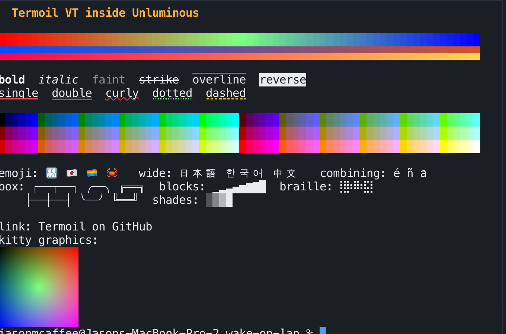
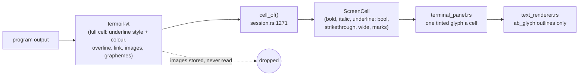
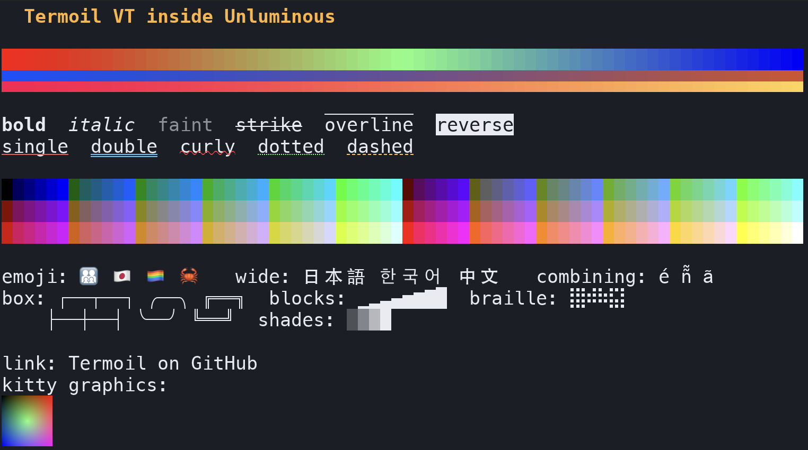
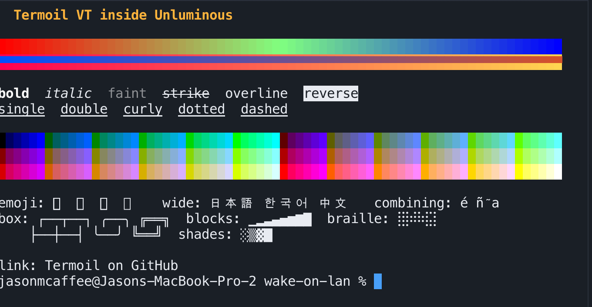
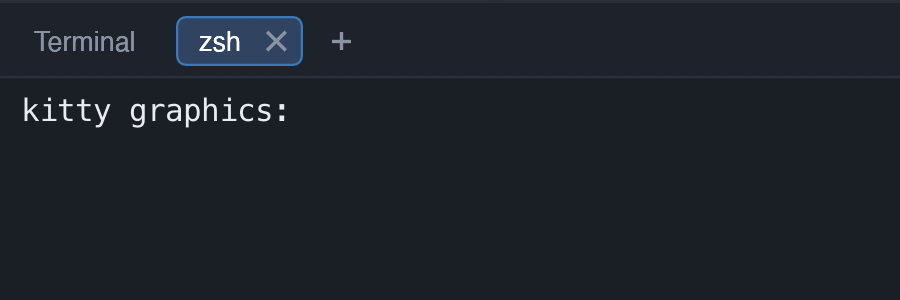

# Termoil in Unluminous: what is drawn and what is not

2026-11-05. Unluminous at `1c35eb98` (task-2510), Termoil pinned at `9b995ae`.

## Update: fixed in 1.25.0

Checked on 2026-11-05 against Unluminous 1.25.0 (built 5:26pm) with the same `demo.sh` and `kitty.py`. Every gap
below now draws in the terminal tab: overline, all five underline styles in colour, colour emoji, accents over their
letters, box and block characters drawn to fit the cell, and the kitty image. OSC 8 links still look like plain text,
which is also true in Termoil.app. One difference remains: the 96 by 96 pixel kitty image is drawn about 1.8 times
larger than in Termoil.app.

## The short answer

Yes. These are features of the **Termoil app** that the **Unluminous terminal** does not show.

A terminal has two halves:

1. **The emulator.** It reads the bytes a program writes, works out what every cell holds (character, colours,
   underline style, overline, the link, any image), and keeps the scrollback.
2. **The renderer.** It turns those cells into pixels.

Since `task-2489`, Unluminous uses Termoil's emulator (`termoil-vt`, plus `termoil-pty` and `termoil-input`) in place
of `alacritty_terminal`. It does **not** use Termoil's renderer. It still draws the terminal with its own painter,
`terminal_panel.rs`, and the editor's glyph atlas, `text_renderer.rs`. Termoil's emulator gets everything right. The
features are lost between the two halves: Unluminous either throws the information away when it copies each cell, or
its painter has no way to draw it.

`tasks/task-2489-termoil-tdd.md` ("Not in this change") lists images, underline styles and OSC 8 links as left for
later on purpose. Overline, colour emoji, box drawing and combining marks are not mentioned.

## Side by side

The same script (`termoil-rendering-gaps/demo.sh` and `kitty.py`) in both.

**Termoil.app**

**Unluminous terminal tab**

Unluminous after `kitty.py`: the image's space is kept free, but nothing is drawn in it.

## Each gap

| Feature | Termoil.app | Unluminous | Where it is lost | Why |
|---|---|---|---|---|
| 24-bit colour, 256-colour palette, half blocks | ✅ | ✅ | — | — |
| Bold, italic, faint, strikethrough, reverse | ✅ | ✅ | — | — |
| Wide CJK text | ✅ | ✅ | — | — |
| **Overline** | ✅ | ❌ plain text | `ScreenCell` (`screen.rs:15`) | No field for it; `cell_of` never reads `attr::OVERLINE`. Not listed in the TDD. |
| **Double, curly, dotted, dashed underline** | ✅ | ❌ all single | `cell_of` (`session.rs:1297`) | `style.underline != None` turns five styles into one bool. In the TDD. |
| **Underline colour** (`SGR 58`) | ✅ | ❌ text colour | same | Not copied into `ScreenCell`. In the TDD. |
| **Images** (kitty, sixel, iTerm2) | ✅ | ❌ empty space | `terminal_panel.rs` | `termoil-vt` stores the image and its placement; the painter never asks for them. In the TDD. |
| **Colour emoji** | ✅ | ❌ empty boxes | `text_renderer.rs:63` | The atlas holds coverage only (white with alpha, tinted by text colour) and is rasterised by `ab_glyph`, which reads outlines. Apple Color Emoji is bitmaps (`sbix`), so it is left out of the fallback list on purpose. |
| **Combining marks** (ñ̃, a͂) | ✅ placed over the letter | ⚠️ beside it | `terminal_panel.rs:586` | Each mark is drawn as its own glyph at the cell's starting position, with no shaping to anchor it to the base letter. |
| **Box drawing, blocks, shades** | ✅ drawn to fit the cell | ⚠️ gaps between cells | `text_renderer.rs` | Unluminous uses the font's glyphs, which don't fill the cell height. Termoil draws these characters itself. |
| **OSC 8 links** | plain text (not checked on hover) | plain text | `cell_of` | Termoil records the link; Unluminous does not read it. In the TDD. |
| **OSC 133 prompt jumping** | ✅ (`Cmd+Up/Down`) | ❌ | — | Termoil records the prompt marks; nothing in Unluminous asks for them. In the TDD. |

The **tabs, splits, command palette, theme picker and shaders** belong to the Termoil app itself, not the emulator. Unluminous has its own tabs and panes, so those are not expected in its terminal.

## What fixing it would take

Smallest first.

1. **Overline, underline styles and underline colour.** Add `overline`, `underline: UnderlineStyle` and
   `underline_colour: Option<Rgb>` to `ScreenCell`, fill them in `cell_of`, and draw them in the line pass in
   `terminal_panel.rs` (~line 616), which already draws underline and strikethrough from the cell's own measurements.
   `replay.rs` also writes `underline` and `strikethrough`, so it needs the same fields so a restored terminal looks
   the same.
2. **Box drawing and block characters.** Draw U+2500–U+259F (and braille) as shapes sized to the cell instead of
   looking them up in the font. Termoil's own code for this could be reused.
3. **Combining marks.** Place each mark from the font's mark anchors (or centre it over the base cell) instead of at
   the cell's starting position.
4. **Images.** Read the placements from `termoil-vt`'s graphics store in the snapshot, upload each image as an egui
   texture, and draw it after the glyphs and before the cursor. The scroll offset, clipping and image deletion need
   care. On Windows the pseudoconsole choice in the TDD (`ConptyChoice::Inbox`) strips images before they arrive, so
   it would also have to change to the bundled `conpty.dll`.
5. **Colour emoji.** Needs a second atlas that holds full colour (RGBA) and a rasteriser that reads `sbix`, `CBDT` and
   `COLR` (for example `swash`), plus a rule to send emoji there. This is the largest change and also helps the
   editor.
6. **OSC 8 links and OSC 133 prompts.** Expose the link and the prompt marks from the session, underline links on
   hover, and add previous/next prompt actions.

## Files

- `tasks/task-2489-termoil-tdd.md:193`: the deferred list
- `crates/unluminous-terminal/src/session.rs:1271`: `cell_of`, where the attributes are lost
- `crates/unluminous-terminal/src/screen.rs:15`: `ScreenCell`
- `crates/unluminous-terminal/src/replay.rs:219`: the restore path's copy of the attributes
- `crates/unluminous-app/src/components/terminal_panel.rs:565`: the glyph pass, with the line pass at 616
- `crates/unluminous-app/src/services/text_renderer.rs:63`: fallback fonts and the coverage-only atlas
